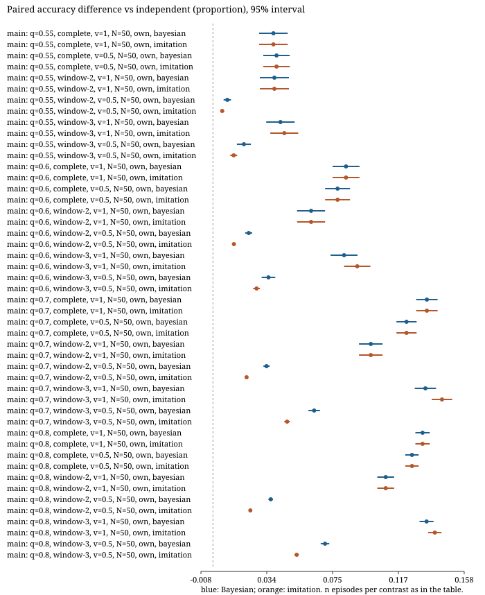
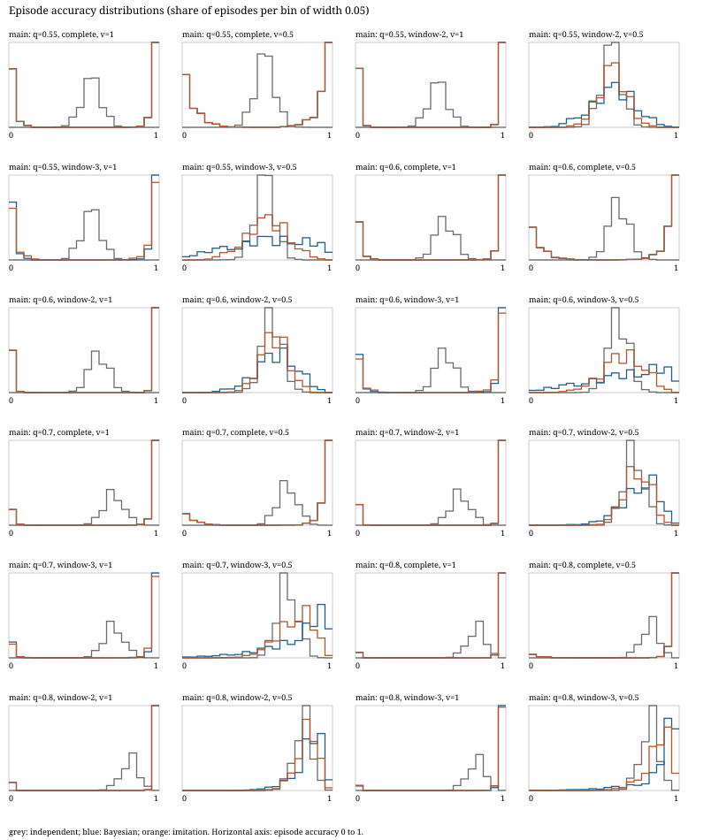

<!-- SPDX-License-Identifier: LicenseRef-HERD-NC-Research-1.0 -->
# EXP-002-R001 (CONFIRMATORY): generated run report

- Experiment: EXP-002; run: EXP-002-R001; created (UTC): 2026-11-24T23:31:40Z
- Description: EXP-002 full matrix as in the frozen protocol v1.0 (24 cells with window-2 in place of window-1 (amendment A-1), 3 rules, seeds 0-9, 1,000 episodes per seed and cell, N=50, own-signal ties)
- Config SHA-256: `26e7cef89deddbb8a9d5bcdc95ae1b785f42e086a6b0e4b885731153312e9796`
- Seeds: [0, 1, 2, 3, 4, 5, 6, 7, 8, 9]; episodes per seed and cell: 1000
- Result schema: 1.0.0
- Code revision: `50fbdb1af8db41c1569013166365f17379dd05bd` (dirty: False)
- Platform: Apple M1 Pro, Darwin 24.3.0; Python 3.12.1, numpy 2.3.4
- Wall-clock runtime: 8.73 s; peak resident memory: 158318592 bytes
- Simulation time: 4.79 s for 36000000 agent decisions (0.133 ms per 1,000 decisions); analysis time 3.32 s

## Verification checks

61 checks, 61 passed, 0 failed.

- C1: analytic wrong-cascade anchor (Bayesian, complete, v=1)
- C3: independent baseline: agent accuracy q, no cascades
- C4: complete network: Bayesian and imitation actions identical
- C5: result validates against result-v1 schema
- C6: no near ties in Bayesian comparisons

| Check | Cell | Rule | Result | Observed | Expected |
|------|----------------------------------------|------------------|-------|----------|----------|
| C1 | main: q=0.55, complete, v=1, N=50, own | bayesian | pass | 0.4084 | 0.4010 |
| C3 | main: q=0.55, complete, v=1, N=50, own | independent | pass | 0.5501 | 0.5500 |
| C4 | main: q=0.55, complete, v=1, N=50, own | bayesian,imitation | pass | 0 | 0 |
| C6 | main: q=0.55, complete, v=1, N=50, own | bayesian | pass | 0 | 0 |
| C3 | main: q=0.55, complete, v=0.5, N=50, own | independent | pass | 0.5499 | 0.5500 |
| C4 | main: q=0.55, complete, v=0.5, N=50, own | bayesian,imitation | pass | 0 | 0 |
| C6 | main: q=0.55, complete, v=0.5, N=50, own | bayesian | pass | 0 | 0 |
| C3 | main: q=0.55, window-2, v=1, N=50, own | independent | pass | 0.5503 | 0.5500 |
| C6 | main: q=0.55, window-2, v=1, N=50, own | bayesian | pass | 0 | 0 |
| C3 | main: q=0.55, window-2, v=0.5, N=50, own | independent | pass | 0.5499 | 0.5500 |
| C6 | main: q=0.55, window-2, v=0.5, N=50, own | bayesian | pass | 0 | 0 |
| C3 | main: q=0.55, window-3, v=1, N=50, own | independent | pass | 0.5497 | 0.5500 |
| C6 | main: q=0.55, window-3, v=1, N=50, own | bayesian | pass | 0 | 0 |
| C3 | main: q=0.55, window-3, v=0.5, N=50, own | independent | pass | 0.5495 | 0.5500 |
| C6 | main: q=0.55, window-3, v=0.5, N=50, own | bayesian | pass | 0 | 0 |
| C1 | main: q=0.6, complete, v=1, N=50, own | bayesian | pass | 0.3098 | 0.3077 |
| C3 | main: q=0.6, complete, v=1, N=50, own | independent | pass | 0.5996 | 0.6000 |
| C4 | main: q=0.6, complete, v=1, N=50, own | bayesian,imitation | pass | 0 | 0 |
| C6 | main: q=0.6, complete, v=1, N=50, own | bayesian | pass | 0 | 0 |
| C3 | main: q=0.6, complete, v=0.5, N=50, own | independent | pass | 0.6007 | 0.6000 |
| C4 | main: q=0.6, complete, v=0.5, N=50, own | bayesian,imitation | pass | 0 | 0 |
| C6 | main: q=0.6, complete, v=0.5, N=50, own | bayesian | pass | 0 | 0 |
| C3 | main: q=0.6, window-2, v=1, N=50, own | independent | pass | 0.6009 | 0.6000 |
| C6 | main: q=0.6, window-2, v=1, N=50, own | bayesian | pass | 0 | 0 |
| C3 | main: q=0.6, window-2, v=0.5, N=50, own | independent | pass | 0.6012 | 0.6000 |
| C6 | main: q=0.6, window-2, v=0.5, N=50, own | bayesian | pass | 0 | 0 |
| C3 | main: q=0.6, window-3, v=1, N=50, own | independent | pass | 0.5995 | 0.6000 |
| C6 | main: q=0.6, window-3, v=1, N=50, own | bayesian | pass | 0 | 0 |
| C3 | main: q=0.6, window-3, v=0.5, N=50, own | independent | pass | 0.6009 | 0.6000 |
| C6 | main: q=0.6, window-3, v=0.5, N=50, own | bayesian | pass | 0 | 0 |
| C1 | main: q=0.7, complete, v=1, N=50, own | bayesian | pass | 0.1550 | 0.1552 |
| C3 | main: q=0.7, complete, v=1, N=50, own | independent | pass | 0.7001 | 0.7000 |
| C4 | main: q=0.7, complete, v=1, N=50, own | bayesian,imitation | pass | 0 | 0 |
| C6 | main: q=0.7, complete, v=1, N=50, own | bayesian | pass | 0 | 0 |
| C3 | main: q=0.7, complete, v=0.5, N=50, own | independent | pass | 0.7012 | 0.7000 |
| C4 | main: q=0.7, complete, v=0.5, N=50, own | bayesian,imitation | pass | 0 | 0 |
| C6 | main: q=0.7, complete, v=0.5, N=50, own | bayesian | pass | 0 | 0 |
| C3 | main: q=0.7, window-2, v=1, N=50, own | independent | pass | 0.6999 | 0.7000 |
| C6 | main: q=0.7, window-2, v=1, N=50, own | bayesian | pass | 0 | 0 |
| C3 | main: q=0.7, window-2, v=0.5, N=50, own | independent | pass | 0.6999 | 0.7000 |
| C6 | main: q=0.7, window-2, v=0.5, N=50, own | bayesian | pass | 0 | 0 |
| C3 | main: q=0.7, window-3, v=1, N=50, own | independent | pass | 0.7007 | 0.7000 |
| C6 | main: q=0.7, window-3, v=1, N=50, own | bayesian | pass | 0 | 0 |
| C3 | main: q=0.7, window-3, v=0.5, N=50, own | independent | pass | 0.7009 | 0.7000 |
| C6 | main: q=0.7, window-3, v=0.5, N=50, own | bayesian | pass | 0 | 0 |
| C1 | main: q=0.8, complete, v=1, N=50, own | bayesian | pass | 0.0597 | 0.0588 |
| C3 | main: q=0.8, complete, v=1, N=50, own | independent | pass | 0.8004 | 0.8000 |
| C4 | main: q=0.8, complete, v=1, N=50, own | bayesian,imitation | pass | 0 | 0 |
| C6 | main: q=0.8, complete, v=1, N=50, own | bayesian | pass | 0 | 0 |
| C3 | main: q=0.8, complete, v=0.5, N=50, own | independent | pass | 0.8005 | 0.8000 |
| C4 | main: q=0.8, complete, v=0.5, N=50, own | bayesian,imitation | pass | 0 | 0 |
| C6 | main: q=0.8, complete, v=0.5, N=50, own | bayesian | pass | 0 | 0 |
| C3 | main: q=0.8, window-2, v=1, N=50, own | independent | pass | 0.7994 | 0.8000 |
| C6 | main: q=0.8, window-2, v=1, N=50, own | bayesian | pass | 0 | 0 |
| C3 | main: q=0.8, window-2, v=0.5, N=50, own | independent | pass | 0.8005 | 0.8000 |
| C6 | main: q=0.8, window-2, v=0.5, N=50, own | bayesian | pass | 0 | 0 |
| C3 | main: q=0.8, window-3, v=1, N=50, own | independent | pass | 0.8008 | 0.8000 |
| C6 | main: q=0.8, window-3, v=1, N=50, own | bayesian | pass | 0 | 0 |
| C3 | main: q=0.8, window-3, v=0.5, N=50, own | independent | pass | 0.7996 | 0.8000 |
| C6 | main: q=0.8, window-3, v=0.5, N=50, own | bayesian | pass | 0 | 0 |
| C5 | all |  | pass | valid | valid |

## Failed cells

None.

## Paired accuracy differences against the independent baseline

Mean paired difference in episode accuracy (proportion of agents correct), normal-approximation 95% interval at the episode level, Holm adjustment within each variation over its non-degenerate contrasts; a degenerate contrast (zero paired variance) is an exact comparison outside the Holm family and shows `n/a` as its Holm p-value. `seed SD` is the standard deviation of the per-seed mean differences; `hw@10k` is the 95% half-width that the observed paired SD implies at 10,000 episodes.

| Cell | Rule | n | Delta | CI low | CI high | paired SD | seed SD | p (Holm) | hw@10k |
|----------------------------------|---------|------|--------|--------|--------|--------|--------|--------|--------|
| main: q=0.55, complete, v=1, N=50, own | bayesian | 10000 | 0.0380 | 0.0290 | 0.0470 | 0.4577 | 0.0176 | 0.0000 | 0.0090 |
| main: q=0.55, complete, v=1, N=50, own | imitation | 10000 | 0.0380 | 0.0290 | 0.0470 | 0.4577 | 0.0176 | 0.0000 | 0.0090 |
| main: q=0.55, complete, v=0.5, N=50, own | bayesian | 10000 | 0.0400 | 0.0317 | 0.0483 | 0.4232 | 0.0119 | 0.0000 | 0.0083 |
| main: q=0.55, complete, v=0.5, N=50, own | imitation | 10000 | 0.0400 | 0.0317 | 0.0483 | 0.4232 | 0.0119 | 0.0000 | 0.0083 |
| main: q=0.55, window-2, v=1, N=50, own | bayesian | 10000 | 0.0386 | 0.0295 | 0.0477 | 0.4665 | 0.0145 | 0.0000 | 0.0091 |
| main: q=0.55, window-2, v=1, N=50, own | imitation | 10000 | 0.0386 | 0.0295 | 0.0477 | 0.4665 | 0.0145 | 0.0000 | 0.0091 |
| main: q=0.55, window-2, v=0.5, N=50, own | bayesian | 10000 | 0.0091 | 0.0067 | 0.0114 | 0.1191 | 0.0032 | 0.0000 | 0.0023 |
| main: q=0.55, window-2, v=0.5, N=50, own | imitation | 10000 | 0.0059 | 0.0048 | 0.0070 | 0.0561 | 0.0016 | 0.0000 | 0.0011 |
| main: q=0.55, window-3, v=1, N=50, own | bayesian | 10000 | 0.0424 | 0.0335 | 0.0514 | 0.4570 | 0.0161 | 0.0000 | 0.0090 |
| main: q=0.55, window-3, v=1, N=50, own | imitation | 10000 | 0.0448 | 0.0360 | 0.0536 | 0.4483 | 0.0138 | 0.0000 | 0.0088 |
| main: q=0.55, window-3, v=0.5, N=50, own | bayesian | 10000 | 0.0195 | 0.0151 | 0.0239 | 0.2248 | 0.0054 | 0.0000 | 0.0044 |
| main: q=0.55, window-3, v=0.5, N=50, own | imitation | 10000 | 0.0131 | 0.0109 | 0.0152 | 0.1106 | 0.0048 | 0.0000 | 0.0022 |
| main: q=0.6, complete, v=1, N=50, own | bayesian | 10000 | 0.0836 | 0.0752 | 0.0921 | 0.4323 | 0.0148 | 0.0000 | 0.0085 |
| main: q=0.6, complete, v=1, N=50, own | imitation | 10000 | 0.0836 | 0.0752 | 0.0921 | 0.4323 | 0.0148 | 0.0000 | 0.0085 |
| main: q=0.6, complete, v=0.5, N=50, own | bayesian | 10000 | 0.0783 | 0.0705 | 0.0861 | 0.3995 | 0.0181 | 0.0000 | 0.0078 |
| main: q=0.6, complete, v=0.5, N=50, own | imitation | 10000 | 0.0783 | 0.0705 | 0.0861 | 0.3995 | 0.0181 | 0.0000 | 0.0078 |
| main: q=0.6, window-2, v=1, N=50, own | bayesian | 10000 | 0.0617 | 0.0529 | 0.0705 | 0.4487 | 0.0155 | 0.0000 | 0.0088 |
| main: q=0.6, window-2, v=1, N=50, own | imitation | 10000 | 0.0617 | 0.0529 | 0.0705 | 0.4487 | 0.0155 | 0.0000 | 0.0088 |
| main: q=0.6, window-2, v=0.5, N=50, own | bayesian | 10000 | 0.0225 | 0.0203 | 0.0247 | 0.1122 | 0.0031 | 0.0000 | 0.0022 |
| main: q=0.6, window-2, v=0.5, N=50, own | imitation | 10000 | 0.0132 | 0.0122 | 0.0142 | 0.0534 | 0.0017 | 0.0000 | 0.0010 |
| main: q=0.6, window-3, v=1, N=50, own | bayesian | 10000 | 0.0824 | 0.0739 | 0.0909 | 0.4328 | 0.0147 | 0.0000 | 0.0085 |
| main: q=0.6, window-3, v=1, N=50, own | imitation | 10000 | 0.0907 | 0.0824 | 0.0990 | 0.4221 | 0.0137 | 0.0000 | 0.0083 |
| main: q=0.6, window-3, v=0.5, N=50, own | bayesian | 10000 | 0.0349 | 0.0306 | 0.0392 | 0.2186 | 0.0066 | 0.0000 | 0.0043 |
| main: q=0.6, window-3, v=0.5, N=50, own | imitation | 10000 | 0.0274 | 0.0253 | 0.0295 | 0.1077 | 0.0064 | 0.0000 | 0.0021 |
| main: q=0.7, complete, v=1, N=50, own | bayesian | 10000 | 0.1344 | 0.1277 | 0.1412 | 0.3436 | 0.0121 | 0.0000 | 0.0067 |
| main: q=0.7, complete, v=1, N=50, own | imitation | 10000 | 0.1344 | 0.1277 | 0.1412 | 0.3436 | 0.0121 | 0.0000 | 0.0067 |
| main: q=0.7, complete, v=0.5, N=50, own | bayesian | 10000 | 0.1216 | 0.1153 | 0.1280 | 0.3232 | 0.0108 | 0.0000 | 0.0063 |
| main: q=0.7, complete, v=0.5, N=50, own | imitation | 10000 | 0.1216 | 0.1153 | 0.1280 | 0.3232 | 0.0108 | 0.0000 | 0.0063 |
| main: q=0.7, window-2, v=1, N=50, own | bayesian | 10000 | 0.0992 | 0.0918 | 0.1066 | 0.3791 | 0.0136 | 0.0000 | 0.0074 |
| main: q=0.7, window-2, v=1, N=50, own | imitation | 10000 | 0.0992 | 0.0918 | 0.1066 | 0.3791 | 0.0136 | 0.0000 | 0.0074 |
| main: q=0.7, window-2, v=0.5, N=50, own | bayesian | 10000 | 0.0337 | 0.0317 | 0.0356 | 0.0992 | 0.0027 | 0.0000 | 0.0019 |
| main: q=0.7, window-2, v=0.5, N=50, own | imitation | 10000 | 0.0212 | 0.0202 | 0.0221 | 0.0483 | 0.0016 | 0.0000 | 0.0009 |
| main: q=0.7, window-3, v=1, N=50, own | bayesian | 10000 | 0.1335 | 0.1268 | 0.1402 | 0.3433 | 0.0112 | 0.0000 | 0.0067 |
| main: q=0.7, window-3, v=1, N=50, own | imitation | 10000 | 0.1439 | 0.1375 | 0.1504 | 0.3283 | 0.0111 | 0.0000 | 0.0064 |
| main: q=0.7, window-3, v=0.5, N=50, own | bayesian | 10000 | 0.0636 | 0.0600 | 0.0673 | 0.1860 | 0.0067 | 0.0000 | 0.0036 |
| main: q=0.7, window-3, v=0.5, N=50, own | imitation | 10000 | 0.0466 | 0.0448 | 0.0484 | 0.0919 | 0.0032 | 0.0000 | 0.0018 |
| main: q=0.8, complete, v=1, N=50, own | bayesian | 10000 | 0.1317 | 0.1272 | 0.1362 | 0.2293 | 0.0085 | 0.0000 | 0.0045 |
| main: q=0.8, complete, v=1, N=50, own | imitation | 10000 | 0.1317 | 0.1272 | 0.1362 | 0.2293 | 0.0085 | 0.0000 | 0.0045 |
| main: q=0.8, complete, v=0.5, N=50, own | bayesian | 10000 | 0.1251 | 0.1209 | 0.1293 | 0.2130 | 0.0064 | 0.0000 | 0.0042 |
| main: q=0.8, complete, v=0.5, N=50, own | imitation | 10000 | 0.1251 | 0.1209 | 0.1293 | 0.2130 | 0.0064 | 0.0000 | 0.0042 |
| main: q=0.8, window-2, v=1, N=50, own | bayesian | 10000 | 0.1086 | 0.1033 | 0.1139 | 0.2710 | 0.0073 | 0.0000 | 0.0053 |
| main: q=0.8, window-2, v=1, N=50, own | imitation | 10000 | 0.1086 | 0.1033 | 0.1139 | 0.2710 | 0.0073 | 0.0000 | 0.0053 |
| main: q=0.8, window-2, v=0.5, N=50, own | bayesian | 10000 | 0.0363 | 0.0349 | 0.0378 | 0.0743 | 0.0019 | 0.0000 | 0.0015 |
| main: q=0.8, window-2, v=0.5, N=50, own | imitation | 10000 | 0.0235 | 0.0228 | 0.0243 | 0.0384 | 0.0015 | 0.0000 | 0.0008 |
| main: q=0.8, window-3, v=1, N=50, own | bayesian | 10000 | 0.1342 | 0.1298 | 0.1386 | 0.2252 | 0.0081 | 0.0000 | 0.0044 |
| main: q=0.8, window-3, v=1, N=50, own | imitation | 10000 | 0.1394 | 0.1353 | 0.1436 | 0.2124 | 0.0067 | 0.0000 | 0.0042 |
| main: q=0.8, window-3, v=0.5, N=50, own | bayesian | 10000 | 0.0704 | 0.0678 | 0.0731 | 0.1363 | 0.0041 | 0.0000 | 0.0027 |
| main: q=0.8, window-3, v=0.5, N=50, own | imitation | 10000 | 0.0526 | 0.0513 | 0.0540 | 0.0688 | 0.0025 | 0.0000 | 0.0013 |

*Figure: paired accuracy difference (proportion) against the independent baseline, points are means and bars 95% normal intervals over episodes; the dashed line marks zero. Source: EXP-002-R001/result.json.*

## Arms

Means over episodes with 95% intervals in the CSV table `tables/arms.csv`.

| Cell | Rule | n | Accuracy | Cascade | Wrong cascade | Longest wrong run | Informative | Last agent |
|----------------------------------|----------|------|--------|--------|--------|--------|--------|--------|
| main: q=0.55, complete, v=1, N=50, own | independent | 10000 | 0.550 | 0.000 | 0.000 | 4.409 | 1.000 | 0.547 |
| main: q=0.55, complete, v=1, N=50, own | bayesian | 10000 | 0.588 | 1.000 | 0.408 | 20.072 | 0.079 | 0.592 |
| main: q=0.55, complete, v=1, N=50, own | imitation | 10000 | 0.588 | 1.000 | 0.408 | 20.072 | 0.079 | 0.592 |
| main: q=0.55, complete, v=0.5, N=50, own | independent | 10000 | 0.550 | 0.000 | 0.000 | 4.394 | 1.000 | 0.554 |
| main: q=0.55, complete, v=0.5, N=50, own | bayesian | 10000 | 0.590 | 0.999 | 0.402 | 18.711 | 0.158 | 0.598 |
| main: q=0.55, complete, v=0.5, N=50, own | imitation | 10000 | 0.590 | 0.999 | 0.402 | 18.711 | 0.158 | 0.598 |
| main: q=0.55, window-2, v=1, N=50, own | independent | 10000 | 0.550 | 0.000 | 0.000 | 4.413 | 1.000 | 0.546 |
| main: q=0.55, window-2, v=1, N=50, own | bayesian | 10000 | 0.589 | 1.000 | 0.409 | 20.321 | 0.060 | 0.591 |
| main: q=0.55, window-2, v=1, N=50, own | imitation | 10000 | 0.589 | 1.000 | 0.409 | 20.321 | 0.060 | 0.591 |
| main: q=0.55, window-2, v=0.5, N=50, own | independent | 10000 | 0.550 | 0.000 | 0.000 | 4.408 | 1.000 | 0.546 |
| main: q=0.55, window-2, v=0.5, N=50, own | bayesian | 10000 | 0.559 | 0.999 | 0.829 | 8.310 | 0.691 | 0.563 |
| main: q=0.55, window-2, v=0.5, N=50, own | imitation | 10000 | 0.556 | 0.997 | 0.842 | 5.934 | 0.839 | 0.553 |
| main: q=0.55, window-3, v=1, N=50, own | independent | 10000 | 0.550 | 0.000 | 0.000 | 4.414 | 1.000 | 0.554 |
| main: q=0.55, window-3, v=1, N=50, own | bayesian | 10000 | 0.592 | 1.000 | 0.404 | 19.870 | 0.080 | 0.596 |
| main: q=0.55, window-3, v=1, N=50, own | imitation | 10000 | 0.594 | 1.000 | 0.400 | 19.448 | 0.099 | 0.600 |
| main: q=0.55, window-3, v=0.5, N=50, own | independent | 10000 | 0.549 | 0.000 | 0.000 | 4.394 | 1.000 | 0.547 |
| main: q=0.55, window-3, v=0.5, N=50, own | bayesian | 10000 | 0.569 | 1.000 | 0.774 | 12.628 | 0.438 | 0.569 |
| main: q=0.55, window-3, v=0.5, N=50, own | imitation | 10000 | 0.563 | 1.000 | 0.868 | 8.338 | 0.665 | 0.565 |
| main: q=0.6, complete, v=1, N=50, own | independent | 10000 | 0.600 | 0.000 | 0.000 | 3.855 | 1.000 | 0.600 |
| main: q=0.6, complete, v=1, N=50, own | bayesian | 10000 | 0.683 | 1.000 | 0.310 | 15.383 | 0.077 | 0.690 |
| main: q=0.6, complete, v=1, N=50, own | imitation | 10000 | 0.683 | 1.000 | 0.310 | 15.383 | 0.077 | 0.690 |
| main: q=0.6, complete, v=0.5, N=50, own | independent | 10000 | 0.601 | 0.000 | 0.000 | 3.836 | 1.000 | 0.593 |
| main: q=0.6, complete, v=0.5, N=50, own | bayesian | 10000 | 0.679 | 1.000 | 0.305 | 14.529 | 0.154 | 0.695 |
| main: q=0.6, complete, v=0.5, N=50, own | imitation | 10000 | 0.679 | 1.000 | 0.305 | 14.529 | 0.154 | 0.695 |
| main: q=0.6, window-2, v=1, N=50, own | independent | 10000 | 0.601 | 0.000 | 0.000 | 3.857 | 1.000 | 0.605 |
| main: q=0.6, window-2, v=1, N=50, own | bayesian | 10000 | 0.663 | 1.000 | 0.334 | 16.677 | 0.059 | 0.666 |
| main: q=0.6, window-2, v=1, N=50, own | imitation | 10000 | 0.663 | 1.000 | 0.334 | 16.677 | 0.059 | 0.666 |
| main: q=0.6, window-2, v=0.5, N=50, own | independent | 10000 | 0.601 | 0.000 | 0.000 | 3.862 | 1.000 | 0.596 |
| main: q=0.6, window-2, v=0.5, N=50, own | bayesian | 10000 | 0.624 | 0.998 | 0.750 | 7.067 | 0.691 | 0.613 |
| main: q=0.6, window-2, v=0.5, N=50, own | imitation | 10000 | 0.614 | 0.996 | 0.763 | 5.188 | 0.837 | 0.607 |
| main: q=0.6, window-3, v=1, N=50, own | independent | 10000 | 0.600 | 0.000 | 0.000 | 3.867 | 1.000 | 0.598 |
| main: q=0.6, window-3, v=1, N=50, own | bayesian | 10000 | 0.682 | 1.000 | 0.311 | 15.455 | 0.076 | 0.689 |
| main: q=0.6, window-3, v=1, N=50, own | imitation | 10000 | 0.690 | 1.000 | 0.300 | 14.791 | 0.094 | 0.700 |
| main: q=0.6, window-3, v=0.5, N=50, own | independent | 10000 | 0.601 | 0.000 | 0.000 | 3.860 | 1.000 | 0.606 |
| main: q=0.6, window-3, v=0.5, N=50, own | bayesian | 10000 | 0.636 | 1.000 | 0.691 | 10.839 | 0.431 | 0.641 |
| main: q=0.6, window-3, v=0.5, N=50, own | imitation | 10000 | 0.628 | 1.000 | 0.786 | 7.177 | 0.656 | 0.635 |
| main: q=0.7, complete, v=1, N=50, own | independent | 10000 | 0.700 | 0.000 | 0.000 | 2.930 | 1.000 | 0.702 |
| main: q=0.7, complete, v=1, N=50, own | bayesian | 10000 | 0.835 | 1.000 | 0.155 | 7.996 | 0.069 | 0.845 |
| main: q=0.7, complete, v=1, N=50, own | imitation | 10000 | 0.835 | 1.000 | 0.155 | 7.996 | 0.069 | 0.845 |
| main: q=0.7, complete, v=0.5, N=50, own | independent | 10000 | 0.701 | 0.000 | 0.000 | 2.933 | 1.000 | 0.708 |
| main: q=0.7, complete, v=0.5, N=50, own | bayesian | 10000 | 0.823 | 1.000 | 0.157 | 7.933 | 0.138 | 0.843 |
| main: q=0.7, complete, v=0.5, N=50, own | imitation | 10000 | 0.823 | 1.000 | 0.157 | 7.933 | 0.138 | 0.843 |
| main: q=0.7, window-2, v=1, N=50, own | independent | 10000 | 0.700 | 0.000 | 0.000 | 2.955 | 1.000 | 0.693 |
| main: q=0.7, window-2, v=1, N=50, own | bayesian | 10000 | 0.799 | 1.000 | 0.196 | 9.908 | 0.056 | 0.804 |
| main: q=0.7, window-2, v=1, N=50, own | imitation | 10000 | 0.799 | 1.000 | 0.196 | 9.908 | 0.056 | 0.804 |
| main: q=0.7, window-2, v=0.5, N=50, own | independent | 10000 | 0.700 | 0.000 | 0.000 | 2.952 | 1.000 | 0.690 |
| main: q=0.7, window-2, v=0.5, N=50, own | bayesian | 10000 | 0.734 | 0.999 | 0.551 | 5.092 | 0.682 | 0.736 |
| main: q=0.7, window-2, v=0.5, N=50, own | imitation | 10000 | 0.721 | 0.998 | 0.556 | 3.870 | 0.827 | 0.716 |
| main: q=0.7, window-3, v=1, N=50, own | independent | 10000 | 0.701 | 0.000 | 0.000 | 2.939 | 1.000 | 0.699 |
| main: q=0.7, window-3, v=1, N=50, own | bayesian | 10000 | 0.834 | 1.000 | 0.156 | 8.022 | 0.069 | 0.844 |
| main: q=0.7, window-3, v=1, N=50, own | imitation | 10000 | 0.845 | 1.000 | 0.142 | 7.365 | 0.081 | 0.858 |
| main: q=0.7, window-3, v=0.5, N=50, own | independent | 10000 | 0.701 | 0.000 | 0.000 | 2.933 | 1.000 | 0.706 |
| main: q=0.7, window-3, v=0.5, N=50, own | bayesian | 10000 | 0.764 | 1.000 | 0.475 | 6.955 | 0.422 | 0.763 |
| main: q=0.7, window-3, v=0.5, N=50, own | imitation | 10000 | 0.747 | 1.000 | 0.562 | 4.908 | 0.640 | 0.748 |
| main: q=0.8, complete, v=1, N=50, own | independent | 10000 | 0.800 | 0.000 | 0.000 | 2.175 | 1.000 | 0.799 |
| main: q=0.8, complete, v=1, N=50, own | bayesian | 10000 | 0.932 | 1.000 | 0.060 | 3.265 | 0.059 | 0.940 |
| main: q=0.8, complete, v=1, N=50, own | imitation | 10000 | 0.932 | 1.000 | 0.060 | 3.265 | 0.059 | 0.940 |
| main: q=0.8, complete, v=0.5, N=50, own | independent | 10000 | 0.801 | 0.000 | 0.000 | 2.161 | 1.000 | 0.802 |
| main: q=0.8, complete, v=0.5, N=50, own | bayesian | 10000 | 0.926 | 1.000 | 0.058 | 3.296 | 0.117 | 0.942 |
| main: q=0.8, complete, v=0.5, N=50, own | imitation | 10000 | 0.926 | 1.000 | 0.058 | 3.296 | 0.117 | 0.942 |
| main: q=0.8, window-2, v=1, N=50, own | independent | 10000 | 0.799 | 0.000 | 0.000 | 2.172 | 1.000 | 0.796 |
| main: q=0.8, window-2, v=1, N=50, own | bayesian | 10000 | 0.908 | 1.000 | 0.087 | 4.535 | 0.051 | 0.913 |
| main: q=0.8, window-2, v=1, N=50, own | imitation | 10000 | 0.908 | 1.000 | 0.087 | 4.535 | 0.051 | 0.913 |
| main: q=0.8, window-2, v=0.5, N=50, own | independent | 10000 | 0.801 | 0.000 | 0.000 | 2.176 | 1.000 | 0.801 |
| main: q=0.8, window-2, v=0.5, N=50, own | bayesian | 10000 | 0.837 | 1.000 | 0.303 | 3.199 | 0.671 | 0.838 |
| main: q=0.8, window-2, v=0.5, N=50, own | imitation | 10000 | 0.824 | 0.999 | 0.306 | 2.643 | 0.811 | 0.825 |
| main: q=0.8, window-3, v=1, N=50, own | independent | 10000 | 0.801 | 0.000 | 0.000 | 2.163 | 1.000 | 0.812 |
| main: q=0.8, window-3, v=1, N=50, own | bayesian | 10000 | 0.935 | 1.000 | 0.057 | 3.120 | 0.059 | 0.943 |
| main: q=0.8, window-3, v=1, N=50, own | imitation | 10000 | 0.940 | 1.000 | 0.050 | 2.806 | 0.065 | 0.950 |
| main: q=0.8, window-3, v=0.5, N=50, own | independent | 10000 | 0.800 | 0.000 | 0.000 | 2.180 | 1.000 | 0.805 |
| main: q=0.8, window-3, v=0.5, N=50, own | bayesian | 10000 | 0.870 | 1.000 | 0.248 | 3.863 | 0.401 | 0.878 |
| main: q=0.8, window-3, v=0.5, N=50, own | imitation | 10000 | 0.852 | 1.000 | 0.300 | 2.978 | 0.608 | 0.859 |

*Figure: distribution of episode accuracy, share of episodes per bin of width 0.05; grey independent, blue Bayesian, orange imitation.*

## Metric definitions

- `accuracy`: proportion of agents with a_i = theta (0 to 1)
- `cascade_any`: 1 if at least one agent is in a cascade (0 or 1)
- `wrong_cascade_any`: 1 if at least one agent is in a cascade on the wrong action (0 or 1)
- `longest_wrong_run`: length of the longest run of consecutive incorrect actions (agents)
- `informative_share`: share of agents not in a cascade (0 to 1)
- `action_entropy_bits`: binary entropy of the within-episode action frequency (bits)
- `last_agent_accuracy`: 1 if a_N = theta (0 or 1)
