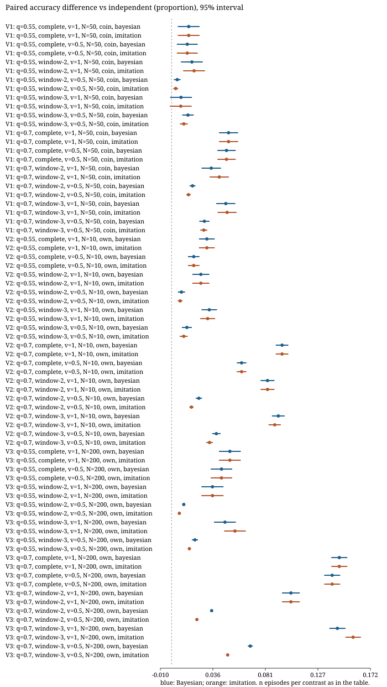
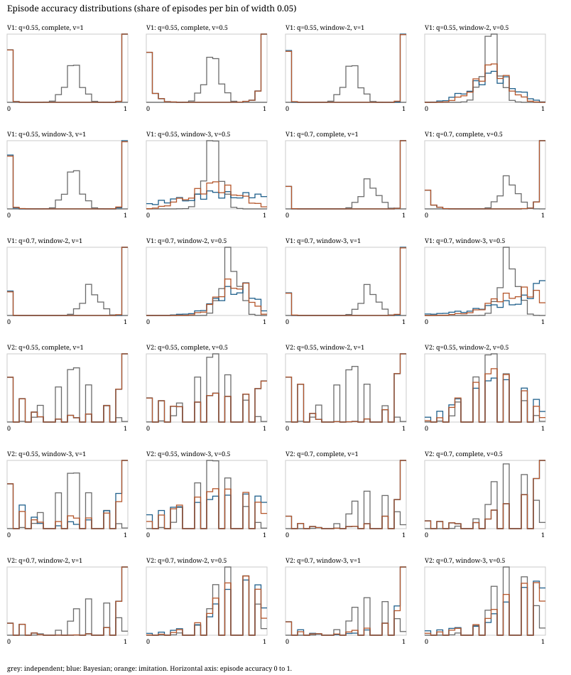

<!-- SPDX-License-Identifier: LicenseRef-HERD-NC-Research-1.0 -->
# EXP-003-R001 (CONFIRMATORY): generated run report

- Experiment: EXP-003; run: EXP-003-R001; created (UTC): 2026-11-24T23:32:04Z
- Description: EXP-003 sensitivity matrix as in the frozen protocol v1.0 (12 cells with window-2 in place of window-1 (amendment A-1), V1 coin ties N=50, V2 N=10, V3 N=200, seeds 0-9, 1,000 episodes per seed and cell)
- Config SHA-256: `12ebfabeef1fca01b598cc0026c22a2cd1b30be6ad39b96386decc8f0ee8584a`
- Seeds: [0, 1, 2, 3, 4, 5, 6, 7, 8, 9]; episodes per seed and cell: 1000
- Result schema: 1.0.0
- Code revision: `50fbdb1af8db41c1569013166365f17379dd05bd` (dirty: False)
- Platform: Apple M1 Pro, Darwin 24.3.0; Python 3.12.1, numpy 2.3.4
- Wall-clock runtime: 19.47 s; peak resident memory: 280002560 bytes
- Simulation time: 12.88 s for 93600000 agent decisions (0.138 ms per 1,000 decisions); analysis time 5.04 s

## Verification checks

89 checks, 89 passed, 0 failed.

- C1: analytic wrong-cascade anchor (Bayesian, complete, v=1)
- C3: independent baseline: agent accuracy q, no cascades
- C4: complete network: Bayesian and imitation actions identical
- C5: result validates against result-v1 schema
- C6: no near ties in Bayesian comparisons
- C7: complete network, coin ties: Bayesian vs imitation divergence (diagnostic, no prediction)

| Check | Cell | Rule | Result | Observed | Expected |
|------|----------------------------------------|------------------|-------|----------|----------|
| C3 | V1: q=0.55, complete, v=1, N=50, coin | independent | pass | 0.5501 | 0.5500 |
| C7 | V1: q=0.55, complete, v=1, N=50, coin | bayesian,imitation | pass | 0 | n/a |
| C6 | V1: q=0.55, complete, v=1, N=50, coin | bayesian | pass | 0 | 0 |
| C3 | V1: q=0.55, complete, v=0.5, N=50, coin | independent | pass | 0.5499 | 0.5500 |
| C7 | V1: q=0.55, complete, v=0.5, N=50, coin | bayesian,imitation | pass | 0 | n/a |
| C6 | V1: q=0.55, complete, v=0.5, N=50, coin | bayesian | pass | 0 | 0 |
| C3 | V1: q=0.55, window-2, v=1, N=50, coin | independent | pass | 0.5503 | 0.5500 |
| C6 | V1: q=0.55, window-2, v=1, N=50, coin | bayesian | pass | 0 | 0 |
| C3 | V1: q=0.55, window-2, v=0.5, N=50, coin | independent | pass | 0.5499 | 0.5500 |
| C6 | V1: q=0.55, window-2, v=0.5, N=50, coin | bayesian | pass | 0 | 0 |
| C3 | V1: q=0.55, window-3, v=1, N=50, coin | independent | pass | 0.5497 | 0.5500 |
| C6 | V1: q=0.55, window-3, v=1, N=50, coin | bayesian | pass | 0 | 0 |
| C3 | V1: q=0.55, window-3, v=0.5, N=50, coin | independent | pass | 0.5495 | 0.5500 |
| C6 | V1: q=0.55, window-3, v=0.5, N=50, coin | bayesian | pass | 0 | 0 |
| C3 | V1: q=0.7, complete, v=1, N=50, coin | independent | pass | 0.7001 | 0.7000 |
| C7 | V1: q=0.7, complete, v=1, N=50, coin | bayesian,imitation | pass | 0 | n/a |
| C6 | V1: q=0.7, complete, v=1, N=50, coin | bayesian | pass | 0 | 0 |
| C3 | V1: q=0.7, complete, v=0.5, N=50, coin | independent | pass | 0.7012 | 0.7000 |
| C7 | V1: q=0.7, complete, v=0.5, N=50, coin | bayesian,imitation | pass | 0 | n/a |
| C6 | V1: q=0.7, complete, v=0.5, N=50, coin | bayesian | pass | 0 | 0 |
| C3 | V1: q=0.7, window-2, v=1, N=50, coin | independent | pass | 0.6999 | 0.7000 |
| C6 | V1: q=0.7, window-2, v=1, N=50, coin | bayesian | pass | 0 | 0 |
| C3 | V1: q=0.7, window-2, v=0.5, N=50, coin | independent | pass | 0.6999 | 0.7000 |
| C6 | V1: q=0.7, window-2, v=0.5, N=50, coin | bayesian | pass | 0 | 0 |
| C3 | V1: q=0.7, window-3, v=1, N=50, coin | independent | pass | 0.7007 | 0.7000 |
| C6 | V1: q=0.7, window-3, v=1, N=50, coin | bayesian | pass | 0 | 0 |
| C3 | V1: q=0.7, window-3, v=0.5, N=50, coin | independent | pass | 0.7009 | 0.7000 |
| C6 | V1: q=0.7, window-3, v=0.5, N=50, coin | bayesian | pass | 0 | 0 |
| C1 | V2: q=0.55, complete, v=1, N=10, own | bayesian | pass | 0.3740 | 0.3769 |
| C3 | V2: q=0.55, complete, v=1, N=10, own | independent | pass | 0.5508 | 0.5500 |
| C4 | V2: q=0.55, complete, v=1, N=10, own | bayesian,imitation | pass | 0 | 0 |
| C6 | V2: q=0.55, complete, v=1, N=10, own | bayesian | pass | 0 | 0 |
| C3 | V2: q=0.55, complete, v=0.5, N=10, own | independent | pass | 0.5520 | 0.5500 |
| C4 | V2: q=0.55, complete, v=0.5, N=10, own | bayesian,imitation | pass | 0 | 0 |
| C6 | V2: q=0.55, complete, v=0.5, N=10, own | bayesian | pass | 0 | 0 |
| C3 | V2: q=0.55, window-2, v=1, N=10, own | independent | pass | 0.5496 | 0.5500 |
| C6 | V2: q=0.55, window-2, v=1, N=10, own | bayesian | pass | 0 | 0 |
| C3 | V2: q=0.55, window-2, v=0.5, N=10, own | independent | pass | 0.5529 | 0.5500 |
| C6 | V2: q=0.55, window-2, v=0.5, N=10, own | bayesian | pass | 0 | 0 |
| C3 | V2: q=0.55, window-3, v=1, N=10, own | independent | pass | 0.5508 | 0.5500 |
| C6 | V2: q=0.55, window-3, v=1, N=10, own | bayesian | pass | 0 | 0 |
| C3 | V2: q=0.55, window-3, v=0.5, N=10, own | independent | pass | 0.5520 | 0.5500 |
| C6 | V2: q=0.55, window-3, v=0.5, N=10, own | bayesian | pass | 0 | 0 |
| C1 | V2: q=0.7, complete, v=1, N=10, own | bayesian | pass | 0.1479 | 0.1503 |
| C3 | V2: q=0.7, complete, v=1, N=10, own | independent | pass | 0.7005 | 0.7000 |
| C4 | V2: q=0.7, complete, v=1, N=10, own | bayesian,imitation | pass | 0 | 0 |
| C6 | V2: q=0.7, complete, v=1, N=10, own | bayesian | pass | 0 | 0 |
| C3 | V2: q=0.7, complete, v=0.5, N=10, own | independent | pass | 0.6971 | 0.7000 |
| C4 | V2: q=0.7, complete, v=0.5, N=10, own | bayesian,imitation | pass | 0 | 0 |
| C6 | V2: q=0.7, complete, v=0.5, N=10, own | bayesian | pass | 0 | 0 |
| C3 | V2: q=0.7, window-2, v=1, N=10, own | independent | pass | 0.7022 | 0.7000 |
| C6 | V2: q=0.7, window-2, v=1, N=10, own | bayesian | pass | 0 | 0 |
| C3 | V2: q=0.7, window-2, v=0.5, N=10, own | independent | pass | 0.6985 | 0.7000 |
| C6 | V2: q=0.7, window-2, v=0.5, N=10, own | bayesian | pass | 0 | 0 |
| C3 | V2: q=0.7, window-3, v=1, N=10, own | independent | pass | 0.6985 | 0.7000 |
| C6 | V2: q=0.7, window-3, v=1, N=10, own | bayesian | pass | 0 | 0 |
| C3 | V2: q=0.7, window-3, v=0.5, N=10, own | independent | pass | 0.7000 | 0.7000 |
| C6 | V2: q=0.7, window-3, v=0.5, N=10, own | bayesian | pass | 0 | 0 |
| C1 | V3: q=0.55, complete, v=1, N=200, own | bayesian | pass | 0.3989 | 0.4010 |
| C3 | V3: q=0.55, complete, v=1, N=200, own | independent | pass | 0.5496 | 0.5500 |
| C4 | V3: q=0.55, complete, v=1, N=200, own | bayesian,imitation | pass | 0 | 0 |
| C6 | V3: q=0.55, complete, v=1, N=200, own | bayesian | pass | 0 | 0 |
| C3 | V3: q=0.55, complete, v=0.5, N=200, own | independent | pass | 0.5501 | 0.5500 |
| C4 | V3: q=0.55, complete, v=0.5, N=200, own | bayesian,imitation | pass | 0 | 0 |
| C6 | V3: q=0.55, complete, v=0.5, N=200, own | bayesian | pass | 0 | 0 |
| C3 | V3: q=0.55, window-2, v=1, N=200, own | independent | pass | 0.5501 | 0.5500 |
| C6 | V3: q=0.55, window-2, v=1, N=200, own | bayesian | pass | 0 | 0 |
| C3 | V3: q=0.55, window-2, v=0.5, N=200, own | independent | pass | 0.5498 | 0.5500 |
| C6 | V3: q=0.55, window-2, v=0.5, N=200, own | bayesian | pass | 0 | 0 |
| C3 | V3: q=0.55, window-3, v=1, N=200, own | independent | pass | 0.5500 | 0.5500 |
| C6 | V3: q=0.55, window-3, v=1, N=200, own | bayesian | pass | 0 | 0 |
| C3 | V3: q=0.55, window-3, v=0.5, N=200, own | independent | pass | 0.5498 | 0.5500 |
| C6 | V3: q=0.55, window-3, v=0.5, N=200, own | bayesian | pass | 0 | 0 |
| C1 | V3: q=0.7, complete, v=1, N=200, own | bayesian | pass | 0.1522 | 0.1552 |
| C3 | V3: q=0.7, complete, v=1, N=200, own | independent | pass | 0.7000 | 0.7000 |
| C4 | V3: q=0.7, complete, v=1, N=200, own | bayesian,imitation | pass | 0 | 0 |
| C6 | V3: q=0.7, complete, v=1, N=200, own | bayesian | pass | 0 | 0 |
| C3 | V3: q=0.7, complete, v=0.5, N=200, own | independent | pass | 0.6999 | 0.7000 |
| C4 | V3: q=0.7, complete, v=0.5, N=200, own | bayesian,imitation | pass | 0 | 0 |
| C6 | V3: q=0.7, complete, v=0.5, N=200, own | bayesian | pass | 0 | 0 |
| C3 | V3: q=0.7, window-2, v=1, N=200, own | independent | pass | 0.7006 | 0.7000 |
| C6 | V3: q=0.7, window-2, v=1, N=200, own | bayesian | pass | 0 | 0 |
| C3 | V3: q=0.7, window-2, v=0.5, N=200, own | independent | pass | 0.7000 | 0.7000 |
| C6 | V3: q=0.7, window-2, v=0.5, N=200, own | bayesian | pass | 0 | 0 |
| C3 | V3: q=0.7, window-3, v=1, N=200, own | independent | pass | 0.7003 | 0.7000 |
| C6 | V3: q=0.7, window-3, v=1, N=200, own | bayesian | pass | 0 | 0 |
| C3 | V3: q=0.7, window-3, v=0.5, N=200, own | independent | pass | 0.6999 | 0.7000 |
| C6 | V3: q=0.7, window-3, v=0.5, N=200, own | bayesian | pass | 0 | 0 |
| C5 | all |  | pass | valid | valid |

## Failed cells

None.

## Paired accuracy differences against the independent baseline

Mean paired difference in episode accuracy (proportion of agents correct), normal-approximation 95% interval at the episode level, Holm adjustment within each variation over its non-degenerate contrasts; a degenerate contrast (zero paired variance) is an exact comparison outside the Holm family and shows `n/a` as its Holm p-value. `seed SD` is the standard deviation of the per-seed mean differences; `hw@10k` is the 95% half-width that the observed paired SD implies at 10,000 episodes.

| Cell | Rule | n | Delta | CI low | CI high | paired SD | seed SD | p (Holm) | hw@10k |
|----------------------------------|---------|------|--------|--------|--------|--------|--------|--------|--------|
| V1: q=0.55, complete, v=1, N=50, coin | bayesian | 10000 | 0.0148 | 0.0054 | 0.0243 | 0.4805 | 0.0179 | 0.0121 | 0.0094 |
| V1: q=0.55, complete, v=1, N=50, coin | imitation | 10000 | 0.0148 | 0.0054 | 0.0243 | 0.4805 | 0.0179 | 0.0121 | 0.0094 |
| V1: q=0.55, complete, v=0.5, N=50, coin | bayesian | 10000 | 0.0136 | 0.0046 | 0.0226 | 0.4611 | 0.0098 | 0.0127 | 0.0090 |
| V1: q=0.55, complete, v=0.5, N=50, coin | imitation | 10000 | 0.0136 | 0.0046 | 0.0226 | 0.4611 | 0.0098 | 0.0127 | 0.0090 |
| V1: q=0.55, window-2, v=1, N=50, coin | bayesian | 10000 | 0.0176 | 0.0081 | 0.0270 | 0.4822 | 0.0191 | 0.0024 | 0.0095 |
| V1: q=0.55, window-2, v=1, N=50, coin | imitation | 10000 | 0.0195 | 0.0101 | 0.0289 | 0.4807 | 0.0214 | 0.0005 | 0.0094 |
| V1: q=0.55, window-2, v=0.5, N=50, coin | bayesian | 10000 | 0.0049 | 0.0021 | 0.0078 | 0.1463 | 0.0036 | 0.0060 | 0.0029 |
| V1: q=0.55, window-2, v=0.5, N=50, coin | imitation | 10000 | 0.0036 | 0.0015 | 0.0057 | 0.1076 | 0.0033 | 0.0065 | 0.0021 |
| V1: q=0.55, window-3, v=1, N=50, coin | bayesian | 10000 | 0.0082 | -0.0013 | 0.0176 | 0.4811 | 0.0181 | 0.1791 | 0.0094 |
| V1: q=0.55, window-3, v=1, N=50, coin | imitation | 10000 | 0.0079 | -0.0015 | 0.0174 | 0.4800 | 0.0200 | 0.1791 | 0.0094 |
| V1: q=0.55, window-3, v=0.5, N=50, coin | bayesian | 10000 | 0.0142 | 0.0093 | 0.0191 | 0.2517 | 0.0061 | 0.0000 | 0.0049 |
| V1: q=0.55, window-3, v=0.5, N=50, coin | imitation | 10000 | 0.0106 | 0.0072 | 0.0140 | 0.1726 | 0.0069 | 0.0000 | 0.0034 |
| V1: q=0.7, complete, v=1, N=50, coin | bayesian | 10000 | 0.0494 | 0.0411 | 0.0576 | 0.4207 | 0.0115 | 0.0000 | 0.0082 |
| V1: q=0.7, complete, v=1, N=50, coin | imitation | 10000 | 0.0494 | 0.0411 | 0.0576 | 0.4207 | 0.0115 | 0.0000 | 0.0082 |
| V1: q=0.7, complete, v=0.5, N=50, coin | bayesian | 10000 | 0.0476 | 0.0397 | 0.0555 | 0.4038 | 0.0163 | 0.0000 | 0.0079 |
| V1: q=0.7, complete, v=0.5, N=50, coin | imitation | 10000 | 0.0476 | 0.0397 | 0.0555 | 0.4038 | 0.0163 | 0.0000 | 0.0079 |
| V1: q=0.7, window-2, v=1, N=50, coin | bayesian | 10000 | 0.0344 | 0.0259 | 0.0428 | 0.4307 | 0.0139 | 0.0000 | 0.0084 |
| V1: q=0.7, window-2, v=1, N=50, coin | imitation | 10000 | 0.0413 | 0.0329 | 0.0496 | 0.4262 | 0.0123 | 0.0000 | 0.0084 |
| V1: q=0.7, window-2, v=0.5, N=50, coin | bayesian | 10000 | 0.0181 | 0.0156 | 0.0207 | 0.1302 | 0.0055 | 0.0000 | 0.0026 |
| V1: q=0.7, window-2, v=0.5, N=50, coin | imitation | 10000 | 0.0147 | 0.0128 | 0.0165 | 0.0961 | 0.0033 | 0.0000 | 0.0019 |
| V1: q=0.7, window-3, v=1, N=50, coin | bayesian | 10000 | 0.0469 | 0.0387 | 0.0552 | 0.4214 | 0.0102 | 0.0000 | 0.0083 |
| V1: q=0.7, window-3, v=1, N=50, coin | imitation | 10000 | 0.0481 | 0.0399 | 0.0563 | 0.4198 | 0.0114 | 0.0000 | 0.0082 |
| V1: q=0.7, window-3, v=0.5, N=50, coin | bayesian | 10000 | 0.0284 | 0.0240 | 0.0328 | 0.2245 | 0.0072 | 0.0000 | 0.0044 |
| V1: q=0.7, window-3, v=0.5, N=50, coin | imitation | 10000 | 0.0279 | 0.0249 | 0.0309 | 0.1541 | 0.0047 | 0.0000 | 0.0030 |
| V2: q=0.55, complete, v=1, N=10, own | bayesian | 10000 | 0.0305 | 0.0237 | 0.0373 | 0.3471 | 0.0101 | 0.0000 | 0.0068 |
| V2: q=0.55, complete, v=1, N=10, own | imitation | 10000 | 0.0305 | 0.0237 | 0.0373 | 0.3471 | 0.0101 | 0.0000 | 0.0068 |
| V2: q=0.55, complete, v=0.5, N=10, own | bayesian | 10000 | 0.0192 | 0.0142 | 0.0242 | 0.2546 | 0.0098 | 0.0000 | 0.0050 |
| V2: q=0.55, complete, v=0.5, N=10, own | imitation | 10000 | 0.0192 | 0.0142 | 0.0242 | 0.2546 | 0.0098 | 0.0000 | 0.0050 |
| V2: q=0.55, window-2, v=1, N=10, own | bayesian | 10000 | 0.0254 | 0.0181 | 0.0327 | 0.3733 | 0.0129 | 0.0000 | 0.0073 |
| V2: q=0.55, window-2, v=1, N=10, own | imitation | 10000 | 0.0254 | 0.0181 | 0.0327 | 0.3733 | 0.0129 | 0.0000 | 0.0073 |
| V2: q=0.55, window-2, v=0.5, N=10, own | bayesian | 10000 | 0.0085 | 0.0054 | 0.0116 | 0.1585 | 0.0049 | 0.0000 | 0.0031 |
| V2: q=0.55, window-2, v=0.5, N=10, own | imitation | 10000 | 0.0074 | 0.0053 | 0.0094 | 0.1045 | 0.0023 | 0.0000 | 0.0020 |
| V2: q=0.55, window-3, v=1, N=10, own | bayesian | 10000 | 0.0326 | 0.0259 | 0.0393 | 0.3429 | 0.0073 | 0.0000 | 0.0067 |
| V2: q=0.55, window-3, v=1, N=10, own | imitation | 10000 | 0.0313 | 0.0248 | 0.0377 | 0.3280 | 0.0073 | 0.0000 | 0.0064 |
| V2: q=0.55, window-3, v=0.5, N=10, own | bayesian | 10000 | 0.0132 | 0.0089 | 0.0175 | 0.2192 | 0.0051 | 0.0000 | 0.0043 |
| V2: q=0.55, window-3, v=0.5, N=10, own | imitation | 10000 | 0.0105 | 0.0071 | 0.0139 | 0.1756 | 0.0055 | 0.0000 | 0.0034 |
| V2: q=0.7, complete, v=1, N=10, own | bayesian | 10000 | 0.0957 | 0.0902 | 0.1011 | 0.2763 | 0.0080 | 0.0000 | 0.0054 |
| V2: q=0.7, complete, v=1, N=10, own | imitation | 10000 | 0.0957 | 0.0902 | 0.1011 | 0.2763 | 0.0080 | 0.0000 | 0.0054 |
| V2: q=0.7, complete, v=0.5, N=10, own | bayesian | 10000 | 0.0606 | 0.0565 | 0.0648 | 0.2116 | 0.0042 | 0.0000 | 0.0041 |
| V2: q=0.7, complete, v=0.5, N=10, own | imitation | 10000 | 0.0606 | 0.0565 | 0.0648 | 0.2116 | 0.0042 | 0.0000 | 0.0041 |
| V2: q=0.7, window-2, v=1, N=10, own | bayesian | 10000 | 0.0831 | 0.0771 | 0.0891 | 0.3060 | 0.0080 | 0.0000 | 0.0060 |
| V2: q=0.7, window-2, v=1, N=10, own | imitation | 10000 | 0.0831 | 0.0771 | 0.0891 | 0.3060 | 0.0080 | 0.0000 | 0.0060 |
| V2: q=0.7, window-2, v=0.5, N=10, own | bayesian | 10000 | 0.0236 | 0.0209 | 0.0263 | 0.1379 | 0.0030 | 0.0000 | 0.0027 |
| V2: q=0.7, window-2, v=0.5, N=10, own | imitation | 10000 | 0.0172 | 0.0154 | 0.0191 | 0.0933 | 0.0027 | 0.0000 | 0.0018 |
| V2: q=0.7, window-3, v=1, N=10, own | bayesian | 10000 | 0.0924 | 0.0869 | 0.0979 | 0.2803 | 0.0074 | 0.0000 | 0.0055 |
| V2: q=0.7, window-3, v=1, N=10, own | imitation | 10000 | 0.0893 | 0.0840 | 0.0946 | 0.2702 | 0.0062 | 0.0000 | 0.0053 |
| V2: q=0.7, window-3, v=0.5, N=10, own | bayesian | 10000 | 0.0388 | 0.0352 | 0.0424 | 0.1840 | 0.0037 | 0.0000 | 0.0036 |
| V2: q=0.7, window-3, v=0.5, N=10, own | imitation | 10000 | 0.0329 | 0.0300 | 0.0358 | 0.1470 | 0.0033 | 0.0000 | 0.0029 |
| V3: q=0.55, complete, v=1, N=200, own | bayesian | 10000 | 0.0505 | 0.0410 | 0.0599 | 0.4817 | 0.0152 | 0.0000 | 0.0094 |
| V3: q=0.55, complete, v=1, N=200, own | imitation | 10000 | 0.0505 | 0.0410 | 0.0599 | 0.4817 | 0.0152 | 0.0000 | 0.0094 |
| V3: q=0.55, complete, v=0.5, N=200, own | bayesian | 10000 | 0.0432 | 0.0339 | 0.0525 | 0.4730 | 0.0141 | 0.0000 | 0.0093 |
| V3: q=0.55, complete, v=0.5, N=200, own | imitation | 10000 | 0.0432 | 0.0339 | 0.0525 | 0.4730 | 0.0141 | 0.0000 | 0.0093 |
| V3: q=0.55, window-2, v=1, N=200, own | bayesian | 10000 | 0.0354 | 0.0259 | 0.0449 | 0.4863 | 0.0199 | 0.0000 | 0.0095 |
| V3: q=0.55, window-2, v=1, N=200, own | imitation | 10000 | 0.0354 | 0.0259 | 0.0449 | 0.4863 | 0.0199 | 0.0000 | 0.0095 |
| V3: q=0.55, window-2, v=0.5, N=200, own | bayesian | 10000 | 0.0106 | 0.0093 | 0.0118 | 0.0628 | 0.0010 | 0.0000 | 0.0012 |
| V3: q=0.55, window-2, v=0.5, N=200, own | imitation | 10000 | 0.0068 | 0.0062 | 0.0073 | 0.0285 | 0.0004 | 0.0000 | 0.0006 |
| V3: q=0.55, window-3, v=1, N=200, own | bayesian | 10000 | 0.0462 | 0.0368 | 0.0557 | 0.4818 | 0.0186 | 0.0000 | 0.0094 |
| V3: q=0.55, window-3, v=1, N=200, own | imitation | 10000 | 0.0549 | 0.0455 | 0.0643 | 0.4777 | 0.0152 | 0.0000 | 0.0094 |
| V3: q=0.55, window-3, v=0.5, N=200, own | bayesian | 10000 | 0.0202 | 0.0176 | 0.0228 | 0.1324 | 0.0050 | 0.0000 | 0.0026 |
| V3: q=0.55, window-3, v=0.5, N=200, own | imitation | 10000 | 0.0154 | 0.0143 | 0.0166 | 0.0585 | 0.0017 | 0.0000 | 0.0011 |
| V3: q=0.7, complete, v=1, N=200, own | bayesian | 10000 | 0.1452 | 0.1383 | 0.1522 | 0.3547 | 0.0091 | 0.0000 | 0.0070 |
| V3: q=0.7, complete, v=1, N=200, own | imitation | 10000 | 0.1452 | 0.1383 | 0.1522 | 0.3547 | 0.0091 | 0.0000 | 0.0070 |
| V3: q=0.7, complete, v=0.5, N=200, own | bayesian | 10000 | 0.1391 | 0.1322 | 0.1460 | 0.3524 | 0.0086 | 0.0000 | 0.0069 |
| V3: q=0.7, complete, v=0.5, N=200, own | imitation | 10000 | 0.1391 | 0.1322 | 0.1460 | 0.3524 | 0.0086 | 0.0000 | 0.0069 |
| V3: q=0.7, window-2, v=1, N=200, own | bayesian | 10000 | 0.1033 | 0.0956 | 0.1110 | 0.3921 | 0.0071 | 0.0000 | 0.0077 |
| V3: q=0.7, window-2, v=1, N=200, own | imitation | 10000 | 0.1033 | 0.0956 | 0.1110 | 0.3921 | 0.0071 | 0.0000 | 0.0077 |
| V3: q=0.7, window-2, v=0.5, N=200, own | bayesian | 10000 | 0.0347 | 0.0337 | 0.0357 | 0.0527 | 0.0018 | 0.0000 | 0.0010 |
| V3: q=0.7, window-2, v=0.5, N=200, own | imitation | 10000 | 0.0219 | 0.0214 | 0.0224 | 0.0245 | 0.0009 | 0.0000 | 0.0005 |
| V3: q=0.7, window-3, v=1, N=200, own | bayesian | 10000 | 0.1436 | 0.1366 | 0.1506 | 0.3565 | 0.0155 | 0.0000 | 0.0070 |
| V3: q=0.7, window-3, v=1, N=200, own | imitation | 10000 | 0.1572 | 0.1505 | 0.1639 | 0.3415 | 0.0117 | 0.0000 | 0.0067 |
| V3: q=0.7, window-3, v=0.5, N=200, own | bayesian | 10000 | 0.0681 | 0.0661 | 0.0702 | 0.1069 | 0.0038 | 0.0000 | 0.0021 |
| V3: q=0.7, window-3, v=0.5, N=200, own | imitation | 10000 | 0.0486 | 0.0476 | 0.0495 | 0.0480 | 0.0015 | 0.0000 | 0.0009 |

*Figure: paired accuracy difference (proportion) against the independent baseline, points are means and bars 95% normal intervals over episodes; the dashed line marks zero. Source: EXP-003-R001/result.json.*

## Arms

Means over episodes with 95% intervals in the CSV table `tables/arms.csv`.

| Cell | Rule | n | Accuracy | Cascade | Wrong cascade | Longest wrong run | Informative | Last agent |
|----------------------------------|----------|------|--------|--------|--------|--------|--------|--------|
| V1: q=0.55, complete, v=1, N=50, coin | independent | 10000 | 0.550 | 0.000 | 0.000 | 4.409 | 1.000 | 0.547 |
| V1: q=0.55, complete, v=1, N=50, coin | bayesian | 10000 | 0.565 | 1.000 | 0.434 | 21.629 | 0.053 | 0.566 |
| V1: q=0.55, complete, v=1, N=50, coin | imitation | 10000 | 0.565 | 1.000 | 0.434 | 21.629 | 0.053 | 0.566 |
| V1: q=0.55, complete, v=0.5, N=50, coin | independent | 10000 | 0.550 | 0.000 | 0.000 | 4.394 | 1.000 | 0.554 |
| V1: q=0.55, complete, v=0.5, N=50, coin | bayesian | 10000 | 0.564 | 1.000 | 0.434 | 21.086 | 0.107 | 0.566 |
| V1: q=0.55, complete, v=0.5, N=50, coin | imitation | 10000 | 0.564 | 1.000 | 0.434 | 21.086 | 0.107 | 0.566 |
| V1: q=0.55, window-2, v=1, N=50, coin | independent | 10000 | 0.550 | 0.000 | 0.000 | 4.413 | 1.000 | 0.546 |
| V1: q=0.55, window-2, v=1, N=50, coin | bayesian | 10000 | 0.568 | 1.000 | 0.431 | 21.526 | 0.049 | 0.569 |
| V1: q=0.55, window-2, v=1, N=50, coin | imitation | 10000 | 0.570 | 1.000 | 0.429 | 21.396 | 0.050 | 0.571 |
| V1: q=0.55, window-2, v=0.5, N=50, coin | independent | 10000 | 0.550 | 0.000 | 0.000 | 4.408 | 1.000 | 0.546 |
| V1: q=0.55, window-2, v=0.5, N=50, coin | bayesian | 10000 | 0.555 | 1.000 | 0.887 | 10.035 | 0.657 | 0.552 |
| V1: q=0.55, window-2, v=0.5, N=50, coin | imitation | 10000 | 0.553 | 1.000 | 0.908 | 8.265 | 0.799 | 0.551 |
| V1: q=0.55, window-3, v=1, N=50, coin | independent | 10000 | 0.550 | 0.000 | 0.000 | 4.414 | 1.000 | 0.554 |
| V1: q=0.55, window-3, v=1, N=50, coin | bayesian | 10000 | 0.558 | 1.000 | 0.442 | 21.983 | 0.053 | 0.558 |
| V1: q=0.55, window-3, v=1, N=50, coin | imitation | 10000 | 0.558 | 1.000 | 0.442 | 21.941 | 0.058 | 0.558 |
| V1: q=0.55, window-3, v=0.5, N=50, coin | independent | 10000 | 0.549 | 0.000 | 0.000 | 4.394 | 1.000 | 0.547 |
| V1: q=0.55, window-3, v=0.5, N=50, coin | bayesian | 10000 | 0.564 | 1.000 | 0.807 | 14.477 | 0.392 | 0.562 |
| V1: q=0.55, window-3, v=0.5, N=50, coin | imitation | 10000 | 0.560 | 1.000 | 0.887 | 11.301 | 0.592 | 0.557 |
| V1: q=0.7, complete, v=1, N=50, coin | independent | 10000 | 0.700 | 0.000 | 0.000 | 2.930 | 1.000 | 0.702 |
| V1: q=0.7, complete, v=1, N=50, coin | bayesian | 10000 | 0.749 | 1.000 | 0.248 | 12.459 | 0.051 | 0.752 |
| V1: q=0.7, complete, v=1, N=50, coin | imitation | 10000 | 0.749 | 1.000 | 0.248 | 12.459 | 0.051 | 0.752 |
| V1: q=0.7, complete, v=0.5, N=50, coin | independent | 10000 | 0.701 | 0.000 | 0.000 | 2.933 | 1.000 | 0.708 |
| V1: q=0.7, complete, v=0.5, N=50, coin | bayesian | 10000 | 0.749 | 1.000 | 0.245 | 12.124 | 0.102 | 0.754 |
| V1: q=0.7, complete, v=0.5, N=50, coin | imitation | 10000 | 0.749 | 1.000 | 0.245 | 12.124 | 0.102 | 0.754 |
| V1: q=0.7, window-2, v=1, N=50, coin | independent | 10000 | 0.700 | 0.000 | 0.000 | 2.955 | 1.000 | 0.693 |
| V1: q=0.7, window-2, v=1, N=50, coin | bayesian | 10000 | 0.734 | 1.000 | 0.264 | 13.239 | 0.047 | 0.736 |
| V1: q=0.7, window-2, v=1, N=50, coin | imitation | 10000 | 0.741 | 1.000 | 0.256 | 12.870 | 0.048 | 0.744 |
| V1: q=0.7, window-2, v=0.5, N=50, coin | independent | 10000 | 0.700 | 0.000 | 0.000 | 2.952 | 1.000 | 0.690 |
| V1: q=0.7, window-2, v=0.5, N=50, coin | bayesian | 10000 | 0.718 | 1.000 | 0.697 | 6.803 | 0.653 | 0.720 |
| V1: q=0.7, window-2, v=0.5, N=50, coin | imitation | 10000 | 0.715 | 1.000 | 0.726 | 5.698 | 0.793 | 0.714 |
| V1: q=0.7, window-3, v=1, N=50, coin | independent | 10000 | 0.701 | 0.000 | 0.000 | 2.939 | 1.000 | 0.699 |
| V1: q=0.7, window-3, v=1, N=50, coin | bayesian | 10000 | 0.748 | 1.000 | 0.250 | 12.552 | 0.050 | 0.750 |
| V1: q=0.7, window-3, v=1, N=50, coin | imitation | 10000 | 0.749 | 1.000 | 0.248 | 12.456 | 0.054 | 0.752 |
| V1: q=0.7, window-3, v=0.5, N=50, coin | independent | 10000 | 0.701 | 0.000 | 0.000 | 2.933 | 1.000 | 0.706 |
| V1: q=0.7, window-3, v=0.5, N=50, coin | bayesian | 10000 | 0.729 | 1.000 | 0.598 | 9.455 | 0.384 | 0.727 |
| V1: q=0.7, window-3, v=0.5, N=50, coin | imitation | 10000 | 0.729 | 1.000 | 0.684 | 7.399 | 0.580 | 0.728 |
| V2: q=0.55, complete, v=1, N=10, own | independent | 10000 | 0.551 | 0.000 | 0.000 | 2.474 | 1.000 | 0.547 |
| V2: q=0.55, complete, v=1, N=10, own | bayesian | 10000 | 0.581 | 0.937 | 0.374 | 3.710 | 0.384 | 0.597 |
| V2: q=0.55, complete, v=1, N=10, own | imitation | 10000 | 0.581 | 0.937 | 0.374 | 3.710 | 0.384 | 0.597 |
| V2: q=0.55, complete, v=0.5, N=10, own | independent | 10000 | 0.552 | 0.000 | 0.000 | 2.483 | 1.000 | 0.558 |
| V2: q=0.55, complete, v=0.5, N=10, own | bayesian | 10000 | 0.571 | 0.707 | 0.280 | 3.203 | 0.631 | 0.591 |
| V2: q=0.55, complete, v=0.5, N=10, own | imitation | 10000 | 0.571 | 0.707 | 0.280 | 3.203 | 0.631 | 0.591 |
| V2: q=0.55, window-2, v=1, N=10, own | independent | 10000 | 0.550 | 0.000 | 0.000 | 2.481 | 1.000 | 0.548 |
| V2: q=0.55, window-2, v=1, N=10, own | bayesian | 10000 | 0.575 | 0.997 | 0.415 | 4.021 | 0.299 | 0.584 |
| V2: q=0.55, window-2, v=1, N=10, own | imitation | 10000 | 0.575 | 0.997 | 0.415 | 4.021 | 0.299 | 0.584 |
| V2: q=0.55, window-2, v=0.5, N=10, own | independent | 10000 | 0.553 | 0.000 | 0.000 | 2.454 | 1.000 | 0.550 |
| V2: q=0.55, window-2, v=0.5, N=10, own | bayesian | 10000 | 0.561 | 0.664 | 0.289 | 2.914 | 0.799 | 0.557 |
| V2: q=0.55, window-2, v=0.5, N=10, own | imitation | 10000 | 0.560 | 0.614 | 0.270 | 2.757 | 0.871 | 0.556 |
| V2: q=0.55, window-3, v=1, N=10, own | independent | 10000 | 0.551 | 0.000 | 0.000 | 2.476 | 1.000 | 0.556 |
| V2: q=0.55, window-3, v=1, N=10, own | bayesian | 10000 | 0.583 | 0.939 | 0.371 | 3.687 | 0.388 | 0.602 |
| V2: q=0.55, window-3, v=1, N=10, own | imitation | 10000 | 0.582 | 0.872 | 0.340 | 3.542 | 0.445 | 0.603 |
| V2: q=0.55, window-3, v=0.5, N=10, own | independent | 10000 | 0.552 | 0.000 | 0.000 | 2.469 | 1.000 | 0.550 |
| V2: q=0.55, window-3, v=0.5, N=10, own | bayesian | 10000 | 0.565 | 0.787 | 0.339 | 3.181 | 0.675 | 0.574 |
| V2: q=0.55, window-3, v=0.5, N=10, own | imitation | 10000 | 0.563 | 0.731 | 0.320 | 3.048 | 0.752 | 0.568 |
| V2: q=0.7, complete, v=1, N=10, own | independent | 10000 | 0.701 | 0.000 | 0.000 | 1.677 | 1.000 | 0.703 |
| V2: q=0.7, complete, v=1, N=10, own | bayesian | 10000 | 0.796 | 0.966 | 0.148 | 1.763 | 0.343 | 0.843 |
| V2: q=0.7, complete, v=1, N=10, own | imitation | 10000 | 0.796 | 0.966 | 0.148 | 1.763 | 0.343 | 0.843 |
| V2: q=0.7, complete, v=0.5, N=10, own | independent | 10000 | 0.697 | 0.000 | 0.000 | 1.696 | 1.000 | 0.700 |
| V2: q=0.7, complete, v=0.5, N=10, own | bayesian | 10000 | 0.758 | 0.778 | 0.127 | 1.783 | 0.585 | 0.807 |
| V2: q=0.7, complete, v=0.5, N=10, own | imitation | 10000 | 0.758 | 0.778 | 0.127 | 1.783 | 0.585 | 0.807 |
| V2: q=0.7, window-2, v=1, N=10, own | independent | 10000 | 0.702 | 0.000 | 0.000 | 1.679 | 1.000 | 0.693 |
| V2: q=0.7, window-2, v=1, N=10, own | bayesian | 10000 | 0.785 | 0.998 | 0.187 | 2.015 | 0.279 | 0.813 |
| V2: q=0.7, window-2, v=1, N=10, own | imitation | 10000 | 0.785 | 0.998 | 0.187 | 2.015 | 0.279 | 0.813 |
| V2: q=0.7, window-2, v=0.5, N=10, own | independent | 10000 | 0.699 | 0.000 | 0.000 | 1.691 | 1.000 | 0.707 |
| V2: q=0.7, window-2, v=0.5, N=10, own | bayesian | 10000 | 0.722 | 0.699 | 0.147 | 1.863 | 0.785 | 0.737 |
| V2: q=0.7, window-2, v=0.5, N=10, own | imitation | 10000 | 0.716 | 0.664 | 0.138 | 1.813 | 0.857 | 0.725 |
| V2: q=0.7, window-3, v=1, N=10, own | independent | 10000 | 0.698 | 0.000 | 0.000 | 1.690 | 1.000 | 0.701 |
| V2: q=0.7, window-3, v=1, N=10, own | bayesian | 10000 | 0.791 | 0.970 | 0.155 | 1.829 | 0.340 | 0.836 |
| V2: q=0.7, window-3, v=1, N=10, own | imitation | 10000 | 0.788 | 0.929 | 0.141 | 1.766 | 0.382 | 0.836 |
| V2: q=0.7, window-3, v=0.5, N=10, own | independent | 10000 | 0.700 | 0.000 | 0.000 | 1.687 | 1.000 | 0.707 |
| V2: q=0.7, window-3, v=0.5, N=10, own | bayesian | 10000 | 0.739 | 0.805 | 0.161 | 1.867 | 0.662 | 0.766 |
| V2: q=0.7, window-3, v=0.5, N=10, own | imitation | 10000 | 0.733 | 0.760 | 0.147 | 1.825 | 0.737 | 0.752 |
| V3: q=0.55, complete, v=1, N=200, own | independent | 10000 | 0.550 | 0.000 | 0.000 | 6.112 | 1.000 | 0.557 |
| V3: q=0.55, complete, v=1, N=200, own | bayesian | 10000 | 0.600 | 1.000 | 0.399 | 79.456 | 0.020 | 0.601 |
| V3: q=0.55, complete, v=1, N=200, own | imitation | 10000 | 0.600 | 1.000 | 0.399 | 79.456 | 0.020 | 0.601 |
| V3: q=0.55, complete, v=0.5, N=200, own | independent | 10000 | 0.550 | 0.000 | 0.000 | 6.122 | 1.000 | 0.542 |
| V3: q=0.55, complete, v=0.5, N=200, own | bayesian | 10000 | 0.593 | 1.000 | 0.405 | 79.528 | 0.040 | 0.595 |
| V3: q=0.55, complete, v=0.5, N=200, own | imitation | 10000 | 0.593 | 1.000 | 0.405 | 79.528 | 0.040 | 0.595 |
| V3: q=0.55, window-2, v=1, N=200, own | independent | 10000 | 0.550 | 0.000 | 0.000 | 6.127 | 1.000 | 0.550 |
| V3: q=0.55, window-2, v=1, N=200, own | bayesian | 10000 | 0.586 | 1.000 | 0.414 | 82.672 | 0.015 | 0.586 |
| V3: q=0.55, window-2, v=1, N=200, own | imitation | 10000 | 0.586 | 1.000 | 0.414 | 82.672 | 0.015 | 0.586 |
| V3: q=0.55, window-2, v=0.5, N=200, own | independent | 10000 | 0.550 | 0.000 | 0.000 | 6.116 | 1.000 | 0.555 |
| V3: q=0.55, window-2, v=0.5, N=200, own | bayesian | 10000 | 0.560 | 1.000 | 0.999 | 14.903 | 0.674 | 0.562 |
| V3: q=0.55, window-2, v=0.5, N=200, own | imitation | 10000 | 0.557 | 1.000 | 1.000 | 8.816 | 0.835 | 0.560 |
| V3: q=0.55, window-3, v=1, N=200, own | independent | 10000 | 0.550 | 0.000 | 0.000 | 6.126 | 1.000 | 0.553 |
| V3: q=0.55, window-3, v=1, N=200, own | bayesian | 10000 | 0.596 | 1.000 | 0.403 | 80.235 | 0.020 | 0.597 |
| V3: q=0.55, window-3, v=1, N=200, own | imitation | 10000 | 0.605 | 1.000 | 0.394 | 78.203 | 0.025 | 0.606 |
| V3: q=0.55, window-3, v=0.5, N=200, own | independent | 10000 | 0.550 | 0.000 | 0.000 | 6.145 | 1.000 | 0.551 |
| V3: q=0.55, window-3, v=0.5, N=200, own | bayesian | 10000 | 0.570 | 1.000 | 0.995 | 28.965 | 0.388 | 0.570 |
| V3: q=0.55, window-3, v=0.5, N=200, own | imitation | 10000 | 0.565 | 1.000 | 1.000 | 14.234 | 0.646 | 0.559 |
| V3: q=0.7, complete, v=1, N=200, own | independent | 10000 | 0.700 | 0.000 | 0.000 | 4.090 | 1.000 | 0.702 |
| V3: q=0.7, complete, v=1, N=200, own | bayesian | 10000 | 0.845 | 1.000 | 0.152 | 30.671 | 0.017 | 0.848 |
| V3: q=0.7, complete, v=1, N=200, own | imitation | 10000 | 0.845 | 1.000 | 0.152 | 30.671 | 0.017 | 0.848 |
| V3: q=0.7, complete, v=0.5, N=200, own | independent | 10000 | 0.700 | 0.000 | 0.000 | 4.077 | 1.000 | 0.703 |
| V3: q=0.7, complete, v=0.5, N=200, own | bayesian | 10000 | 0.839 | 1.000 | 0.156 | 31.261 | 0.035 | 0.844 |
| V3: q=0.7, complete, v=0.5, N=200, own | imitation | 10000 | 0.839 | 1.000 | 0.156 | 31.261 | 0.035 | 0.844 |
| V3: q=0.7, window-2, v=1, N=200, own | independent | 10000 | 0.701 | 0.000 | 0.000 | 4.089 | 1.000 | 0.696 |
| V3: q=0.7, window-2, v=1, N=200, own | bayesian | 10000 | 0.804 | 1.000 | 0.195 | 39.075 | 0.014 | 0.805 |
| V3: q=0.7, window-2, v=1, N=200, own | imitation | 10000 | 0.804 | 1.000 | 0.195 | 39.075 | 0.014 | 0.805 |
| V3: q=0.7, window-2, v=0.5, N=200, own | independent | 10000 | 0.700 | 0.000 | 0.000 | 4.101 | 1.000 | 0.702 |
| V3: q=0.7, window-2, v=0.5, N=200, own | bayesian | 10000 | 0.735 | 1.000 | 0.961 | 10.393 | 0.664 | 0.735 |
| V3: q=0.7, window-2, v=0.5, N=200, own | imitation | 10000 | 0.722 | 1.000 | 0.965 | 6.138 | 0.822 | 0.718 |
| V3: q=0.7, window-3, v=1, N=200, own | independent | 10000 | 0.700 | 0.000 | 0.000 | 4.088 | 1.000 | 0.699 |
| V3: q=0.7, window-3, v=1, N=200, own | bayesian | 10000 | 0.844 | 1.000 | 0.154 | 30.944 | 0.017 | 0.846 |
| V3: q=0.7, window-3, v=1, N=200, own | imitation | 10000 | 0.858 | 1.000 | 0.139 | 28.084 | 0.020 | 0.861 |
| V3: q=0.7, window-3, v=0.5, N=200, own | independent | 10000 | 0.700 | 0.000 | 0.000 | 4.092 | 1.000 | 0.701 |
| V3: q=0.7, window-3, v=0.5, N=200, own | bayesian | 10000 | 0.768 | 1.000 | 0.906 | 18.516 | 0.375 | 0.772 |
| V3: q=0.7, window-3, v=0.5, N=200, own | imitation | 10000 | 0.748 | 1.000 | 0.967 | 9.573 | 0.622 | 0.752 |

*Figure: distribution of episode accuracy, share of episodes per bin of width 0.05; grey independent, blue Bayesian, orange imitation.*

## Metric definitions

- `accuracy`: proportion of agents with a_i = theta (0 to 1)
- `cascade_any`: 1 if at least one agent is in a cascade (0 or 1)
- `wrong_cascade_any`: 1 if at least one agent is in a cascade on the wrong action (0 or 1)
- `longest_wrong_run`: length of the longest run of consecutive incorrect actions (agents)
- `informative_share`: share of agents not in a cascade (0 to 1)
- `action_entropy_bits`: binary entropy of the within-episode action frequency (bits)
- `last_agent_accuracy`: 1 if a_N = theta (0 or 1)
