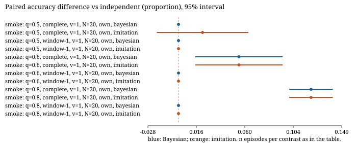
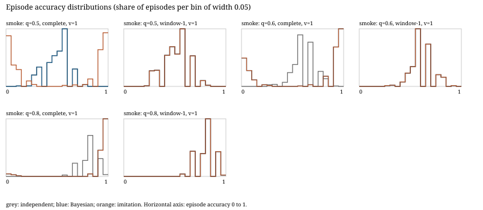

<!-- SPDX-License-Identifier: LicenseRef-HERD-NC-Research-1.0 -->
# EXP-001-R001 (EXPLORATORY): generated run report

**EXPLORATORY RUN. Not evidence for any study hypothesis.** The study protocol is an unfrozen draft; these numbers serve planning and verification only (master prompt section 3).

- Experiment: EXP-001; run: EXP-001-R001; created (UTC): 2026-11-24T16:06:49Z
- Description: EXP-001 smoke matrix and verification checks as in the draft protocol section 7 (exploratory)
- Config SHA-256: `6bb119865235b1f09f33ddfb1cd61c0ec8f644ef4ff331b61acc6871f4b2bb49`
- Seeds: [0, 1]; episodes per seed and cell: 200
- Result schema: 1.0.0
- Code revision: `f15c0c24f83fa84cf7707602660509573ba30b2b` (dirty: False)
- Platform: Apple M1 Pro, Darwin 24.3.0; Python 3.12.1, numpy 2.3.4
- Wall-clock runtime: 0.07 s; peak resident memory: 36175872 bytes
- Simulation time: 0.05 s for 144000 agent decisions (0.325 ms per 1,000 decisions); analysis time 0.00 s

## Verification checks

25 checks, 25 passed, 0 failed.

- C1: analytic wrong-cascade anchor (Bayesian, complete, v=1)
- C2: zero information: mean accuracy 1/2
- C3: independent baseline: agent accuracy q, no cascades
- C4: complete network: Bayesian and imitation actions identical
- C5: result validates against result-v1 schema
- C6: no near ties in Bayesian comparisons

| Check | Cell | Rule | Result | Observed | Expected |
|------|----------------------------------------|------------------|-------|----------|----------|
| C2 | smoke: q=0.5, complete, v=1, N=20, own | independent | pass | 0.4900 | 0.5000 |
| C2 | smoke: q=0.5, complete, v=1, N=20, own | bayesian | pass | 0.4900 | 0.5000 |
| C2 | smoke: q=0.5, complete, v=1, N=20, own | imitation | pass | 0.5119 | 0.5000 |
| C2 | smoke: q=0.5, complete, v=1, N=20, own | bayesian | pass | 0.0000 | 0.0000 |
| C3 | smoke: q=0.5, complete, v=1, N=20, own | independent | pass | 0.4900 | 0.5000 |
| C6 | smoke: q=0.5, complete, v=1, N=20, own | bayesian | pass | 0 | 0 |
| C2 | smoke: q=0.5, window-1, v=1, N=20, own | independent | pass | 0.4986 | 0.5000 |
| C2 | smoke: q=0.5, window-1, v=1, N=20, own | bayesian | pass | 0.4986 | 0.5000 |
| C2 | smoke: q=0.5, window-1, v=1, N=20, own | imitation | pass | 0.4986 | 0.5000 |
| C2 | smoke: q=0.5, window-1, v=1, N=20, own | bayesian | pass | 0.0000 | 0.0000 |
| C3 | smoke: q=0.5, window-1, v=1, N=20, own | independent | pass | 0.4986 | 0.5000 |
| C6 | smoke: q=0.5, window-1, v=1, N=20, own | bayesian | pass | 0 | 0 |
| C1 | smoke: q=0.6, complete, v=1, N=20, own | bayesian | pass | 0.3275 | 0.3073 |
| C3 | smoke: q=0.6, complete, v=1, N=20, own | independent | pass | 0.5989 | 0.6000 |
| C4 | smoke: q=0.6, complete, v=1, N=20, own | bayesian,imitation | pass | 0 | 0 |
| C6 | smoke: q=0.6, complete, v=1, N=20, own | bayesian | pass | 0 | 0 |
| C3 | smoke: q=0.6, window-1, v=1, N=20, own | independent | pass | 0.6034 | 0.6000 |
| C6 | smoke: q=0.6, window-1, v=1, N=20, own | bayesian | pass | 0 | 0 |
| C1 | smoke: q=0.8, complete, v=1, N=20, own | bayesian | pass | 0.0525 | 0.0588 |
| C3 | smoke: q=0.8, complete, v=1, N=20, own | independent | pass | 0.8070 | 0.8000 |
| C4 | smoke: q=0.8, complete, v=1, N=20, own | bayesian,imitation | pass | 0 | 0 |
| C6 | smoke: q=0.8, complete, v=1, N=20, own | bayesian | pass | 0 | 0 |
| C3 | smoke: q=0.8, window-1, v=1, N=20, own | independent | pass | 0.8009 | 0.8000 |
| C6 | smoke: q=0.8, window-1, v=1, N=20, own | bayesian | pass | 0 | 0 |
| C5 | all |  | pass | valid | valid |

## Failed cells

None.

## Paired accuracy differences against the independent baseline

Mean paired difference in episode accuracy (proportion of agents correct), normal-approximation 95% interval at the episode level, Holm adjustment within each variation. `seed SD` is the standard deviation of the per-seed mean differences; `hw@10k` is the 95% half-width that the observed paired SD implies at 10,000 episodes.

| Cell | Rule | n | Delta | CI low | CI high | paired SD | seed SD | p (Holm) | hw@10k |
|----------------------------------|---------|------|--------|--------|--------|--------|--------|--------|--------|
| smoke: q=0.5, complete, v=1, N=20, own | bayesian | 400 | 0.0000 | 0.0000 | 0.0000 | 0.0000 | 0.0000 | 1.0000 | 0.0000 |
| smoke: q=0.5, complete, v=1, N=20, own | imitation | 400 | 0.0219 | -0.0198 | 0.0636 | 0.4254 | 0.0352 | 1.0000 | 0.0083 |
| smoke: q=0.5, window-1, v=1, N=20, own | bayesian | 400 | 0.0000 | 0.0000 | 0.0000 | 0.0000 | 0.0000 | 1.0000 | 0.0000 |
| smoke: q=0.5, window-1, v=1, N=20, own | imitation | 400 | 0.0000 | 0.0000 | 0.0000 | 0.0000 | 0.0000 | 1.0000 | 0.0000 |
| smoke: q=0.6, complete, v=1, N=20, own | bayesian | 400 | 0.0550 | 0.0152 | 0.0948 | 0.4062 | 0.0067 | 0.0706 | 0.0080 |
| smoke: q=0.6, complete, v=1, N=20, own | imitation | 400 | 0.0550 | 0.0152 | 0.0948 | 0.4062 | 0.0067 | 0.0706 | 0.0080 |
| smoke: q=0.6, window-1, v=1, N=20, own | bayesian | 400 | 0.0000 | 0.0000 | 0.0000 | 0.0000 | 0.0000 | 1.0000 | 0.0000 |
| smoke: q=0.6, window-1, v=1, N=20, own | imitation | 400 | 0.0000 | 0.0000 | 0.0000 | 0.0000 | 0.0000 | 1.0000 | 0.0000 |
| smoke: q=0.8, complete, v=1, N=20, own | bayesian | 400 | 0.1206 | 0.1008 | 0.1405 | 0.2027 | 0.0168 | 0.0000 | 0.0040 |
| smoke: q=0.8, complete, v=1, N=20, own | imitation | 400 | 0.1206 | 0.1008 | 0.1405 | 0.2027 | 0.0168 | 0.0000 | 0.0040 |
| smoke: q=0.8, window-1, v=1, N=20, own | bayesian | 400 | 0.0000 | 0.0000 | 0.0000 | 0.0000 | 0.0000 | 1.0000 | 0.0000 |
| smoke: q=0.8, window-1, v=1, N=20, own | imitation | 400 | 0.0000 | 0.0000 | 0.0000 | 0.0000 | 0.0000 | 1.0000 | 0.0000 |

*Figure: paired accuracy difference (proportion) against the independent baseline, points are means and bars 95% normal intervals over episodes; the dashed line marks zero. Source: EXP-001-R001/result.json.*

## Arms

Means over episodes with 95% intervals in the CSV table `tables/arms.csv`.

| Cell | Rule | n | Accuracy | Cascade | Wrong cascade | Longest wrong run | Informative | Last agent |
|----------------------------------|----------|------|--------|--------|--------|--------|--------|--------|
| smoke: q=0.5, complete, v=1, N=20, own | independent | 400 | 0.490 | 0.000 | 0.000 | 3.808 | 1.000 | 0.477 |
| smoke: q=0.5, complete, v=1, N=20, own | bayesian | 400 | 0.490 | 0.000 | 0.000 | 3.808 | 1.000 | 0.477 |
| smoke: q=0.5, complete, v=1, N=20, own | imitation | 400 | 0.512 | 0.998 | 0.485 | 9.207 | 0.197 | 0.515 |
| smoke: q=0.5, window-1, v=1, N=20, own | independent | 400 | 0.499 | 0.000 | 0.000 | 3.697 | 1.000 | 0.520 |
| smoke: q=0.5, window-1, v=1, N=20, own | bayesian | 400 | 0.499 | 0.000 | 0.000 | 3.697 | 1.000 | 0.520 |
| smoke: q=0.5, window-1, v=1, N=20, own | imitation | 400 | 0.499 | 0.000 | 0.000 | 3.697 | 1.000 | 0.520 |
| smoke: q=0.6, complete, v=1, N=20, own | independent | 400 | 0.599 | 0.000 | 0.000 | 2.837 | 1.000 | 0.635 |
| smoke: q=0.6, complete, v=1, N=20, own | bayesian | 400 | 0.654 | 0.998 | 0.328 | 6.485 | 0.189 | 0.672 |
| smoke: q=0.6, complete, v=1, N=20, own | imitation | 400 | 0.654 | 0.998 | 0.328 | 6.485 | 0.189 | 0.672 |
| smoke: q=0.6, window-1, v=1, N=20, own | independent | 400 | 0.603 | 0.000 | 0.000 | 2.803 | 1.000 | 0.613 |
| smoke: q=0.6, window-1, v=1, N=20, own | bayesian | 400 | 0.603 | 0.000 | 0.000 | 2.803 | 1.000 | 0.613 |
| smoke: q=0.6, window-1, v=1, N=20, own | imitation | 400 | 0.603 | 0.000 | 0.000 | 2.803 | 1.000 | 0.613 |
| smoke: q=0.8, complete, v=1, N=20, own | independent | 400 | 0.807 | 0.000 | 0.000 | 1.625 | 1.000 | 0.792 |
| smoke: q=0.8, complete, v=1, N=20, own | bayesian | 400 | 0.928 | 1.000 | 0.052 | 1.325 | 0.148 | 0.948 |
| smoke: q=0.8, complete, v=1, N=20, own | imitation | 400 | 0.928 | 1.000 | 0.052 | 1.325 | 0.148 | 0.948 |
| smoke: q=0.8, window-1, v=1, N=20, own | independent | 400 | 0.801 | 0.000 | 0.000 | 1.617 | 1.000 | 0.797 |
| smoke: q=0.8, window-1, v=1, N=20, own | bayesian | 400 | 0.801 | 0.000 | 0.000 | 1.617 | 1.000 | 0.797 |
| smoke: q=0.8, window-1, v=1, N=20, own | imitation | 400 | 0.801 | 0.000 | 0.000 | 1.617 | 1.000 | 0.797 |

*Figure: distribution of episode accuracy, share of episodes per bin of width 0.05; grey independent, blue Bayesian, orange imitation.*

## Metric definitions

- `accuracy`: proportion of agents with a_i = theta (0 to 1)
- `cascade_any`: 1 if at least one agent is in a cascade (0 or 1)
- `wrong_cascade_any`: 1 if at least one agent is in a cascade on the wrong action (0 or 1)
- `longest_wrong_run`: length of the longest run of consecutive incorrect actions (agents)
- `informative_share`: share of agents not in a cascade (0 to 1)
- `action_entropy_bits`: binary entropy of the within-episode action frequency (bits)
- `last_agent_accuracy`: 1 if a_N = theta (0 or 1)
