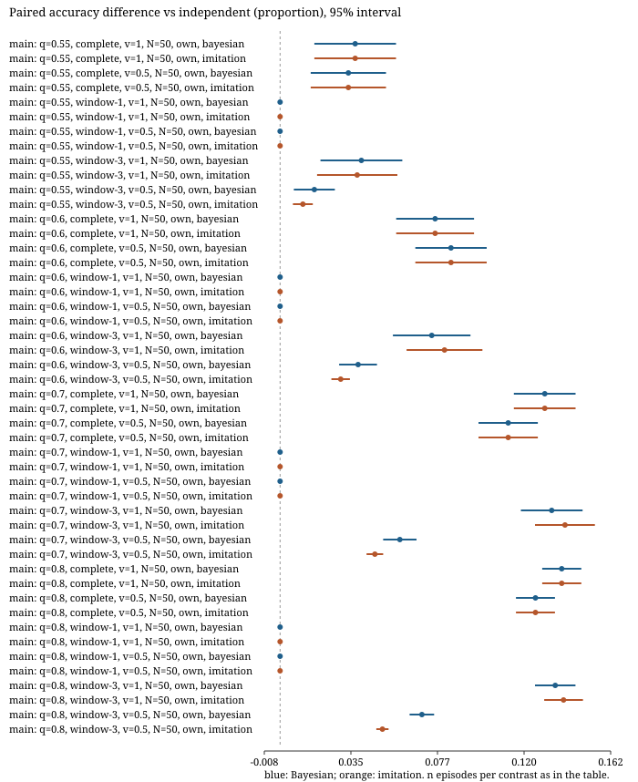
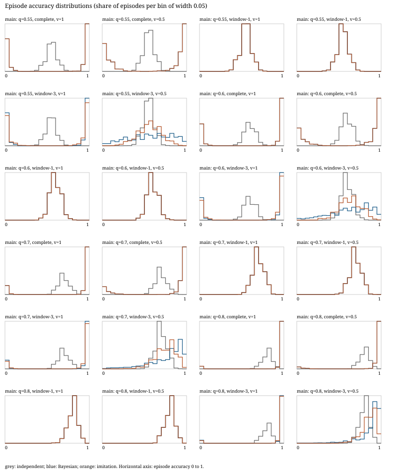

<!-- SPDX-License-Identifier: LicenseRef-HERD-NC-Research-1.0 -->
# EXP-001-R002 (EXPLORATORY): generated run report

**EXPLORATORY RUN. Not evidence for any study hypothesis.** The study protocol is an unfrozen draft; these numbers serve planning and verification only (master prompt section 3).

- Experiment: EXP-001; run: EXP-001-R002; created (UTC): 2026-11-24T16:07:03Z
- Description: Throughput and seed-spread probe on the EXP-002 matrix shape at one fifth of the planned episodes, with seeds 100-109 disjoint from the confirmatory seeds 0-9 (exploratory)
- Config SHA-256: `e18b052ab500b99a79f30ec9a215f3ce1422f7e77ee4aff830dc9c12d7d180ce`
- Seeds: [100, 101, 102, 103, 104, 105, 106, 107, 108, 109]; episodes per seed and cell: 200
- Result schema: 1.0.0
- Code revision: `f15c0c24f83fa84cf7707602660509573ba30b2b` (dirty: False)
- Platform: Apple M1 Pro, Darwin 24.3.0; Python 3.12.1, numpy 2.3.4
- Wall-clock runtime: 9.81 s; peak resident memory: 123060224 bytes
- Simulation time: 5.68 s for 7200000 agent decisions (0.789 ms per 1,000 decisions); analysis time 3.12 s

## Verification checks

61 checks, 61 passed, 0 failed.

- C1: analytic wrong-cascade anchor (Bayesian, complete, v=1)
- C3: independent baseline: agent accuracy q, no cascades
- C4: complete network: Bayesian and imitation actions identical
- C5: result validates against result-v1 schema
- C6: no near ties in Bayesian comparisons

| Check | Cell | Rule | Result | Observed | Expected |
|------|----------------------------------------|------------------|-------|----------|----------|
| C1 | main: q=0.55, complete, v=1, N=50, own | bayesian | pass | 0.4065 | 0.4010 |
| C3 | main: q=0.55, complete, v=1, N=50, own | independent | pass | 0.5524 | 0.5500 |
| C4 | main: q=0.55, complete, v=1, N=50, own | bayesian,imitation | pass | 0 | 0 |
| C6 | main: q=0.55, complete, v=1, N=50, own | bayesian | pass | 0 | 0 |
| C3 | main: q=0.55, complete, v=0.5, N=50, own | independent | pass | 0.5518 | 0.5500 |
| C4 | main: q=0.55, complete, v=0.5, N=50, own | bayesian,imitation | pass | 0 | 0 |
| C6 | main: q=0.55, complete, v=0.5, N=50, own | bayesian | pass | 0 | 0 |
| C3 | main: q=0.55, window-1, v=1, N=50, own | independent | pass | 0.5487 | 0.5500 |
| C6 | main: q=0.55, window-1, v=1, N=50, own | bayesian | pass | 0 | 0 |
| C3 | main: q=0.55, window-1, v=0.5, N=50, own | independent | pass | 0.5474 | 0.5500 |
| C6 | main: q=0.55, window-1, v=0.5, N=50, own | bayesian | pass | 0 | 0 |
| C3 | main: q=0.55, window-3, v=1, N=50, own | independent | pass | 0.5473 | 0.5500 |
| C6 | main: q=0.55, window-3, v=1, N=50, own | bayesian | pass | 0 | 0 |
| C3 | main: q=0.55, window-3, v=0.5, N=50, own | independent | pass | 0.5506 | 0.5500 |
| C6 | main: q=0.55, window-3, v=0.5, N=50, own | bayesian | pass | 0 | 0 |
| C1 | main: q=0.6, complete, v=1, N=50, own | bayesian | pass | 0.3160 | 0.3077 |
| C3 | main: q=0.6, complete, v=1, N=50, own | independent | pass | 0.6011 | 0.6000 |
| C4 | main: q=0.6, complete, v=1, N=50, own | bayesian,imitation | pass | 0 | 0 |
| C6 | main: q=0.6, complete, v=1, N=50, own | bayesian | pass | 0 | 0 |
| C3 | main: q=0.6, complete, v=0.5, N=50, own | independent | pass | 0.5981 | 0.6000 |
| C4 | main: q=0.6, complete, v=0.5, N=50, own | bayesian,imitation | pass | 0 | 0 |
| C6 | main: q=0.6, complete, v=0.5, N=50, own | bayesian | pass | 0 | 0 |
| C3 | main: q=0.6, window-1, v=1, N=50, own | independent | pass | 0.5988 | 0.6000 |
| C6 | main: q=0.6, window-1, v=1, N=50, own | bayesian | pass | 0 | 0 |
| C3 | main: q=0.6, window-1, v=0.5, N=50, own | independent | pass | 0.5986 | 0.6000 |
| C6 | main: q=0.6, window-1, v=0.5, N=50, own | bayesian | pass | 0 | 0 |
| C3 | main: q=0.6, window-3, v=1, N=50, own | independent | pass | 0.5995 | 0.6000 |
| C6 | main: q=0.6, window-3, v=1, N=50, own | bayesian | pass | 0 | 0 |
| C3 | main: q=0.6, window-3, v=0.5, N=50, own | independent | pass | 0.5994 | 0.6000 |
| C6 | main: q=0.6, window-3, v=0.5, N=50, own | bayesian | pass | 0 | 0 |
| C1 | main: q=0.7, complete, v=1, N=50, own | bayesian | pass | 0.1605 | 0.1552 |
| C3 | main: q=0.7, complete, v=1, N=50, own | independent | pass | 0.6997 | 0.7000 |
| C4 | main: q=0.7, complete, v=1, N=50, own | bayesian,imitation | pass | 0 | 0 |
| C6 | main: q=0.7, complete, v=1, N=50, own | bayesian | pass | 0 | 0 |
| C3 | main: q=0.7, complete, v=0.5, N=50, own | independent | pass | 0.6978 | 0.7000 |
| C4 | main: q=0.7, complete, v=0.5, N=50, own | bayesian,imitation | pass | 0 | 0 |
| C6 | main: q=0.7, complete, v=0.5, N=50, own | bayesian | pass | 0 | 0 |
| C3 | main: q=0.7, window-1, v=1, N=50, own | independent | pass | 0.7004 | 0.7000 |
| C6 | main: q=0.7, window-1, v=1, N=50, own | bayesian | pass | 0 | 0 |
| C3 | main: q=0.7, window-1, v=0.5, N=50, own | independent | pass | 0.6999 | 0.7000 |
| C6 | main: q=0.7, window-1, v=0.5, N=50, own | bayesian | pass | 0 | 0 |
| C3 | main: q=0.7, window-3, v=1, N=50, own | independent | pass | 0.6996 | 0.7000 |
| C6 | main: q=0.7, window-3, v=1, N=50, own | bayesian | pass | 0 | 0 |
| C3 | main: q=0.7, window-3, v=0.5, N=50, own | independent | pass | 0.7002 | 0.7000 |
| C6 | main: q=0.7, window-3, v=0.5, N=50, own | bayesian | pass | 0 | 0 |
| C1 | main: q=0.8, complete, v=1, N=50, own | bayesian | pass | 0.0530 | 0.0588 |
| C3 | main: q=0.8, complete, v=1, N=50, own | independent | pass | 0.7999 | 0.8000 |
| C4 | main: q=0.8, complete, v=1, N=50, own | bayesian,imitation | pass | 0 | 0 |
| C6 | main: q=0.8, complete, v=1, N=50, own | bayesian | pass | 0 | 0 |
| C3 | main: q=0.8, complete, v=0.5, N=50, own | independent | pass | 0.7995 | 0.8000 |
| C4 | main: q=0.8, complete, v=0.5, N=50, own | bayesian,imitation | pass | 0 | 0 |
| C6 | main: q=0.8, complete, v=0.5, N=50, own | bayesian | pass | 0 | 0 |
| C3 | main: q=0.8, window-1, v=1, N=50, own | independent | pass | 0.8012 | 0.8000 |
| C6 | main: q=0.8, window-1, v=1, N=50, own | bayesian | pass | 0 | 0 |
| C3 | main: q=0.8, window-1, v=0.5, N=50, own | independent | pass | 0.7996 | 0.8000 |
| C6 | main: q=0.8, window-1, v=0.5, N=50, own | bayesian | pass | 0 | 0 |
| C3 | main: q=0.8, window-3, v=1, N=50, own | independent | pass | 0.7988 | 0.8000 |
| C6 | main: q=0.8, window-3, v=1, N=50, own | bayesian | pass | 0 | 0 |
| C3 | main: q=0.8, window-3, v=0.5, N=50, own | independent | pass | 0.7987 | 0.8000 |
| C6 | main: q=0.8, window-3, v=0.5, N=50, own | bayesian | pass | 0 | 0 |
| C5 | all |  | pass | valid | valid |

## Failed cells

None.

## Paired accuracy differences against the independent baseline

Mean paired difference in episode accuracy (proportion of agents correct), normal-approximation 95% interval at the episode level, Holm adjustment within each variation. `seed SD` is the standard deviation of the per-seed mean differences; `hw@10k` is the 95% half-width that the observed paired SD implies at 10,000 episodes.

| Cell | Rule | n | Delta | CI low | CI high | paired SD | seed SD | p (Holm) | hw@10k |
|----------------------------------|---------|------|--------|--------|--------|--------|--------|--------|--------|
| main: q=0.55, complete, v=1, N=50, own | bayesian | 2000 | 0.0369 | 0.0168 | 0.0570 | 0.4577 | 0.0288 | 0.0067 | 0.0090 |
| main: q=0.55, complete, v=1, N=50, own | imitation | 2000 | 0.0369 | 0.0168 | 0.0570 | 0.4577 | 0.0288 | 0.0067 | 0.0090 |
| main: q=0.55, complete, v=0.5, N=50, own | bayesian | 2000 | 0.0335 | 0.0150 | 0.0520 | 0.4220 | 0.0222 | 0.0074 | 0.0083 |
| main: q=0.55, complete, v=0.5, N=50, own | imitation | 2000 | 0.0335 | 0.0150 | 0.0520 | 0.4220 | 0.0222 | 0.0074 | 0.0083 |
| main: q=0.55, window-1, v=1, N=50, own | bayesian | 2000 | 0.0000 | 0.0000 | 0.0000 | 0.0000 | 0.0000 | 1.0000 | 0.0000 |
| main: q=0.55, window-1, v=1, N=50, own | imitation | 2000 | 0.0000 | 0.0000 | 0.0000 | 0.0000 | 0.0000 | 1.0000 | 0.0000 |
| main: q=0.55, window-1, v=0.5, N=50, own | bayesian | 2000 | 0.0000 | 0.0000 | 0.0000 | 0.0000 | 0.0000 | 1.0000 | 0.0000 |
| main: q=0.55, window-1, v=0.5, N=50, own | imitation | 2000 | 0.0000 | 0.0000 | 0.0000 | 0.0000 | 0.0000 | 1.0000 | 0.0000 |
| main: q=0.55, window-3, v=1, N=50, own | bayesian | 2000 | 0.0399 | 0.0199 | 0.0600 | 0.4584 | 0.0378 | 0.0023 | 0.0090 |
| main: q=0.55, window-3, v=1, N=50, own | imitation | 2000 | 0.0379 | 0.0182 | 0.0576 | 0.4503 | 0.0318 | 0.0038 | 0.0088 |
| main: q=0.55, window-3, v=0.5, N=50, own | bayesian | 2000 | 0.0168 | 0.0068 | 0.0269 | 0.2297 | 0.0188 | 0.0179 | 0.0045 |
| main: q=0.55, window-3, v=0.5, N=50, own | imitation | 2000 | 0.0112 | 0.0063 | 0.0161 | 0.1112 | 0.0104 | 0.0002 | 0.0022 |
| main: q=0.6, complete, v=1, N=50, own | bayesian | 2000 | 0.0762 | 0.0570 | 0.0953 | 0.4363 | 0.0180 | 0.0000 | 0.0086 |
| main: q=0.6, complete, v=1, N=50, own | imitation | 2000 | 0.0762 | 0.0570 | 0.0953 | 0.4363 | 0.0180 | 0.0000 | 0.0086 |
| main: q=0.6, complete, v=0.5, N=50, own | bayesian | 2000 | 0.0840 | 0.0664 | 0.1015 | 0.4002 | 0.0289 | 0.0000 | 0.0078 |
| main: q=0.6, complete, v=0.5, N=50, own | imitation | 2000 | 0.0840 | 0.0664 | 0.1015 | 0.4002 | 0.0289 | 0.0000 | 0.0078 |
| main: q=0.6, window-1, v=1, N=50, own | bayesian | 2000 | 0.0000 | 0.0000 | 0.0000 | 0.0000 | 0.0000 | 1.0000 | 0.0000 |
| main: q=0.6, window-1, v=1, N=50, own | imitation | 2000 | 0.0000 | 0.0000 | 0.0000 | 0.0000 | 0.0000 | 1.0000 | 0.0000 |
| main: q=0.6, window-1, v=0.5, N=50, own | bayesian | 2000 | 0.0000 | 0.0000 | 0.0000 | 0.0000 | 0.0000 | 1.0000 | 0.0000 |
| main: q=0.6, window-1, v=0.5, N=50, own | imitation | 2000 | 0.0000 | 0.0000 | 0.0000 | 0.0000 | 0.0000 | 1.0000 | 0.0000 |
| main: q=0.6, window-3, v=1, N=50, own | bayesian | 2000 | 0.0745 | 0.0554 | 0.0935 | 0.4346 | 0.0266 | 0.0000 | 0.0085 |
| main: q=0.6, window-3, v=1, N=50, own | imitation | 2000 | 0.0808 | 0.0621 | 0.0994 | 0.4249 | 0.0259 | 0.0000 | 0.0083 |
| main: q=0.6, window-3, v=0.5, N=50, own | bayesian | 2000 | 0.0383 | 0.0290 | 0.0476 | 0.2119 | 0.0148 | 0.0000 | 0.0042 |
| main: q=0.6, window-3, v=0.5, N=50, own | imitation | 2000 | 0.0298 | 0.0252 | 0.0343 | 0.1034 | 0.0060 | 0.0000 | 0.0020 |
| main: q=0.7, complete, v=1, N=50, own | bayesian | 2000 | 0.1300 | 0.1148 | 0.1452 | 0.3461 | 0.0225 | 0.0000 | 0.0068 |
| main: q=0.7, complete, v=1, N=50, own | imitation | 2000 | 0.1300 | 0.1148 | 0.1452 | 0.3461 | 0.0225 | 0.0000 | 0.0068 |
| main: q=0.7, complete, v=0.5, N=50, own | bayesian | 2000 | 0.1121 | 0.0975 | 0.1266 | 0.3325 | 0.0229 | 0.0000 | 0.0065 |
| main: q=0.7, complete, v=0.5, N=50, own | imitation | 2000 | 0.1121 | 0.0975 | 0.1266 | 0.3325 | 0.0229 | 0.0000 | 0.0065 |
| main: q=0.7, window-1, v=1, N=50, own | bayesian | 2000 | 0.0000 | 0.0000 | 0.0000 | 0.0000 | 0.0000 | 1.0000 | 0.0000 |
| main: q=0.7, window-1, v=1, N=50, own | imitation | 2000 | 0.0000 | 0.0000 | 0.0000 | 0.0000 | 0.0000 | 1.0000 | 0.0000 |
| main: q=0.7, window-1, v=0.5, N=50, own | bayesian | 2000 | 0.0000 | 0.0000 | 0.0000 | 0.0000 | 0.0000 | 1.0000 | 0.0000 |
| main: q=0.7, window-1, v=0.5, N=50, own | imitation | 2000 | 0.0000 | 0.0000 | 0.0000 | 0.0000 | 0.0000 | 1.0000 | 0.0000 |
| main: q=0.7, window-3, v=1, N=50, own | bayesian | 2000 | 0.1334 | 0.1183 | 0.1486 | 0.3461 | 0.0362 | 0.0000 | 0.0068 |
| main: q=0.7, window-3, v=1, N=50, own | imitation | 2000 | 0.1399 | 0.1252 | 0.1547 | 0.3355 | 0.0342 | 0.0000 | 0.0066 |
| main: q=0.7, window-3, v=0.5, N=50, own | bayesian | 2000 | 0.0588 | 0.0506 | 0.0670 | 0.1867 | 0.0148 | 0.0000 | 0.0037 |
| main: q=0.7, window-3, v=0.5, N=50, own | imitation | 2000 | 0.0466 | 0.0425 | 0.0507 | 0.0932 | 0.0063 | 0.0000 | 0.0018 |
| main: q=0.8, complete, v=1, N=50, own | bayesian | 2000 | 0.1384 | 0.1288 | 0.1480 | 0.2188 | 0.0195 | 0.0000 | 0.0043 |
| main: q=0.8, complete, v=1, N=50, own | imitation | 2000 | 0.1384 | 0.1288 | 0.1480 | 0.2188 | 0.0195 | 0.0000 | 0.0043 |
| main: q=0.8, complete, v=0.5, N=50, own | bayesian | 2000 | 0.1255 | 0.1159 | 0.1350 | 0.2185 | 0.0185 | 0.0000 | 0.0043 |
| main: q=0.8, complete, v=0.5, N=50, own | imitation | 2000 | 0.1255 | 0.1159 | 0.1350 | 0.2185 | 0.0185 | 0.0000 | 0.0043 |
| main: q=0.8, window-1, v=1, N=50, own | bayesian | 2000 | 0.0000 | 0.0000 | 0.0000 | 0.0000 | 0.0000 | 1.0000 | 0.0000 |
| main: q=0.8, window-1, v=1, N=50, own | imitation | 2000 | 0.0000 | 0.0000 | 0.0000 | 0.0000 | 0.0000 | 1.0000 | 0.0000 |
| main: q=0.8, window-1, v=0.5, N=50, own | bayesian | 2000 | 0.0000 | 0.0000 | 0.0000 | 0.0000 | 0.0000 | 1.0000 | 0.0000 |
| main: q=0.8, window-1, v=0.5, N=50, own | imitation | 2000 | 0.0000 | 0.0000 | 0.0000 | 0.0000 | 0.0000 | 1.0000 | 0.0000 |
| main: q=0.8, window-3, v=1, N=50, own | bayesian | 2000 | 0.1352 | 0.1252 | 0.1451 | 0.2267 | 0.0125 | 0.0000 | 0.0044 |
| main: q=0.8, window-3, v=1, N=50, own | imitation | 2000 | 0.1393 | 0.1298 | 0.1488 | 0.2167 | 0.0139 | 0.0000 | 0.0042 |
| main: q=0.8, window-3, v=0.5, N=50, own | bayesian | 2000 | 0.0697 | 0.0636 | 0.0757 | 0.1378 | 0.0133 | 0.0000 | 0.0027 |
| main: q=0.8, window-3, v=0.5, N=50, own | imitation | 2000 | 0.0503 | 0.0473 | 0.0533 | 0.0684 | 0.0056 | 0.0000 | 0.0013 |

*Figure: paired accuracy difference (proportion) against the independent baseline, points are means and bars 95% normal intervals over episodes; the dashed line marks zero. Source: EXP-001-R002/result.json.*

## Arms

Means over episodes with 95% intervals in the CSV table `tables/arms.csv`.

| Cell | Rule | n | Accuracy | Cascade | Wrong cascade | Longest wrong run | Informative | Last agent |
|----------------------------------|----------|------|--------|--------|--------|--------|--------|--------|
| main: q=0.55, complete, v=1, N=50, own | independent | 2000 | 0.552 | 0.000 | 0.000 | 4.340 | 1.000 | 0.549 |
| main: q=0.55, complete, v=1, N=50, own | bayesian | 2000 | 0.589 | 1.000 | 0.406 | 19.974 | 0.081 | 0.594 |
| main: q=0.55, complete, v=1, N=50, own | imitation | 2000 | 0.589 | 1.000 | 0.406 | 19.974 | 0.081 | 0.594 |
| main: q=0.55, complete, v=0.5, N=50, own | independent | 2000 | 0.552 | 0.000 | 0.000 | 4.439 | 1.000 | 0.574 |
| main: q=0.55, complete, v=0.5, N=50, own | bayesian | 2000 | 0.585 | 1.000 | 0.410 | 18.884 | 0.160 | 0.590 |
| main: q=0.55, complete, v=0.5, N=50, own | imitation | 2000 | 0.585 | 1.000 | 0.410 | 18.884 | 0.160 | 0.590 |
| main: q=0.55, window-1, v=1, N=50, own | independent | 2000 | 0.549 | 0.000 | 0.000 | 4.439 | 1.000 | 0.561 |
| main: q=0.55, window-1, v=1, N=50, own | bayesian | 2000 | 0.549 | 0.000 | 0.000 | 4.439 | 1.000 | 0.561 |
| main: q=0.55, window-1, v=1, N=50, own | imitation | 2000 | 0.549 | 0.000 | 0.000 | 4.439 | 1.000 | 0.561 |
| main: q=0.55, window-1, v=0.5, N=50, own | independent | 2000 | 0.547 | 0.000 | 0.000 | 4.430 | 1.000 | 0.563 |
| main: q=0.55, window-1, v=0.5, N=50, own | bayesian | 2000 | 0.547 | 0.000 | 0.000 | 4.430 | 1.000 | 0.563 |
| main: q=0.55, window-1, v=0.5, N=50, own | imitation | 2000 | 0.547 | 0.000 | 0.000 | 4.430 | 1.000 | 0.563 |
| main: q=0.55, window-3, v=1, N=50, own | independent | 2000 | 0.547 | 0.000 | 0.000 | 4.440 | 1.000 | 0.536 |
| main: q=0.55, window-3, v=1, N=50, own | bayesian | 2000 | 0.587 | 1.000 | 0.409 | 20.131 | 0.079 | 0.591 |
| main: q=0.55, window-3, v=1, N=50, own | imitation | 2000 | 0.585 | 1.000 | 0.410 | 19.936 | 0.098 | 0.590 |
| main: q=0.55, window-3, v=0.5, N=50, own | independent | 2000 | 0.551 | 0.000 | 0.000 | 4.431 | 1.000 | 0.571 |
| main: q=0.55, window-3, v=0.5, N=50, own | bayesian | 2000 | 0.567 | 1.000 | 0.768 | 12.809 | 0.437 | 0.562 |
| main: q=0.55, window-3, v=0.5, N=50, own | imitation | 2000 | 0.562 | 1.000 | 0.864 | 8.329 | 0.669 | 0.578 |
| main: q=0.6, complete, v=1, N=50, own | independent | 2000 | 0.601 | 0.000 | 0.000 | 3.898 | 1.000 | 0.597 |
| main: q=0.6, complete, v=1, N=50, own | bayesian | 2000 | 0.677 | 1.000 | 0.316 | 15.727 | 0.076 | 0.684 |
| main: q=0.6, complete, v=1, N=50, own | imitation | 2000 | 0.677 | 1.000 | 0.316 | 15.727 | 0.076 | 0.684 |
| main: q=0.6, complete, v=0.5, N=50, own | independent | 2000 | 0.598 | 0.000 | 0.000 | 3.913 | 1.000 | 0.594 |
| main: q=0.6, complete, v=0.5, N=50, own | bayesian | 2000 | 0.682 | 1.000 | 0.303 | 14.354 | 0.155 | 0.697 |
| main: q=0.6, complete, v=0.5, N=50, own | imitation | 2000 | 0.682 | 1.000 | 0.303 | 14.354 | 0.155 | 0.697 |
| main: q=0.6, window-1, v=1, N=50, own | independent | 2000 | 0.599 | 0.000 | 0.000 | 3.894 | 1.000 | 0.578 |
| main: q=0.6, window-1, v=1, N=50, own | bayesian | 2000 | 0.599 | 0.000 | 0.000 | 3.894 | 1.000 | 0.578 |
| main: q=0.6, window-1, v=1, N=50, own | imitation | 2000 | 0.599 | 0.000 | 0.000 | 3.894 | 1.000 | 0.578 |
| main: q=0.6, window-1, v=0.5, N=50, own | independent | 2000 | 0.599 | 0.000 | 0.000 | 3.862 | 1.000 | 0.616 |
| main: q=0.6, window-1, v=0.5, N=50, own | bayesian | 2000 | 0.599 | 0.000 | 0.000 | 3.862 | 1.000 | 0.616 |
| main: q=0.6, window-1, v=0.5, N=50, own | imitation | 2000 | 0.599 | 0.000 | 0.000 | 3.862 | 1.000 | 0.616 |
| main: q=0.6, window-3, v=1, N=50, own | independent | 2000 | 0.599 | 0.000 | 0.000 | 3.856 | 1.000 | 0.609 |
| main: q=0.6, window-3, v=1, N=50, own | bayesian | 2000 | 0.674 | 1.000 | 0.319 | 15.869 | 0.076 | 0.681 |
| main: q=0.6, window-3, v=1, N=50, own | imitation | 2000 | 0.680 | 1.000 | 0.310 | 15.331 | 0.092 | 0.690 |
| main: q=0.6, window-3, v=0.5, N=50, own | independent | 2000 | 0.599 | 0.000 | 0.000 | 3.886 | 1.000 | 0.592 |
| main: q=0.6, window-3, v=0.5, N=50, own | bayesian | 2000 | 0.638 | 1.000 | 0.700 | 10.735 | 0.433 | 0.629 |
| main: q=0.6, window-3, v=0.5, N=50, own | imitation | 2000 | 0.629 | 1.000 | 0.784 | 7.034 | 0.658 | 0.623 |
| main: q=0.7, complete, v=1, N=50, own | independent | 2000 | 0.700 | 0.000 | 0.000 | 2.936 | 1.000 | 0.702 |
| main: q=0.7, complete, v=1, N=50, own | bayesian | 2000 | 0.830 | 1.000 | 0.161 | 8.223 | 0.070 | 0.840 |
| main: q=0.7, complete, v=1, N=50, own | imitation | 2000 | 0.830 | 1.000 | 0.161 | 8.223 | 0.070 | 0.840 |
| main: q=0.7, complete, v=0.5, N=50, own | independent | 2000 | 0.698 | 0.000 | 0.000 | 2.959 | 1.000 | 0.698 |
| main: q=0.7, complete, v=0.5, N=50, own | bayesian | 2000 | 0.810 | 1.000 | 0.171 | 8.570 | 0.136 | 0.830 |
| main: q=0.7, complete, v=0.5, N=50, own | imitation | 2000 | 0.810 | 1.000 | 0.171 | 8.570 | 0.136 | 0.830 |
| main: q=0.7, window-1, v=1, N=50, own | independent | 2000 | 0.700 | 0.000 | 0.000 | 2.950 | 1.000 | 0.699 |
| main: q=0.7, window-1, v=1, N=50, own | bayesian | 2000 | 0.700 | 0.000 | 0.000 | 2.950 | 1.000 | 0.699 |
| main: q=0.7, window-1, v=1, N=50, own | imitation | 2000 | 0.700 | 0.000 | 0.000 | 2.950 | 1.000 | 0.699 |
| main: q=0.7, window-1, v=0.5, N=50, own | independent | 2000 | 0.700 | 0.000 | 0.000 | 2.933 | 1.000 | 0.680 |
| main: q=0.7, window-1, v=0.5, N=50, own | bayesian | 2000 | 0.700 | 0.000 | 0.000 | 2.933 | 1.000 | 0.680 |
| main: q=0.7, window-1, v=0.5, N=50, own | imitation | 2000 | 0.700 | 0.000 | 0.000 | 2.933 | 1.000 | 0.680 |
| main: q=0.7, window-3, v=1, N=50, own | independent | 2000 | 0.700 | 0.000 | 0.000 | 2.972 | 1.000 | 0.690 |
| main: q=0.7, window-3, v=1, N=50, own | bayesian | 2000 | 0.833 | 1.000 | 0.157 | 8.072 | 0.069 | 0.843 |
| main: q=0.7, window-3, v=1, N=50, own | imitation | 2000 | 0.840 | 1.000 | 0.147 | 7.608 | 0.081 | 0.853 |
| main: q=0.7, window-3, v=0.5, N=50, own | independent | 2000 | 0.700 | 0.000 | 0.000 | 2.919 | 1.000 | 0.702 |
| main: q=0.7, window-3, v=0.5, N=50, own | bayesian | 2000 | 0.759 | 1.000 | 0.489 | 7.141 | 0.423 | 0.761 |
| main: q=0.7, window-3, v=0.5, N=50, own | imitation | 2000 | 0.747 | 0.999 | 0.565 | 4.899 | 0.637 | 0.735 |
| main: q=0.8, complete, v=1, N=50, own | independent | 2000 | 0.800 | 0.000 | 0.000 | 2.183 | 1.000 | 0.800 |
| main: q=0.8, complete, v=1, N=50, own | bayesian | 2000 | 0.938 | 1.000 | 0.053 | 2.954 | 0.060 | 0.947 |
| main: q=0.8, complete, v=1, N=50, own | imitation | 2000 | 0.938 | 1.000 | 0.053 | 2.954 | 0.060 | 0.947 |
| main: q=0.8, complete, v=0.5, N=50, own | independent | 2000 | 0.800 | 0.000 | 0.000 | 2.174 | 1.000 | 0.805 |
| main: q=0.8, complete, v=0.5, N=50, own | bayesian | 2000 | 0.925 | 1.000 | 0.059 | 3.361 | 0.115 | 0.941 |
| main: q=0.8, complete, v=0.5, N=50, own | imitation | 2000 | 0.925 | 1.000 | 0.059 | 3.361 | 0.115 | 0.941 |
| main: q=0.8, window-1, v=1, N=50, own | independent | 2000 | 0.801 | 0.000 | 0.000 | 2.155 | 1.000 | 0.801 |
| main: q=0.8, window-1, v=1, N=50, own | bayesian | 2000 | 0.801 | 0.000 | 0.000 | 2.155 | 1.000 | 0.801 |
| main: q=0.8, window-1, v=1, N=50, own | imitation | 2000 | 0.801 | 0.000 | 0.000 | 2.155 | 1.000 | 0.801 |
| main: q=0.8, window-1, v=0.5, N=50, own | independent | 2000 | 0.800 | 0.000 | 0.000 | 2.140 | 1.000 | 0.792 |
| main: q=0.8, window-1, v=0.5, N=50, own | bayesian | 2000 | 0.800 | 0.000 | 0.000 | 2.140 | 1.000 | 0.792 |
| main: q=0.8, window-1, v=0.5, N=50, own | imitation | 2000 | 0.800 | 0.000 | 0.000 | 2.140 | 1.000 | 0.792 |
| main: q=0.8, window-3, v=1, N=50, own | independent | 2000 | 0.799 | 0.000 | 0.000 | 2.203 | 1.000 | 0.804 |
| main: q=0.8, window-3, v=1, N=50, own | bayesian | 2000 | 0.934 | 1.000 | 0.058 | 3.176 | 0.059 | 0.943 |
| main: q=0.8, window-3, v=1, N=50, own | imitation | 2000 | 0.938 | 1.000 | 0.052 | 2.927 | 0.065 | 0.948 |
| main: q=0.8, window-3, v=0.5, N=50, own | independent | 2000 | 0.799 | 0.000 | 0.000 | 2.191 | 1.000 | 0.805 |
| main: q=0.8, window-3, v=0.5, N=50, own | bayesian | 2000 | 0.868 | 1.000 | 0.250 | 3.866 | 0.403 | 0.875 |
| main: q=0.8, window-3, v=0.5, N=50, own | imitation | 2000 | 0.849 | 1.000 | 0.314 | 3.058 | 0.611 | 0.851 |

*Figure: distribution of episode accuracy, share of episodes per bin of width 0.05; grey independent, blue Bayesian, orange imitation.*

## Metric definitions

- `accuracy`: proportion of agents with a_i = theta (0 to 1)
- `cascade_any`: 1 if at least one agent is in a cascade (0 or 1)
- `wrong_cascade_any`: 1 if at least one agent is in a cascade on the wrong action (0 or 1)
- `longest_wrong_run`: length of the longest run of consecutive incorrect actions (agents)
- `informative_share`: share of agents not in a cascade (0 to 1)
- `action_entropy_bits`: binary entropy of the within-episode action frequency (bits)
- `last_agent_accuracy`: 1 if a_N = theta (0 or 1)
