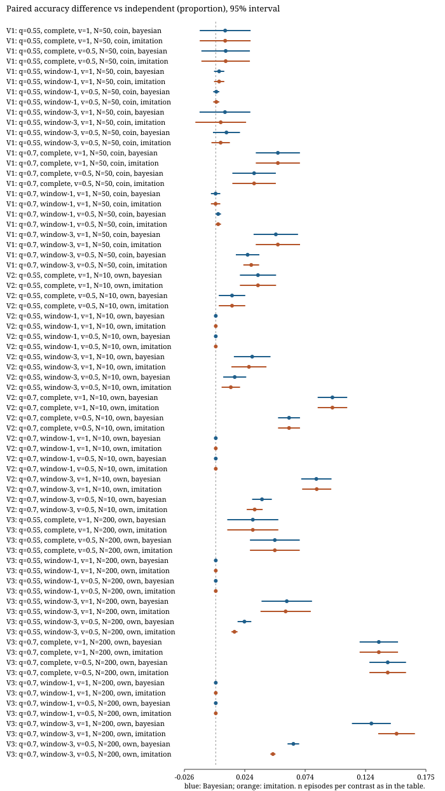
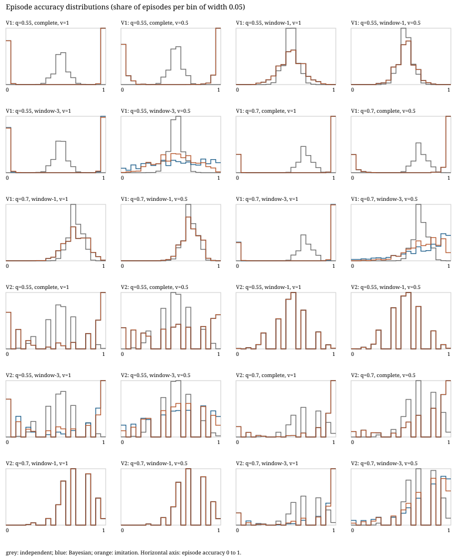

<!-- SPDX-License-Identifier: LicenseRef-HERD-NC-Research-1.0 -->
# EXP-001-R003 (EXPLORATORY): generated run report

**EXPLORATORY RUN. Not evidence for any study hypothesis.** The study protocol is an unfrozen draft; these numbers serve planning and verification only (master prompt section 3).

- Experiment: EXP-001; run: EXP-001-R003; created (UTC): 2026-11-24T16:07:26Z
- Description: Throughput probe on the EXP-003 matrix shape (coin ties at N=50; own ties at N=10 and N=200) at one fifth of the planned episodes, seeds 100-109 (exploratory)
- Config SHA-256: `0f01eecc86cd6251b8bcbbb244e107f8ace205b2f9a09b0c44ec0a067eb21d2a`
- Seeds: [100, 101, 102, 103, 104, 105, 106, 107, 108, 109]; episodes per seed and cell: 200
- Result schema: 1.0.0
- Code revision: `f15c0c24f83fa84cf7707602660509573ba30b2b` (dirty: False)
- Platform: Apple M1 Pro, Darwin 24.3.0; Python 3.12.1, numpy 2.3.4
- Wall-clock runtime: 22.34 s; peak resident memory: 144687104 bytes
- Simulation time: 16.24 s for 18720000 agent decisions (0.868 ms per 1,000 decisions); analysis time 4.23 s

## Verification checks

89 checks, 89 passed, 0 failed.

- C1: analytic wrong-cascade anchor (Bayesian, complete, v=1)
- C3: independent baseline: agent accuracy q, no cascades
- C4: complete network: Bayesian and imitation actions identical
- C5: result validates against result-v1 schema
- C6: no near ties in Bayesian comparisons
- C7: complete network, coin ties: Bayesian vs imitation divergence (diagnostic, no prediction)

| Check | Cell | Rule | Result | Observed | Expected |
|------|----------------------------------------|------------------|-------|----------|----------|
| C3 | V1: q=0.55, complete, v=1, N=50, coin | independent | pass | 0.5524 | 0.5500 |
| C7 | V1: q=0.55, complete, v=1, N=50, coin | bayesian,imitation | pass | 0 | n/a |
| C6 | V1: q=0.55, complete, v=1, N=50, coin | bayesian | pass | 0 | 0 |
| C3 | V1: q=0.55, complete, v=0.5, N=50, coin | independent | pass | 0.5518 | 0.5500 |
| C7 | V1: q=0.55, complete, v=0.5, N=50, coin | bayesian,imitation | pass | 0 | n/a |
| C6 | V1: q=0.55, complete, v=0.5, N=50, coin | bayesian | pass | 0 | 0 |
| C3 | V1: q=0.55, window-1, v=1, N=50, coin | independent | pass | 0.5487 | 0.5500 |
| C6 | V1: q=0.55, window-1, v=1, N=50, coin | bayesian | pass | 0 | 0 |
| C3 | V1: q=0.55, window-1, v=0.5, N=50, coin | independent | pass | 0.5474 | 0.5500 |
| C6 | V1: q=0.55, window-1, v=0.5, N=50, coin | bayesian | pass | 0 | 0 |
| C3 | V1: q=0.55, window-3, v=1, N=50, coin | independent | pass | 0.5473 | 0.5500 |
| C6 | V1: q=0.55, window-3, v=1, N=50, coin | bayesian | pass | 0 | 0 |
| C3 | V1: q=0.55, window-3, v=0.5, N=50, coin | independent | pass | 0.5506 | 0.5500 |
| C6 | V1: q=0.55, window-3, v=0.5, N=50, coin | bayesian | pass | 0 | 0 |
| C3 | V1: q=0.7, complete, v=1, N=50, coin | independent | pass | 0.6997 | 0.7000 |
| C7 | V1: q=0.7, complete, v=1, N=50, coin | bayesian,imitation | pass | 0 | n/a |
| C6 | V1: q=0.7, complete, v=1, N=50, coin | bayesian | pass | 0 | 0 |
| C3 | V1: q=0.7, complete, v=0.5, N=50, coin | independent | pass | 0.6978 | 0.7000 |
| C7 | V1: q=0.7, complete, v=0.5, N=50, coin | bayesian,imitation | pass | 0 | n/a |
| C6 | V1: q=0.7, complete, v=0.5, N=50, coin | bayesian | pass | 0 | 0 |
| C3 | V1: q=0.7, window-1, v=1, N=50, coin | independent | pass | 0.7004 | 0.7000 |
| C6 | V1: q=0.7, window-1, v=1, N=50, coin | bayesian | pass | 0 | 0 |
| C3 | V1: q=0.7, window-1, v=0.5, N=50, coin | independent | pass | 0.6999 | 0.7000 |
| C6 | V1: q=0.7, window-1, v=0.5, N=50, coin | bayesian | pass | 0 | 0 |
| C3 | V1: q=0.7, window-3, v=1, N=50, coin | independent | pass | 0.6996 | 0.7000 |
| C6 | V1: q=0.7, window-3, v=1, N=50, coin | bayesian | pass | 0 | 0 |
| C3 | V1: q=0.7, window-3, v=0.5, N=50, coin | independent | pass | 0.7002 | 0.7000 |
| C6 | V1: q=0.7, window-3, v=0.5, N=50, coin | bayesian | pass | 0 | 0 |
| C1 | V2: q=0.55, complete, v=1, N=10, own | bayesian | pass | 0.3660 | 0.3769 |
| C3 | V2: q=0.55, complete, v=1, N=10, own | independent | pass | 0.5528 | 0.5500 |
| C4 | V2: q=0.55, complete, v=1, N=10, own | bayesian,imitation | pass | 0 | 0 |
| C6 | V2: q=0.55, complete, v=1, N=10, own | bayesian | pass | 0 | 0 |
| C3 | V2: q=0.55, complete, v=0.5, N=10, own | independent | pass | 0.5495 | 0.5500 |
| C4 | V2: q=0.55, complete, v=0.5, N=10, own | bayesian,imitation | pass | 0 | 0 |
| C6 | V2: q=0.55, complete, v=0.5, N=10, own | bayesian | pass | 0 | 0 |
| C3 | V2: q=0.55, window-1, v=1, N=10, own | independent | pass | 0.5564 | 0.5500 |
| C6 | V2: q=0.55, window-1, v=1, N=10, own | bayesian | pass | 0 | 0 |
| C3 | V2: q=0.55, window-1, v=0.5, N=10, own | independent | pass | 0.5481 | 0.5500 |
| C6 | V2: q=0.55, window-1, v=0.5, N=10, own | bayesian | pass | 0 | 0 |
| C3 | V2: q=0.55, window-3, v=1, N=10, own | independent | pass | 0.5448 | 0.5500 |
| C6 | V2: q=0.55, window-3, v=1, N=10, own | bayesian | pass | 0 | 0 |
| C3 | V2: q=0.55, window-3, v=0.5, N=10, own | independent | pass | 0.5497 | 0.5500 |
| C6 | V2: q=0.55, window-3, v=0.5, N=10, own | bayesian | pass | 0 | 0 |
| C1 | V2: q=0.7, complete, v=1, N=10, own | bayesian | pass | 0.1505 | 0.1503 |
| C3 | V2: q=0.7, complete, v=1, N=10, own | independent | pass | 0.7004 | 0.7000 |
| C4 | V2: q=0.7, complete, v=1, N=10, own | bayesian,imitation | pass | 0 | 0 |
| C6 | V2: q=0.7, complete, v=1, N=10, own | bayesian | pass | 0 | 0 |
| C3 | V2: q=0.7, complete, v=0.5, N=10, own | independent | pass | 0.6993 | 0.7000 |
| C4 | V2: q=0.7, complete, v=0.5, N=10, own | bayesian,imitation | pass | 0 | 0 |
| C6 | V2: q=0.7, complete, v=0.5, N=10, own | bayesian | pass | 0 | 0 |
| C3 | V2: q=0.7, window-1, v=1, N=10, own | independent | pass | 0.7039 | 0.7000 |
| C6 | V2: q=0.7, window-1, v=1, N=10, own | bayesian | pass | 0 | 0 |
| C3 | V2: q=0.7, window-1, v=0.5, N=10, own | independent | pass | 0.7038 | 0.7000 |
| C6 | V2: q=0.7, window-1, v=0.5, N=10, own | bayesian | pass | 0 | 0 |
| C3 | V2: q=0.7, window-3, v=1, N=10, own | independent | pass | 0.7015 | 0.7000 |
| C6 | V2: q=0.7, window-3, v=1, N=10, own | bayesian | pass | 0 | 0 |
| C3 | V2: q=0.7, window-3, v=0.5, N=10, own | independent | pass | 0.7026 | 0.7000 |
| C6 | V2: q=0.7, window-3, v=0.5, N=10, own | bayesian | pass | 0 | 0 |
| C1 | V3: q=0.55, complete, v=1, N=200, own | bayesian | pass | 0.4190 | 0.4010 |
| C3 | V3: q=0.55, complete, v=1, N=200, own | independent | pass | 0.5495 | 0.5500 |
| C4 | V3: q=0.55, complete, v=1, N=200, own | bayesian,imitation | pass | 0 | 0 |
| C6 | V3: q=0.55, complete, v=1, N=200, own | bayesian | pass | 0 | 0 |
| C3 | V3: q=0.55, complete, v=0.5, N=200, own | independent | pass | 0.5495 | 0.5500 |
| C4 | V3: q=0.55, complete, v=0.5, N=200, own | bayesian,imitation | pass | 0 | 0 |
| C6 | V3: q=0.55, complete, v=0.5, N=200, own | bayesian | pass | 0 | 0 |
| C3 | V3: q=0.55, window-1, v=1, N=200, own | independent | pass | 0.5496 | 0.5500 |
| C6 | V3: q=0.55, window-1, v=1, N=200, own | bayesian | pass | 0 | 0 |
| C3 | V3: q=0.55, window-1, v=0.5, N=200, own | independent | pass | 0.5504 | 0.5500 |
| C6 | V3: q=0.55, window-1, v=0.5, N=200, own | bayesian | pass | 0 | 0 |
| C3 | V3: q=0.55, window-3, v=1, N=200, own | independent | pass | 0.5513 | 0.5500 |
| C6 | V3: q=0.55, window-3, v=1, N=200, own | bayesian | pass | 0 | 0 |
| C3 | V3: q=0.55, window-3, v=0.5, N=200, own | independent | pass | 0.5500 | 0.5500 |
| C6 | V3: q=0.55, window-3, v=0.5, N=200, own | bayesian | pass | 0 | 0 |
| C1 | V3: q=0.7, complete, v=1, N=200, own | bayesian | pass | 0.1625 | 0.1552 |
| C3 | V3: q=0.7, complete, v=1, N=200, own | independent | pass | 0.6994 | 0.7000 |
| C4 | V3: q=0.7, complete, v=1, N=200, own | bayesian,imitation | pass | 0 | 0 |
| C6 | V3: q=0.7, complete, v=1, N=200, own | bayesian | pass | 0 | 0 |
| C3 | V3: q=0.7, complete, v=0.5, N=200, own | independent | pass | 0.6997 | 0.7000 |
| C4 | V3: q=0.7, complete, v=0.5, N=200, own | bayesian,imitation | pass | 0 | 0 |
| C6 | V3: q=0.7, complete, v=0.5, N=200, own | bayesian | pass | 0 | 0 |
| C3 | V3: q=0.7, window-1, v=1, N=200, own | independent | pass | 0.6996 | 0.7000 |
| C6 | V3: q=0.7, window-1, v=1, N=200, own | bayesian | pass | 0 | 0 |
| C3 | V3: q=0.7, window-1, v=0.5, N=200, own | independent | pass | 0.7006 | 0.7000 |
| C6 | V3: q=0.7, window-1, v=0.5, N=200, own | bayesian | pass | 0 | 0 |
| C3 | V3: q=0.7, window-3, v=1, N=200, own | independent | pass | 0.7000 | 0.7000 |
| C6 | V3: q=0.7, window-3, v=1, N=200, own | bayesian | pass | 0 | 0 |
| C3 | V3: q=0.7, window-3, v=0.5, N=200, own | independent | pass | 0.6991 | 0.7000 |
| C6 | V3: q=0.7, window-3, v=0.5, N=200, own | bayesian | pass | 0 | 0 |
| C5 | all |  | pass | valid | valid |

## Failed cells

None.

## Paired accuracy differences against the independent baseline

Mean paired difference in episode accuracy (proportion of agents correct), normal-approximation 95% interval at the episode level, Holm adjustment within each variation. `seed SD` is the standard deviation of the per-seed mean differences; `hw@10k` is the 95% half-width that the observed paired SD implies at 10,000 episodes.

| Cell | Rule | n | Delta | CI low | CI high | paired SD | seed SD | p (Holm) | hw@10k |
|----------------------------------|---------|------|--------|--------|--------|--------|--------|--------|--------|
| V1: q=0.55, complete, v=1, N=50, coin | bayesian | 2000 | 0.0078 | -0.0133 | 0.0290 | 0.4822 | 0.0385 | 1.0000 | 0.0095 |
| V1: q=0.55, complete, v=1, N=50, coin | imitation | 2000 | 0.0078 | -0.0133 | 0.0290 | 0.4822 | 0.0385 | 1.0000 | 0.0095 |
| V1: q=0.55, complete, v=0.5, N=50, coin | bayesian | 2000 | 0.0082 | -0.0119 | 0.0284 | 0.4600 | 0.0219 | 1.0000 | 0.0090 |
| V1: q=0.55, complete, v=0.5, N=50, coin | imitation | 2000 | 0.0082 | -0.0119 | 0.0284 | 0.4600 | 0.0219 | 1.0000 | 0.0090 |
| V1: q=0.55, window-1, v=1, N=50, coin | bayesian | 2000 | 0.0028 | -0.0014 | 0.0071 | 0.0970 | 0.0054 | 1.0000 | 0.0019 |
| V1: q=0.55, window-1, v=1, N=50, coin | imitation | 2000 | 0.0028 | -0.0014 | 0.0071 | 0.0970 | 0.0054 | 1.0000 | 0.0019 |
| V1: q=0.55, window-1, v=0.5, N=50, coin | bayesian | 2000 | 0.0004 | -0.0021 | 0.0029 | 0.0574 | 0.0046 | 1.0000 | 0.0011 |
| V1: q=0.55, window-1, v=0.5, N=50, coin | imitation | 2000 | 0.0004 | -0.0021 | 0.0029 | 0.0574 | 0.0046 | 1.0000 | 0.0011 |
| V1: q=0.55, window-3, v=1, N=50, coin | bayesian | 2000 | 0.0076 | -0.0135 | 0.0287 | 0.4814 | 0.0232 | 1.0000 | 0.0094 |
| V1: q=0.55, window-3, v=1, N=50, coin | imitation | 2000 | 0.0041 | -0.0170 | 0.0252 | 0.4811 | 0.0298 | 1.0000 | 0.0094 |
| V1: q=0.55, window-3, v=0.5, N=50, coin | bayesian | 2000 | 0.0089 | -0.0023 | 0.0201 | 0.2558 | 0.0143 | 1.0000 | 0.0050 |
| V1: q=0.55, window-3, v=0.5, N=50, coin | imitation | 2000 | 0.0041 | -0.0036 | 0.0117 | 0.1744 | 0.0136 | 1.0000 | 0.0034 |
| V1: q=0.7, complete, v=1, N=50, coin | bayesian | 2000 | 0.0516 | 0.0333 | 0.0699 | 0.4185 | 0.0414 | 0.0000 | 0.0082 |
| V1: q=0.7, complete, v=1, N=50, coin | imitation | 2000 | 0.0516 | 0.0333 | 0.0699 | 0.4185 | 0.0414 | 0.0000 | 0.0082 |
| V1: q=0.7, complete, v=0.5, N=50, coin | bayesian | 2000 | 0.0318 | 0.0138 | 0.0499 | 0.4122 | 0.0290 | 0.0101 | 0.0081 |
| V1: q=0.7, complete, v=0.5, N=50, coin | imitation | 2000 | 0.0318 | 0.0138 | 0.0499 | 0.4122 | 0.0290 | 0.0101 | 0.0081 |
| V1: q=0.7, window-1, v=1, N=50, coin | bayesian | 2000 | -0.0002 | -0.0040 | 0.0037 | 0.0885 | 0.0087 | 1.0000 | 0.0017 |
| V1: q=0.7, window-1, v=1, N=50, coin | imitation | 2000 | -0.0002 | -0.0040 | 0.0037 | 0.0885 | 0.0087 | 1.0000 | 0.0017 |
| V1: q=0.7, window-1, v=0.5, N=50, coin | bayesian | 2000 | 0.0020 | -0.0003 | 0.0043 | 0.0524 | 0.0039 | 1.0000 | 0.0010 |
| V1: q=0.7, window-1, v=0.5, N=50, coin | imitation | 2000 | 0.0020 | -0.0003 | 0.0043 | 0.0524 | 0.0039 | 1.0000 | 0.0010 |
| V1: q=0.7, window-3, v=1, N=50, coin | bayesian | 2000 | 0.0499 | 0.0314 | 0.0684 | 0.4215 | 0.0238 | 0.0000 | 0.0083 |
| V1: q=0.7, window-3, v=1, N=50, coin | imitation | 2000 | 0.0516 | 0.0332 | 0.0700 | 0.4197 | 0.0195 | 0.0000 | 0.0082 |
| V1: q=0.7, window-3, v=0.5, N=50, coin | bayesian | 2000 | 0.0264 | 0.0167 | 0.0362 | 0.2230 | 0.0134 | 0.0000 | 0.0044 |
| V1: q=0.7, window-3, v=0.5, N=50, coin | imitation | 2000 | 0.0295 | 0.0229 | 0.0360 | 0.1495 | 0.0098 | 0.0000 | 0.0029 |
| V2: q=0.55, complete, v=1, N=10, own | bayesian | 2000 | 0.0351 | 0.0201 | 0.0501 | 0.3427 | 0.0340 | 0.0001 | 0.0067 |
| V2: q=0.55, complete, v=1, N=10, own | imitation | 2000 | 0.0351 | 0.0201 | 0.0501 | 0.3427 | 0.0340 | 0.0001 | 0.0067 |
| V2: q=0.55, complete, v=0.5, N=10, own | bayesian | 2000 | 0.0135 | 0.0025 | 0.0245 | 0.2509 | 0.0228 | 0.1620 | 0.0049 |
| V2: q=0.55, complete, v=0.5, N=10, own | imitation | 2000 | 0.0135 | 0.0025 | 0.0245 | 0.2509 | 0.0228 | 0.1620 | 0.0049 |
| V2: q=0.55, window-1, v=1, N=10, own | bayesian | 2000 | 0.0000 | 0.0000 | 0.0000 | 0.0000 | 0.0000 | 1.0000 | 0.0000 |
| V2: q=0.55, window-1, v=1, N=10, own | imitation | 2000 | 0.0000 | 0.0000 | 0.0000 | 0.0000 | 0.0000 | 1.0000 | 0.0000 |
| V2: q=0.55, window-1, v=0.5, N=10, own | bayesian | 2000 | 0.0000 | 0.0000 | 0.0000 | 0.0000 | 0.0000 | 1.0000 | 0.0000 |
| V2: q=0.55, window-1, v=0.5, N=10, own | imitation | 2000 | 0.0000 | 0.0000 | 0.0000 | 0.0000 | 0.0000 | 1.0000 | 0.0000 |
| V2: q=0.55, window-3, v=1, N=10, own | bayesian | 2000 | 0.0303 | 0.0150 | 0.0455 | 0.3473 | 0.0229 | 0.0014 | 0.0068 |
| V2: q=0.55, window-3, v=1, N=10, own | imitation | 2000 | 0.0276 | 0.0130 | 0.0421 | 0.3321 | 0.0195 | 0.0028 | 0.0065 |
| V2: q=0.55, window-3, v=0.5, N=10, own | bayesian | 2000 | 0.0158 | 0.0062 | 0.0253 | 0.2179 | 0.0123 | 0.0150 | 0.0043 |
| V2: q=0.55, window-3, v=0.5, N=10, own | imitation | 2000 | 0.0125 | 0.0048 | 0.0202 | 0.1749 | 0.0099 | 0.0156 | 0.0034 |
| V2: q=0.7, complete, v=1, N=10, own | bayesian | 2000 | 0.0970 | 0.0847 | 0.1092 | 0.2803 | 0.0160 | 0.0000 | 0.0055 |
| V2: q=0.7, complete, v=1, N=10, own | imitation | 2000 | 0.0970 | 0.0847 | 0.1092 | 0.2803 | 0.0160 | 0.0000 | 0.0055 |
| V2: q=0.7, complete, v=0.5, N=10, own | bayesian | 2000 | 0.0609 | 0.0518 | 0.0700 | 0.2079 | 0.0163 | 0.0000 | 0.0041 |
| V2: q=0.7, complete, v=0.5, N=10, own | imitation | 2000 | 0.0609 | 0.0518 | 0.0700 | 0.2079 | 0.0163 | 0.0000 | 0.0041 |
| V2: q=0.7, window-1, v=1, N=10, own | bayesian | 2000 | 0.0000 | 0.0000 | 0.0000 | 0.0000 | 0.0000 | 1.0000 | 0.0000 |
| V2: q=0.7, window-1, v=1, N=10, own | imitation | 2000 | 0.0000 | 0.0000 | 0.0000 | 0.0000 | 0.0000 | 1.0000 | 0.0000 |
| V2: q=0.7, window-1, v=0.5, N=10, own | bayesian | 2000 | 0.0000 | 0.0000 | 0.0000 | 0.0000 | 0.0000 | 1.0000 | 0.0000 |
| V2: q=0.7, window-1, v=0.5, N=10, own | imitation | 2000 | 0.0000 | 0.0000 | 0.0000 | 0.0000 | 0.0000 | 1.0000 | 0.0000 |
| V2: q=0.7, window-3, v=1, N=10, own | bayesian | 2000 | 0.0836 | 0.0710 | 0.0962 | 0.2869 | 0.0282 | 0.0000 | 0.0056 |
| V2: q=0.7, window-3, v=1, N=10, own | imitation | 2000 | 0.0839 | 0.0718 | 0.0960 | 0.2759 | 0.0259 | 0.0000 | 0.0054 |
| V2: q=0.7, window-3, v=0.5, N=10, own | bayesian | 2000 | 0.0384 | 0.0302 | 0.0466 | 0.1865 | 0.0140 | 0.0000 | 0.0037 |
| V2: q=0.7, window-3, v=0.5, N=10, own | imitation | 2000 | 0.0324 | 0.0257 | 0.0390 | 0.1510 | 0.0111 | 0.0000 | 0.0030 |
| V3: q=0.55, complete, v=1, N=200, own | bayesian | 2000 | 0.0308 | 0.0096 | 0.0520 | 0.4837 | 0.0364 | 0.0447 | 0.0095 |
| V3: q=0.55, complete, v=1, N=200, own | imitation | 2000 | 0.0308 | 0.0096 | 0.0520 | 0.4837 | 0.0364 | 0.0447 | 0.0095 |
| V3: q=0.55, complete, v=0.5, N=200, own | bayesian | 2000 | 0.0491 | 0.0284 | 0.0698 | 0.4721 | 0.0271 | 0.0000 | 0.0093 |
| V3: q=0.55, complete, v=0.5, N=200, own | imitation | 2000 | 0.0491 | 0.0284 | 0.0698 | 0.4721 | 0.0271 | 0.0000 | 0.0093 |
| V3: q=0.55, window-1, v=1, N=200, own | bayesian | 2000 | 0.0000 | 0.0000 | 0.0000 | 0.0000 | 0.0000 | 1.0000 | 0.0000 |
| V3: q=0.55, window-1, v=1, N=200, own | imitation | 2000 | 0.0000 | 0.0000 | 0.0000 | 0.0000 | 0.0000 | 1.0000 | 0.0000 |
| V3: q=0.55, window-1, v=0.5, N=200, own | bayesian | 2000 | 0.0000 | 0.0000 | 0.0000 | 0.0000 | 0.0000 | 1.0000 | 0.0000 |
| V3: q=0.55, window-1, v=0.5, N=200, own | imitation | 2000 | 0.0000 | 0.0000 | 0.0000 | 0.0000 | 0.0000 | 1.0000 | 0.0000 |
| V3: q=0.55, window-3, v=1, N=200, own | bayesian | 2000 | 0.0590 | 0.0381 | 0.0800 | 0.4785 | 0.0396 | 0.0000 | 0.0094 |
| V3: q=0.55, window-3, v=1, N=200, own | imitation | 2000 | 0.0581 | 0.0372 | 0.0790 | 0.4767 | 0.0358 | 0.0000 | 0.0093 |
| V3: q=0.55, window-3, v=0.5, N=200, own | bayesian | 2000 | 0.0238 | 0.0181 | 0.0295 | 0.1300 | 0.0087 | 0.0000 | 0.0025 |
| V3: q=0.55, window-3, v=0.5, N=200, own | imitation | 2000 | 0.0156 | 0.0131 | 0.0180 | 0.0569 | 0.0041 | 0.0000 | 0.0011 |
| V3: q=0.7, complete, v=1, N=200, own | bayesian | 2000 | 0.1355 | 0.1195 | 0.1515 | 0.3643 | 0.0273 | 0.0000 | 0.0071 |
| V3: q=0.7, complete, v=1, N=200, own | imitation | 2000 | 0.1355 | 0.1195 | 0.1515 | 0.3643 | 0.0273 | 0.0000 | 0.0071 |
| V3: q=0.7, complete, v=0.5, N=200, own | bayesian | 2000 | 0.1429 | 0.1277 | 0.1581 | 0.3475 | 0.0165 | 0.0000 | 0.0068 |
| V3: q=0.7, complete, v=0.5, N=200, own | imitation | 2000 | 0.1429 | 0.1277 | 0.1581 | 0.3475 | 0.0165 | 0.0000 | 0.0068 |
| V3: q=0.7, window-1, v=1, N=200, own | bayesian | 2000 | 0.0000 | 0.0000 | 0.0000 | 0.0000 | 0.0000 | 1.0000 | 0.0000 |
| V3: q=0.7, window-1, v=1, N=200, own | imitation | 2000 | 0.0000 | 0.0000 | 0.0000 | 0.0000 | 0.0000 | 1.0000 | 0.0000 |
| V3: q=0.7, window-1, v=0.5, N=200, own | bayesian | 2000 | 0.0000 | 0.0000 | 0.0000 | 0.0000 | 0.0000 | 1.0000 | 0.0000 |
| V3: q=0.7, window-1, v=0.5, N=200, own | imitation | 2000 | 0.0000 | 0.0000 | 0.0000 | 0.0000 | 0.0000 | 1.0000 | 0.0000 |
| V3: q=0.7, window-3, v=1, N=200, own | bayesian | 2000 | 0.1293 | 0.1132 | 0.1455 | 0.3691 | 0.0302 | 0.0000 | 0.0072 |
| V3: q=0.7, window-3, v=1, N=200, own | imitation | 2000 | 0.1503 | 0.1350 | 0.1655 | 0.3484 | 0.0259 | 0.0000 | 0.0068 |
| V3: q=0.7, window-3, v=0.5, N=200, own | bayesian | 2000 | 0.0645 | 0.0596 | 0.0693 | 0.1106 | 0.0073 | 0.0000 | 0.0022 |
| V3: q=0.7, window-3, v=0.5, N=200, own | imitation | 2000 | 0.0475 | 0.0454 | 0.0496 | 0.0481 | 0.0025 | 0.0000 | 0.0009 |

*Figure: paired accuracy difference (proportion) against the independent baseline, points are means and bars 95% normal intervals over episodes; the dashed line marks zero. Source: EXP-001-R003/result.json.*

## Arms

Means over episodes with 95% intervals in the CSV table `tables/arms.csv`.

| Cell | Rule | n | Accuracy | Cascade | Wrong cascade | Longest wrong run | Informative | Last agent |
|----------------------------------|----------|------|--------|--------|--------|--------|--------|--------|
| V1: q=0.55, complete, v=1, N=50, coin | independent | 2000 | 0.552 | 0.000 | 0.000 | 4.340 | 1.000 | 0.549 |
| V1: q=0.55, complete, v=1, N=50, coin | bayesian | 2000 | 0.560 | 1.000 | 0.439 | 21.847 | 0.054 | 0.561 |
| V1: q=0.55, complete, v=1, N=50, coin | imitation | 2000 | 0.560 | 1.000 | 0.439 | 21.847 | 0.054 | 0.561 |
| V1: q=0.55, complete, v=0.5, N=50, coin | independent | 2000 | 0.552 | 0.000 | 0.000 | 4.439 | 1.000 | 0.574 |
| V1: q=0.55, complete, v=0.5, N=50, coin | bayesian | 2000 | 0.560 | 1.000 | 0.439 | 21.206 | 0.108 | 0.561 |
| V1: q=0.55, complete, v=0.5, N=50, coin | imitation | 2000 | 0.560 | 1.000 | 0.439 | 21.206 | 0.108 | 0.561 |
| V1: q=0.55, window-1, v=1, N=50, coin | independent | 2000 | 0.549 | 0.000 | 0.000 | 4.439 | 1.000 | 0.561 |
| V1: q=0.55, window-1, v=1, N=50, coin | bayesian | 2000 | 0.551 | 0.000 | 0.000 | 8.145 | 1.000 | 0.571 |
| V1: q=0.55, window-1, v=1, N=50, coin | imitation | 2000 | 0.551 | 0.000 | 0.000 | 8.145 | 1.000 | 0.571 |
| V1: q=0.55, window-1, v=0.5, N=50, coin | independent | 2000 | 0.547 | 0.000 | 0.000 | 4.430 | 1.000 | 0.563 |
| V1: q=0.55, window-1, v=0.5, N=50, coin | bayesian | 2000 | 0.548 | 0.000 | 0.000 | 5.823 | 1.000 | 0.566 |
| V1: q=0.55, window-1, v=0.5, N=50, coin | imitation | 2000 | 0.548 | 0.000 | 0.000 | 5.823 | 1.000 | 0.566 |
| V1: q=0.55, window-3, v=1, N=50, coin | independent | 2000 | 0.547 | 0.000 | 0.000 | 4.440 | 1.000 | 0.536 |
| V1: q=0.55, window-3, v=1, N=50, coin | bayesian | 2000 | 0.555 | 1.000 | 0.445 | 22.133 | 0.053 | 0.555 |
| V1: q=0.55, window-3, v=1, N=50, coin | imitation | 2000 | 0.551 | 1.000 | 0.449 | 22.259 | 0.057 | 0.551 |
| V1: q=0.55, window-3, v=0.5, N=50, coin | independent | 2000 | 0.551 | 0.000 | 0.000 | 4.431 | 1.000 | 0.571 |
| V1: q=0.55, window-3, v=0.5, N=50, coin | bayesian | 2000 | 0.559 | 1.000 | 0.799 | 14.724 | 0.391 | 0.549 |
| V1: q=0.55, window-3, v=0.5, N=50, coin | imitation | 2000 | 0.555 | 1.000 | 0.893 | 11.579 | 0.594 | 0.567 |
| V1: q=0.7, complete, v=1, N=50, coin | independent | 2000 | 0.700 | 0.000 | 0.000 | 2.936 | 1.000 | 0.702 |
| V1: q=0.7, complete, v=1, N=50, coin | bayesian | 2000 | 0.751 | 1.000 | 0.246 | 12.363 | 0.051 | 0.754 |
| V1: q=0.7, complete, v=1, N=50, coin | imitation | 2000 | 0.751 | 1.000 | 0.246 | 12.363 | 0.051 | 0.754 |
| V1: q=0.7, complete, v=0.5, N=50, coin | independent | 2000 | 0.698 | 0.000 | 0.000 | 2.959 | 1.000 | 0.698 |
| V1: q=0.7, complete, v=0.5, N=50, coin | bayesian | 2000 | 0.730 | 1.000 | 0.266 | 13.090 | 0.100 | 0.735 |
| V1: q=0.7, complete, v=0.5, N=50, coin | imitation | 2000 | 0.730 | 1.000 | 0.266 | 13.090 | 0.100 | 0.735 |
| V1: q=0.7, window-1, v=1, N=50, coin | independent | 2000 | 0.700 | 0.000 | 0.000 | 2.950 | 1.000 | 0.699 |
| V1: q=0.7, window-1, v=1, N=50, coin | bayesian | 2000 | 0.700 | 0.000 | 0.000 | 5.774 | 1.000 | 0.697 |
| V1: q=0.7, window-1, v=1, N=50, coin | imitation | 2000 | 0.700 | 0.000 | 0.000 | 5.774 | 1.000 | 0.697 |
| V1: q=0.7, window-1, v=0.5, N=50, coin | independent | 2000 | 0.700 | 0.000 | 0.000 | 2.933 | 1.000 | 0.680 |
| V1: q=0.7, window-1, v=0.5, N=50, coin | bayesian | 2000 | 0.702 | 0.000 | 0.000 | 4.046 | 1.000 | 0.685 |
| V1: q=0.7, window-1, v=0.5, N=50, coin | imitation | 2000 | 0.702 | 0.000 | 0.000 | 4.046 | 1.000 | 0.685 |
| V1: q=0.7, window-3, v=1, N=50, coin | independent | 2000 | 0.700 | 0.000 | 0.000 | 2.972 | 1.000 | 0.690 |
| V1: q=0.7, window-3, v=1, N=50, coin | bayesian | 2000 | 0.750 | 1.000 | 0.247 | 12.450 | 0.051 | 0.752 |
| V1: q=0.7, window-3, v=1, N=50, coin | imitation | 2000 | 0.751 | 1.000 | 0.245 | 12.328 | 0.054 | 0.754 |
| V1: q=0.7, window-3, v=0.5, N=50, coin | independent | 2000 | 0.700 | 0.000 | 0.000 | 2.919 | 1.000 | 0.702 |
| V1: q=0.7, window-3, v=0.5, N=50, coin | bayesian | 2000 | 0.727 | 1.000 | 0.609 | 9.639 | 0.386 | 0.717 |
| V1: q=0.7, window-3, v=0.5, N=50, coin | imitation | 2000 | 0.730 | 1.000 | 0.701 | 7.412 | 0.579 | 0.726 |
| V2: q=0.55, complete, v=1, N=10, own | independent | 2000 | 0.553 | 0.000 | 0.000 | 2.494 | 1.000 | 0.557 |
| V2: q=0.55, complete, v=1, N=10, own | bayesian | 2000 | 0.588 | 0.941 | 0.366 | 3.655 | 0.383 | 0.613 |
| V2: q=0.55, complete, v=1, N=10, own | imitation | 2000 | 0.588 | 0.941 | 0.366 | 3.655 | 0.383 | 0.613 |
| V2: q=0.55, complete, v=0.5, N=10, own | independent | 2000 | 0.550 | 0.000 | 0.000 | 2.489 | 1.000 | 0.550 |
| V2: q=0.55, complete, v=0.5, N=10, own | bayesian | 2000 | 0.563 | 0.711 | 0.292 | 3.274 | 0.632 | 0.577 |
| V2: q=0.55, complete, v=0.5, N=10, own | imitation | 2000 | 0.563 | 0.711 | 0.292 | 3.274 | 0.632 | 0.577 |
| V2: q=0.55, window-1, v=1, N=10, own | independent | 2000 | 0.556 | 0.000 | 0.000 | 2.436 | 1.000 | 0.547 |
| V2: q=0.55, window-1, v=1, N=10, own | bayesian | 2000 | 0.556 | 0.000 | 0.000 | 2.436 | 1.000 | 0.547 |
| V2: q=0.55, window-1, v=1, N=10, own | imitation | 2000 | 0.556 | 0.000 | 0.000 | 2.436 | 1.000 | 0.547 |
| V2: q=0.55, window-1, v=0.5, N=10, own | independent | 2000 | 0.548 | 0.000 | 0.000 | 2.511 | 1.000 | 0.555 |
| V2: q=0.55, window-1, v=0.5, N=10, own | bayesian | 2000 | 0.548 | 0.000 | 0.000 | 2.511 | 1.000 | 0.555 |
| V2: q=0.55, window-1, v=0.5, N=10, own | imitation | 2000 | 0.548 | 0.000 | 0.000 | 2.511 | 1.000 | 0.555 |
| V2: q=0.55, window-3, v=1, N=10, own | independent | 2000 | 0.545 | 0.000 | 0.000 | 2.492 | 1.000 | 0.532 |
| V2: q=0.55, window-3, v=1, N=10, own | bayesian | 2000 | 0.575 | 0.946 | 0.387 | 3.787 | 0.383 | 0.588 |
| V2: q=0.55, window-3, v=1, N=10, own | imitation | 2000 | 0.572 | 0.874 | 0.357 | 3.647 | 0.441 | 0.584 |
| V2: q=0.55, window-3, v=0.5, N=10, own | independent | 2000 | 0.550 | 0.000 | 0.000 | 2.499 | 1.000 | 0.545 |
| V2: q=0.55, window-3, v=0.5, N=10, own | bayesian | 2000 | 0.565 | 0.775 | 0.330 | 3.165 | 0.684 | 0.573 |
| V2: q=0.55, window-3, v=0.5, N=10, own | imitation | 2000 | 0.562 | 0.717 | 0.307 | 3.023 | 0.761 | 0.560 |
| V2: q=0.7, complete, v=1, N=10, own | independent | 2000 | 0.700 | 0.000 | 0.000 | 1.722 | 1.000 | 0.715 |
| V2: q=0.7, complete, v=1, N=10, own | bayesian | 2000 | 0.797 | 0.972 | 0.150 | 1.777 | 0.335 | 0.841 |
| V2: q=0.7, complete, v=1, N=10, own | imitation | 2000 | 0.797 | 0.972 | 0.150 | 1.777 | 0.335 | 0.841 |
| V2: q=0.7, complete, v=0.5, N=10, own | independent | 2000 | 0.699 | 0.000 | 0.000 | 1.687 | 1.000 | 0.683 |
| V2: q=0.7, complete, v=0.5, N=10, own | bayesian | 2000 | 0.760 | 0.778 | 0.117 | 1.758 | 0.586 | 0.807 |
| V2: q=0.7, complete, v=0.5, N=10, own | imitation | 2000 | 0.760 | 0.778 | 0.117 | 1.758 | 0.586 | 0.807 |
| V2: q=0.7, window-1, v=1, N=10, own | independent | 2000 | 0.704 | 0.000 | 0.000 | 1.663 | 1.000 | 0.709 |
| V2: q=0.7, window-1, v=1, N=10, own | bayesian | 2000 | 0.704 | 0.000 | 0.000 | 1.663 | 1.000 | 0.709 |
| V2: q=0.7, window-1, v=1, N=10, own | imitation | 2000 | 0.704 | 0.000 | 0.000 | 1.663 | 1.000 | 0.709 |
| V2: q=0.7, window-1, v=0.5, N=10, own | independent | 2000 | 0.704 | 0.000 | 0.000 | 1.643 | 1.000 | 0.694 |
| V2: q=0.7, window-1, v=0.5, N=10, own | bayesian | 2000 | 0.704 | 0.000 | 0.000 | 1.643 | 1.000 | 0.694 |
| V2: q=0.7, window-1, v=0.5, N=10, own | imitation | 2000 | 0.704 | 0.000 | 0.000 | 1.643 | 1.000 | 0.694 |
| V2: q=0.7, window-3, v=1, N=10, own | independent | 2000 | 0.701 | 0.000 | 0.000 | 1.676 | 1.000 | 0.701 |
| V2: q=0.7, window-3, v=1, N=10, own | bayesian | 2000 | 0.785 | 0.975 | 0.164 | 1.900 | 0.333 | 0.828 |
| V2: q=0.7, window-3, v=1, N=10, own | imitation | 2000 | 0.785 | 0.936 | 0.146 | 1.810 | 0.373 | 0.835 |
| V2: q=0.7, window-3, v=0.5, N=10, own | independent | 2000 | 0.703 | 0.000 | 0.000 | 1.692 | 1.000 | 0.709 |
| V2: q=0.7, window-3, v=0.5, N=10, own | bayesian | 2000 | 0.741 | 0.817 | 0.169 | 1.907 | 0.650 | 0.767 |
| V2: q=0.7, window-3, v=0.5, N=10, own | imitation | 2000 | 0.735 | 0.764 | 0.153 | 1.858 | 0.728 | 0.756 |
| V3: q=0.55, complete, v=1, N=200, own | independent | 2000 | 0.550 | 0.000 | 0.000 | 6.090 | 1.000 | 0.552 |
| V3: q=0.55, complete, v=1, N=200, own | bayesian | 2000 | 0.580 | 1.000 | 0.419 | 83.384 | 0.020 | 0.581 |
| V3: q=0.55, complete, v=1, N=200, own | imitation | 2000 | 0.580 | 1.000 | 0.419 | 83.384 | 0.020 | 0.581 |
| V3: q=0.55, complete, v=0.5, N=200, own | independent | 2000 | 0.550 | 0.000 | 0.000 | 6.159 | 1.000 | 0.555 |
| V3: q=0.55, complete, v=0.5, N=200, own | bayesian | 2000 | 0.599 | 1.000 | 0.400 | 78.539 | 0.039 | 0.601 |
| V3: q=0.55, complete, v=0.5, N=200, own | imitation | 2000 | 0.599 | 1.000 | 0.400 | 78.539 | 0.039 | 0.601 |
| V3: q=0.55, window-1, v=1, N=200, own | independent | 2000 | 0.550 | 0.000 | 0.000 | 6.096 | 1.000 | 0.559 |
| V3: q=0.55, window-1, v=1, N=200, own | bayesian | 2000 | 0.550 | 0.000 | 0.000 | 6.096 | 1.000 | 0.559 |
| V3: q=0.55, window-1, v=1, N=200, own | imitation | 2000 | 0.550 | 0.000 | 0.000 | 6.096 | 1.000 | 0.559 |
| V3: q=0.55, window-1, v=0.5, N=200, own | independent | 2000 | 0.550 | 0.000 | 0.000 | 6.159 | 1.000 | 0.560 |
| V3: q=0.55, window-1, v=0.5, N=200, own | bayesian | 2000 | 0.550 | 0.000 | 0.000 | 6.159 | 1.000 | 0.560 |
| V3: q=0.55, window-1, v=0.5, N=200, own | imitation | 2000 | 0.550 | 0.000 | 0.000 | 6.159 | 1.000 | 0.560 |
| V3: q=0.55, window-3, v=1, N=200, own | independent | 2000 | 0.551 | 0.000 | 0.000 | 6.123 | 1.000 | 0.557 |
| V3: q=0.55, window-3, v=1, N=200, own | bayesian | 2000 | 0.610 | 1.000 | 0.389 | 77.413 | 0.020 | 0.612 |
| V3: q=0.55, window-3, v=1, N=200, own | imitation | 2000 | 0.609 | 1.000 | 0.389 | 77.327 | 0.025 | 0.611 |
| V3: q=0.55, window-3, v=0.5, N=200, own | independent | 2000 | 0.550 | 0.000 | 0.000 | 6.120 | 1.000 | 0.553 |
| V3: q=0.55, window-3, v=0.5, N=200, own | bayesian | 2000 | 0.574 | 1.000 | 0.995 | 28.342 | 0.389 | 0.573 |
| V3: q=0.55, window-3, v=0.5, N=200, own | imitation | 2000 | 0.566 | 1.000 | 1.000 | 14.301 | 0.646 | 0.568 |
| V3: q=0.7, complete, v=1, N=200, own | independent | 2000 | 0.699 | 0.000 | 0.000 | 4.075 | 1.000 | 0.715 |
| V3: q=0.7, complete, v=1, N=200, own | bayesian | 2000 | 0.835 | 1.000 | 0.163 | 32.741 | 0.017 | 0.838 |
| V3: q=0.7, complete, v=1, N=200, own | imitation | 2000 | 0.835 | 1.000 | 0.163 | 32.741 | 0.017 | 0.838 |
| V3: q=0.7, complete, v=0.5, N=200, own | independent | 2000 | 0.700 | 0.000 | 0.000 | 4.131 | 1.000 | 0.675 |
| V3: q=0.7, complete, v=0.5, N=200, own | bayesian | 2000 | 0.843 | 1.000 | 0.152 | 30.556 | 0.035 | 0.848 |
| V3: q=0.7, complete, v=0.5, N=200, own | imitation | 2000 | 0.843 | 1.000 | 0.152 | 30.556 | 0.035 | 0.848 |
| V3: q=0.7, window-1, v=1, N=200, own | independent | 2000 | 0.700 | 0.000 | 0.000 | 4.115 | 1.000 | 0.697 |
| V3: q=0.7, window-1, v=1, N=200, own | bayesian | 2000 | 0.700 | 0.000 | 0.000 | 4.115 | 1.000 | 0.697 |
| V3: q=0.7, window-1, v=1, N=200, own | imitation | 2000 | 0.700 | 0.000 | 0.000 | 4.115 | 1.000 | 0.697 |
| V3: q=0.7, window-1, v=0.5, N=200, own | independent | 2000 | 0.701 | 0.000 | 0.000 | 4.101 | 1.000 | 0.705 |
| V3: q=0.7, window-1, v=0.5, N=200, own | bayesian | 2000 | 0.701 | 0.000 | 0.000 | 4.101 | 1.000 | 0.705 |
| V3: q=0.7, window-1, v=0.5, N=200, own | imitation | 2000 | 0.701 | 0.000 | 0.000 | 4.101 | 1.000 | 0.705 |
| V3: q=0.7, window-3, v=1, N=200, own | independent | 2000 | 0.700 | 0.000 | 0.000 | 4.088 | 1.000 | 0.688 |
| V3: q=0.7, window-3, v=1, N=200, own | bayesian | 2000 | 0.829 | 1.000 | 0.169 | 33.879 | 0.017 | 0.832 |
| V3: q=0.7, window-3, v=1, N=200, own | imitation | 2000 | 0.850 | 1.000 | 0.146 | 29.584 | 0.019 | 0.854 |
| V3: q=0.7, window-3, v=0.5, N=200, own | independent | 2000 | 0.699 | 0.000 | 0.000 | 4.072 | 1.000 | 0.676 |
| V3: q=0.7, window-3, v=0.5, N=200, own | bayesian | 2000 | 0.764 | 1.000 | 0.910 | 18.951 | 0.372 | 0.758 |
| V3: q=0.7, window-3, v=0.5, N=200, own | imitation | 2000 | 0.747 | 1.000 | 0.974 | 9.770 | 0.619 | 0.732 |

*Figure: distribution of episode accuracy, share of episodes per bin of width 0.05; grey independent, blue Bayesian, orange imitation.*

## Metric definitions

- `accuracy`: proportion of agents with a_i = theta (0 to 1)
- `cascade_any`: 1 if at least one agent is in a cascade (0 or 1)
- `wrong_cascade_any`: 1 if at least one agent is in a cascade on the wrong action (0 or 1)
- `longest_wrong_run`: length of the longest run of consecutive incorrect actions (agents)
- `informative_share`: share of agents not in a cascade (0 to 1)
- `action_entropy_bits`: binary entropy of the within-episode action frequency (bits)
- `last_agent_accuracy`: 1 if a_N = theta (0 or 1)
