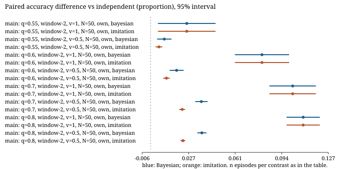
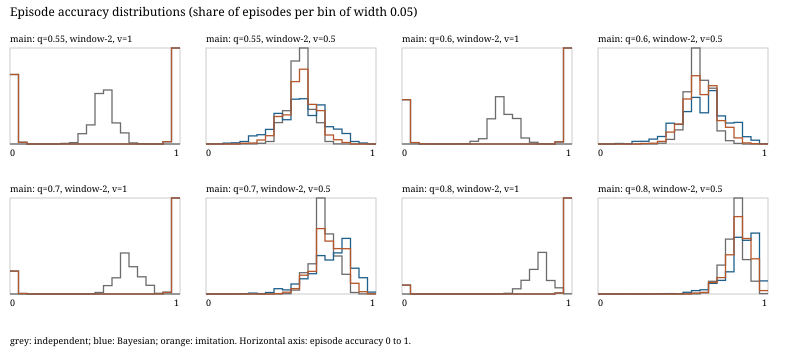

<!-- SPDX-License-Identifier: LicenseRef-HERD-NC-Research-1.0 -->
# EXP-001-R004 (EXPLORATORY): generated run report

**EXPLORATORY RUN. Not evidence for any study hypothesis.** The study protocol is an unfrozen draft; these numbers serve planning and verification only (master prompt section 3).

- Experiment: EXP-001; run: EXP-001-R004; created (UTC): 2026-11-24T16:07:31Z
- Description: Candidate replacement for the degenerate window-1 network: window-2 cells at N=50, seeds 100-109 (exploratory, supports a proposed amendment)
- Config SHA-256: `7e64cd6f93ffe4db44f8d8f1daffa7148f9909db69687833ac185a4234d104e6`
- Seeds: [100, 101, 102, 103, 104, 105, 106, 107, 108, 109]; episodes per seed and cell: 200
- Result schema: 1.0.0
- Code revision: `f15c0c24f83fa84cf7707602660509573ba30b2b` (dirty: False)
- Platform: Apple M1 Pro, Darwin 24.3.0; Python 3.12.1, numpy 2.3.4
- Wall-clock runtime: 3.26 s; peak resident memory: 108593152 bytes
- Simulation time: 2.17 s for 2400000 agent decisions (0.905 ms per 1,000 decisions); analysis time 0.81 s

## Verification checks

17 checks, 17 passed, 0 failed.

- C3: independent baseline: agent accuracy q, no cascades
- C5: result validates against result-v1 schema
- C6: no near ties in Bayesian comparisons

| Check | Cell | Rule | Result | Observed | Expected |
|------|----------------------------------------|------------------|-------|----------|----------|
| C3 | main: q=0.55, window-2, v=1, N=50, own | independent | pass | 0.5520 | 0.5500 |
| C6 | main: q=0.55, window-2, v=1, N=50, own | bayesian | pass | 0 | 0 |
| C3 | main: q=0.55, window-2, v=0.5, N=50, own | independent | pass | 0.5508 | 0.5500 |
| C6 | main: q=0.55, window-2, v=0.5, N=50, own | bayesian | pass | 0 | 0 |
| C3 | main: q=0.6, window-2, v=1, N=50, own | independent | pass | 0.5989 | 0.6000 |
| C6 | main: q=0.6, window-2, v=1, N=50, own | bayesian | pass | 0 | 0 |
| C3 | main: q=0.6, window-2, v=0.5, N=50, own | independent | pass | 0.5993 | 0.6000 |
| C6 | main: q=0.6, window-2, v=0.5, N=50, own | bayesian | pass | 0 | 0 |
| C3 | main: q=0.7, window-2, v=1, N=50, own | independent | pass | 0.6997 | 0.7000 |
| C6 | main: q=0.7, window-2, v=1, N=50, own | bayesian | pass | 0 | 0 |
| C3 | main: q=0.7, window-2, v=0.5, N=50, own | independent | pass | 0.6990 | 0.7000 |
| C6 | main: q=0.7, window-2, v=0.5, N=50, own | bayesian | pass | 0 | 0 |
| C3 | main: q=0.8, window-2, v=1, N=50, own | independent | pass | 0.8007 | 0.8000 |
| C6 | main: q=0.8, window-2, v=1, N=50, own | bayesian | pass | 0 | 0 |
| C3 | main: q=0.8, window-2, v=0.5, N=50, own | independent | pass | 0.8017 | 0.8000 |
| C6 | main: q=0.8, window-2, v=0.5, N=50, own | bayesian | pass | 0 | 0 |
| C5 | all |  | pass | valid | valid |

## Failed cells

None.

## Paired accuracy differences against the independent baseline

Mean paired difference in episode accuracy (proportion of agents correct), normal-approximation 95% interval at the episode level, Holm adjustment within each variation. `seed SD` is the standard deviation of the per-seed mean differences; `hw@10k` is the 95% half-width that the observed paired SD implies at 10,000 episodes.

| Cell | Rule | n | Delta | CI low | CI high | paired SD | seed SD | p (Holm) | hw@10k |
|----------------------------------|---------|------|--------|--------|--------|--------|--------|--------|--------|
| main: q=0.55, window-2, v=1, N=50, own | bayesian | 2000 | 0.0259 | 0.0053 | 0.0465 | 0.4704 | 0.0286 | 0.0278 | 0.0092 |
| main: q=0.55, window-2, v=1, N=50, own | imitation | 2000 | 0.0259 | 0.0053 | 0.0465 | 0.4704 | 0.0286 | 0.0278 | 0.0092 |
| main: q=0.55, window-2, v=0.5, N=50, own | bayesian | 2000 | 0.0098 | 0.0047 | 0.0150 | 0.1173 | 0.0082 | 0.0006 | 0.0023 |
| main: q=0.55, window-2, v=0.5, N=50, own | imitation | 2000 | 0.0060 | 0.0036 | 0.0084 | 0.0553 | 0.0051 | 0.0000 | 0.0011 |
| main: q=0.6, window-2, v=1, N=50, own | bayesian | 2000 | 0.0798 | 0.0604 | 0.0992 | 0.4425 | 0.0256 | 0.0000 | 0.0087 |
| main: q=0.6, window-2, v=1, N=50, own | imitation | 2000 | 0.0798 | 0.0604 | 0.0992 | 0.4425 | 0.0256 | 0.0000 | 0.0087 |
| main: q=0.6, window-2, v=0.5, N=50, own | bayesian | 2000 | 0.0186 | 0.0136 | 0.0237 | 0.1144 | 0.0085 | 0.0000 | 0.0022 |
| main: q=0.6, window-2, v=0.5, N=50, own | imitation | 2000 | 0.0114 | 0.0090 | 0.0138 | 0.0541 | 0.0041 | 0.0000 | 0.0011 |
| main: q=0.7, window-2, v=1, N=50, own | bayesian | 2000 | 0.1017 | 0.0851 | 0.1184 | 0.3795 | 0.0302 | 0.0000 | 0.0074 |
| main: q=0.7, window-2, v=1, N=50, own | imitation | 2000 | 0.1017 | 0.0851 | 0.1184 | 0.3795 | 0.0302 | 0.0000 | 0.0074 |
| main: q=0.7, window-2, v=0.5, N=50, own | bayesian | 2000 | 0.0364 | 0.0320 | 0.0408 | 0.1006 | 0.0073 | 0.0000 | 0.0020 |
| main: q=0.7, window-2, v=0.5, N=50, own | imitation | 2000 | 0.0226 | 0.0205 | 0.0247 | 0.0478 | 0.0031 | 0.0000 | 0.0009 |
| main: q=0.8, window-2, v=1, N=50, own | bayesian | 2000 | 0.1093 | 0.0974 | 0.1212 | 0.2714 | 0.0111 | 0.0000 | 0.0053 |
| main: q=0.8, window-2, v=1, N=50, own | imitation | 2000 | 0.1093 | 0.0974 | 0.1212 | 0.2714 | 0.0111 | 0.0000 | 0.0053 |
| main: q=0.8, window-2, v=0.5, N=50, own | bayesian | 2000 | 0.0367 | 0.0335 | 0.0399 | 0.0738 | 0.0049 | 0.0000 | 0.0014 |
| main: q=0.8, window-2, v=0.5, N=50, own | imitation | 2000 | 0.0231 | 0.0215 | 0.0248 | 0.0382 | 0.0028 | 0.0000 | 0.0007 |

*Figure: paired accuracy difference (proportion) against the independent baseline, points are means and bars 95% normal intervals over episodes; the dashed line marks zero. Source: EXP-001-R004/result.json.*

## Arms

Means over episodes with 95% intervals in the CSV table `tables/arms.csv`.

| Cell | Rule | n | Accuracy | Cascade | Wrong cascade | Longest wrong run | Informative | Last agent |
|----------------------------------|----------|------|--------|--------|--------|--------|--------|--------|
| main: q=0.55, window-2, v=1, N=50, own | independent | 2000 | 0.552 | 0.000 | 0.000 | 4.386 | 1.000 | 0.557 |
| main: q=0.55, window-2, v=1, N=50, own | bayesian | 2000 | 0.578 | 1.000 | 0.420 | 20.907 | 0.059 | 0.580 |
| main: q=0.55, window-2, v=1, N=50, own | imitation | 2000 | 0.578 | 1.000 | 0.420 | 20.907 | 0.059 | 0.580 |
| main: q=0.55, window-2, v=0.5, N=50, own | independent | 2000 | 0.551 | 0.000 | 0.000 | 4.329 | 1.000 | 0.534 |
| main: q=0.55, window-2, v=0.5, N=50, own | bayesian | 2000 | 0.561 | 0.999 | 0.838 | 8.319 | 0.692 | 0.552 |
| main: q=0.55, window-2, v=0.5, N=50, own | imitation | 2000 | 0.557 | 0.996 | 0.842 | 5.925 | 0.839 | 0.539 |
| main: q=0.6, window-2, v=1, N=50, own | independent | 2000 | 0.599 | 0.000 | 0.000 | 3.896 | 1.000 | 0.588 |
| main: q=0.6, window-2, v=1, N=50, own | bayesian | 2000 | 0.679 | 1.000 | 0.318 | 15.876 | 0.058 | 0.682 |
| main: q=0.6, window-2, v=1, N=50, own | imitation | 2000 | 0.679 | 1.000 | 0.318 | 15.876 | 0.058 | 0.682 |
| main: q=0.6, window-2, v=0.5, N=50, own | independent | 2000 | 0.599 | 0.000 | 0.000 | 3.919 | 1.000 | 0.610 |
| main: q=0.6, window-2, v=0.5, N=50, own | bayesian | 2000 | 0.618 | 0.999 | 0.758 | 7.181 | 0.692 | 0.631 |
| main: q=0.6, window-2, v=0.5, N=50, own | imitation | 2000 | 0.611 | 0.998 | 0.771 | 5.228 | 0.837 | 0.628 |
| main: q=0.7, window-2, v=1, N=50, own | independent | 2000 | 0.700 | 0.000 | 0.000 | 2.961 | 1.000 | 0.674 |
| main: q=0.7, window-2, v=1, N=50, own | bayesian | 2000 | 0.801 | 1.000 | 0.193 | 9.793 | 0.056 | 0.807 |
| main: q=0.7, window-2, v=1, N=50, own | imitation | 2000 | 0.801 | 1.000 | 0.193 | 9.793 | 0.056 | 0.807 |
| main: q=0.7, window-2, v=0.5, N=50, own | independent | 2000 | 0.699 | 0.000 | 0.000 | 2.967 | 1.000 | 0.704 |
| main: q=0.7, window-2, v=0.5, N=50, own | bayesian | 2000 | 0.735 | 1.000 | 0.538 | 5.025 | 0.680 | 0.741 |
| main: q=0.7, window-2, v=0.5, N=50, own | imitation | 2000 | 0.722 | 1.000 | 0.556 | 3.874 | 0.826 | 0.736 |
| main: q=0.8, window-2, v=1, N=50, own | independent | 2000 | 0.801 | 0.000 | 0.000 | 2.162 | 1.000 | 0.795 |
| main: q=0.8, window-2, v=1, N=50, own | bayesian | 2000 | 0.910 | 1.000 | 0.085 | 4.432 | 0.051 | 0.915 |
| main: q=0.8, window-2, v=1, N=50, own | imitation | 2000 | 0.910 | 1.000 | 0.085 | 4.432 | 0.051 | 0.915 |
| main: q=0.8, window-2, v=0.5, N=50, own | independent | 2000 | 0.802 | 0.000 | 0.000 | 2.155 | 1.000 | 0.793 |
| main: q=0.8, window-2, v=0.5, N=50, own | bayesian | 2000 | 0.838 | 1.000 | 0.298 | 3.135 | 0.671 | 0.841 |
| main: q=0.8, window-2, v=0.5, N=50, own | imitation | 2000 | 0.825 | 0.998 | 0.298 | 2.619 | 0.811 | 0.827 |

*Figure: distribution of episode accuracy, share of episodes per bin of width 0.05; grey independent, blue Bayesian, orange imitation.*

## Metric definitions

- `accuracy`: proportion of agents with a_i = theta (0 to 1)
- `cascade_any`: 1 if at least one agent is in a cascade (0 or 1)
- `wrong_cascade_any`: 1 if at least one agent is in a cascade on the wrong action (0 or 1)
- `longest_wrong_run`: length of the longest run of consecutive incorrect actions (agents)
- `informative_share`: share of agents not in a cascade (0 to 1)
- `action_entropy_bits`: binary entropy of the within-episode action frequency (bits)
- `last_agent_accuracy`: 1 if a_N = theta (0 or 1)
