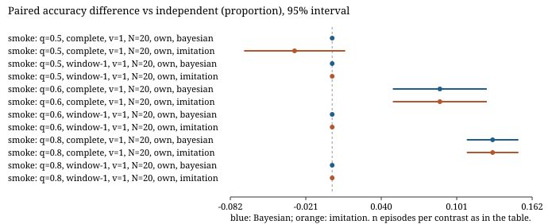
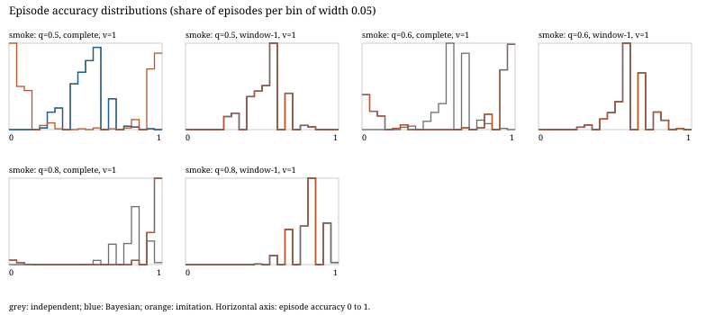

<!-- SPDX-License-Identifier: LicenseRef-HERD-NC-Research-1.0 -->
# EXP-001-R005 (EXPLORATORY): generated run report

**EXPLORATORY RUN. Not evidence for any study hypothesis.** These numbers serve planning and verification only (master prompt section 3).

- Experiment: EXP-001; run: EXP-001-R005; created (UTC): 2026-11-24T23:30:59Z
- Description: M3 pre-confirmatory smoke run: the EXP-001 smoke matrix (study protocol section 7) on exploratory seeds 100-101, disjoint from the confirmatory seeds 0-9 (exploratory; metric and engine validation before EXP-002 and EXP-003)
- Config SHA-256: `0c1bfeb60beb150c2b858a8e74b86d3b4b72f907cd03ace5d140a58259147cbf`
- Seeds: [100, 101]; episodes per seed and cell: 200
- Result schema: 1.0.0
- Code revision: `eded9b82ff9a7b64471ae6e66d127cbc83a9b5e3` (dirty: False)
- Platform: Apple M1 Pro, Darwin 24.3.0; Python 3.12.1, numpy 2.3.4
- Wall-clock runtime: 0.05 s; peak resident memory: 35389440 bytes
- Simulation time: 0.02 s for 144000 agent decisions (0.160 ms per 1,000 decisions); analysis time 0.00 s

## Verification checks

25 checks, 25 passed, 0 failed.

- C1: analytic wrong-cascade anchor (Bayesian, complete, v=1)
- C2: zero information: mean accuracy 1/2
- C3: independent baseline: agent accuracy q, no cascades
- C4: complete network: Bayesian and imitation actions identical
- C5: result validates against result-v1 schema
- C6: no near ties in Bayesian comparisons

| Check | Cell | Rule | Result | Observed | Expected |
|------|----------------------------------------|------------------|-------|----------|----------|
| C2 | smoke: q=0.5, complete, v=1, N=20, own | independent | pass | 0.4939 | 0.5000 |
| C2 | smoke: q=0.5, complete, v=1, N=20, own | bayesian | pass | 0.4939 | 0.5000 |
| C2 | smoke: q=0.5, complete, v=1, N=20, own | imitation | pass | 0.4635 | 0.5000 |
| C2 | smoke: q=0.5, complete, v=1, N=20, own | bayesian | pass | 0.0000 | 0.0000 |
| C3 | smoke: q=0.5, complete, v=1, N=20, own | independent | pass | 0.4939 | 0.5000 |
| C6 | smoke: q=0.5, complete, v=1, N=20, own | bayesian | pass | 0 | 0 |
| C2 | smoke: q=0.5, window-1, v=1, N=20, own | independent | pass | 0.5126 | 0.5000 |
| C2 | smoke: q=0.5, window-1, v=1, N=20, own | bayesian | pass | 0.5126 | 0.5000 |
| C2 | smoke: q=0.5, window-1, v=1, N=20, own | imitation | pass | 0.5126 | 0.5000 |
| C2 | smoke: q=0.5, window-1, v=1, N=20, own | bayesian | pass | 0.0000 | 0.0000 |
| C3 | smoke: q=0.5, window-1, v=1, N=20, own | independent | pass | 0.5126 | 0.5000 |
| C6 | smoke: q=0.5, window-1, v=1, N=20, own | bayesian | pass | 0 | 0 |
| C1 | smoke: q=0.6, complete, v=1, N=20, own | bayesian | pass | 0.3075 | 0.3073 |
| C3 | smoke: q=0.6, complete, v=1, N=20, own | independent | pass | 0.5915 | 0.6000 |
| C4 | smoke: q=0.6, complete, v=1, N=20, own | bayesian,imitation | pass | 0 | 0 |
| C6 | smoke: q=0.6, complete, v=1, N=20, own | bayesian | pass | 0 | 0 |
| C3 | smoke: q=0.6, window-1, v=1, N=20, own | independent | pass | 0.5891 | 0.6000 |
| C6 | smoke: q=0.6, window-1, v=1, N=20, own | bayesian | pass | 0 | 0 |
| C1 | smoke: q=0.8, complete, v=1, N=20, own | bayesian | pass | 0.0525 | 0.0588 |
| C3 | smoke: q=0.8, complete, v=1, N=20, own | independent | pass | 0.7994 | 0.8000 |
| C4 | smoke: q=0.8, complete, v=1, N=20, own | bayesian,imitation | pass | 0 | 0 |
| C6 | smoke: q=0.8, complete, v=1, N=20, own | bayesian | pass | 0 | 0 |
| C3 | smoke: q=0.8, window-1, v=1, N=20, own | independent | pass | 0.7963 | 0.8000 |
| C6 | smoke: q=0.8, window-1, v=1, N=20, own | bayesian | pass | 0 | 0 |
| C5 | all |  | pass | valid | valid |

## Failed cells

None.

## Paired accuracy differences against the independent baseline

Mean paired difference in episode accuracy (proportion of agents correct), normal-approximation 95% interval at the episode level, Holm adjustment within each variation over its non-degenerate contrasts; a degenerate contrast (zero paired variance) is an exact comparison outside the Holm family and shows `n/a` as its Holm p-value. `seed SD` is the standard deviation of the per-seed mean differences; `hw@10k` is the 95% half-width that the observed paired SD implies at 10,000 episodes.

| Cell | Rule | n | Delta | CI low | CI high | paired SD | seed SD | p (Holm) | hw@10k |
|----------------------------------|---------|------|--------|--------|--------|--------|--------|--------|--------|
| smoke: q=0.5, complete, v=1, N=20, own | bayesian | 400 | 0.0000 | 0.0000 | 0.0000 | 0.0000 | 0.0000 | n/a | 0.0000 |
| smoke: q=0.5, complete, v=1, N=20, own | imitation | 400 | -0.0304 | -0.0712 | 0.0105 | 0.4168 | 0.0147 | 0.1458 | 0.0082 |
| smoke: q=0.5, window-1, v=1, N=20, own | bayesian | 400 | 0.0000 | 0.0000 | 0.0000 | 0.0000 | 0.0000 | n/a | 0.0000 |
| smoke: q=0.5, window-1, v=1, N=20, own | imitation | 400 | 0.0000 | 0.0000 | 0.0000 | 0.0000 | 0.0000 | n/a | 0.0000 |
| smoke: q=0.6, complete, v=1, N=20, own | bayesian | 400 | 0.0870 | 0.0490 | 0.1250 | 0.3874 | 0.0576 | 0.0000 | 0.0076 |
| smoke: q=0.6, complete, v=1, N=20, own | imitation | 400 | 0.0870 | 0.0490 | 0.1250 | 0.3874 | 0.0576 | 0.0000 | 0.0076 |
| smoke: q=0.6, window-1, v=1, N=20, own | bayesian | 400 | 0.0000 | 0.0000 | 0.0000 | 0.0000 | 0.0000 | n/a | 0.0000 |
| smoke: q=0.6, window-1, v=1, N=20, own | imitation | 400 | 0.0000 | 0.0000 | 0.0000 | 0.0000 | 0.0000 | n/a | 0.0000 |
| smoke: q=0.8, complete, v=1, N=20, own | bayesian | 400 | 0.1296 | 0.1087 | 0.1505 | 0.2131 | 0.0055 | 0.0000 | 0.0042 |
| smoke: q=0.8, complete, v=1, N=20, own | imitation | 400 | 0.1296 | 0.1087 | 0.1505 | 0.2131 | 0.0055 | 0.0000 | 0.0042 |
| smoke: q=0.8, window-1, v=1, N=20, own | bayesian | 400 | 0.0000 | 0.0000 | 0.0000 | 0.0000 | 0.0000 | n/a | 0.0000 |
| smoke: q=0.8, window-1, v=1, N=20, own | imitation | 400 | 0.0000 | 0.0000 | 0.0000 | 0.0000 | 0.0000 | n/a | 0.0000 |

*Figure: paired accuracy difference (proportion) against the independent baseline, points are means and bars 95% normal intervals over episodes; the dashed line marks zero. Source: EXP-001-R005/result.json.*

## Arms

Means over episodes with 95% intervals in the CSV table `tables/arms.csv`.

| Cell | Rule | n | Accuracy | Cascade | Wrong cascade | Longest wrong run | Informative | Last agent |
|----------------------------------|----------|------|--------|--------|--------|--------|--------|--------|
| smoke: q=0.5, complete, v=1, N=20, own | independent | 400 | 0.494 | 0.000 | 0.000 | 3.690 | 1.000 | 0.470 |
| smoke: q=0.5, complete, v=1, N=20, own | bayesian | 400 | 0.494 | 0.000 | 0.000 | 3.690 | 1.000 | 0.470 |
| smoke: q=0.5, complete, v=1, N=20, own | imitation | 400 | 0.463 | 0.993 | 0.542 | 10.082 | 0.205 | 0.455 |
| smoke: q=0.5, window-1, v=1, N=20, own | independent | 400 | 0.513 | 0.000 | 0.000 | 3.632 | 1.000 | 0.510 |
| smoke: q=0.5, window-1, v=1, N=20, own | bayesian | 400 | 0.513 | 0.000 | 0.000 | 3.632 | 1.000 | 0.510 |
| smoke: q=0.5, window-1, v=1, N=20, own | imitation | 400 | 0.513 | 0.000 | 0.000 | 3.632 | 1.000 | 0.510 |
| smoke: q=0.6, complete, v=1, N=20, own | independent | 400 | 0.592 | 0.000 | 0.000 | 2.928 | 1.000 | 0.583 |
| smoke: q=0.6, complete, v=1, N=20, own | bayesian | 400 | 0.678 | 1.000 | 0.307 | 5.933 | 0.197 | 0.693 |
| smoke: q=0.6, complete, v=1, N=20, own | imitation | 400 | 0.678 | 1.000 | 0.307 | 5.933 | 0.197 | 0.693 |
| smoke: q=0.6, window-1, v=1, N=20, own | independent | 400 | 0.589 | 0.000 | 0.000 | 2.993 | 1.000 | 0.517 |
| smoke: q=0.6, window-1, v=1, N=20, own | bayesian | 400 | 0.589 | 0.000 | 0.000 | 2.993 | 1.000 | 0.517 |
| smoke: q=0.6, window-1, v=1, N=20, own | imitation | 400 | 0.589 | 0.000 | 0.000 | 2.993 | 1.000 | 0.517 |
| smoke: q=0.8, complete, v=1, N=20, own | independent | 400 | 0.799 | 0.000 | 0.000 | 1.595 | 1.000 | 0.792 |
| smoke: q=0.8, complete, v=1, N=20, own | bayesian | 400 | 0.929 | 1.000 | 0.052 | 1.327 | 0.141 | 0.948 |
| smoke: q=0.8, complete, v=1, N=20, own | imitation | 400 | 0.929 | 1.000 | 0.052 | 1.327 | 0.141 | 0.948 |
| smoke: q=0.8, window-1, v=1, N=20, own | independent | 400 | 0.796 | 0.000 | 0.000 | 1.635 | 1.000 | 0.802 |
| smoke: q=0.8, window-1, v=1, N=20, own | bayesian | 400 | 0.796 | 0.000 | 0.000 | 1.635 | 1.000 | 0.802 |
| smoke: q=0.8, window-1, v=1, N=20, own | imitation | 400 | 0.796 | 0.000 | 0.000 | 1.635 | 1.000 | 0.802 |

*Figure: distribution of episode accuracy, share of episodes per bin of width 0.05; grey independent, blue Bayesian, orange imitation.*

## Metric definitions

- `accuracy`: proportion of agents with a_i = theta (0 to 1)
- `cascade_any`: 1 if at least one agent is in a cascade (0 or 1)
- `wrong_cascade_any`: 1 if at least one agent is in a cascade on the wrong action (0 or 1)
- `longest_wrong_run`: length of the longest run of consecutive incorrect actions (agents)
- `informative_share`: share of agents not in a cascade (0 to 1)
- `action_entropy_bits`: binary entropy of the within-episode action frequency (bits)
- `last_agent_accuracy`: 1 if a_N = theta (0 or 1)
