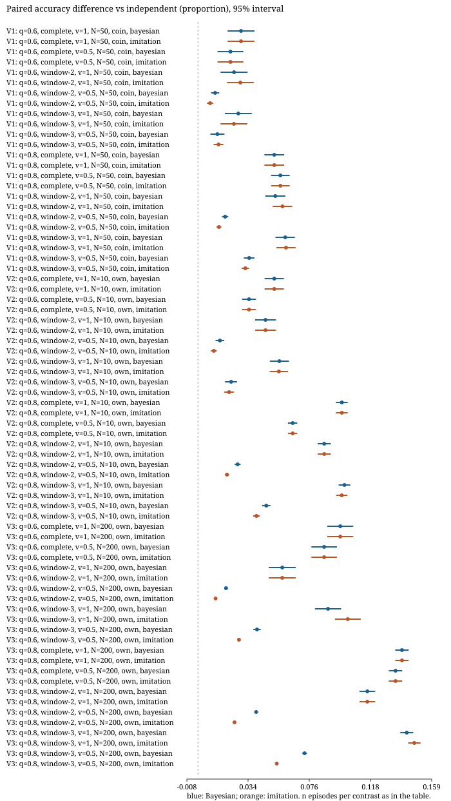
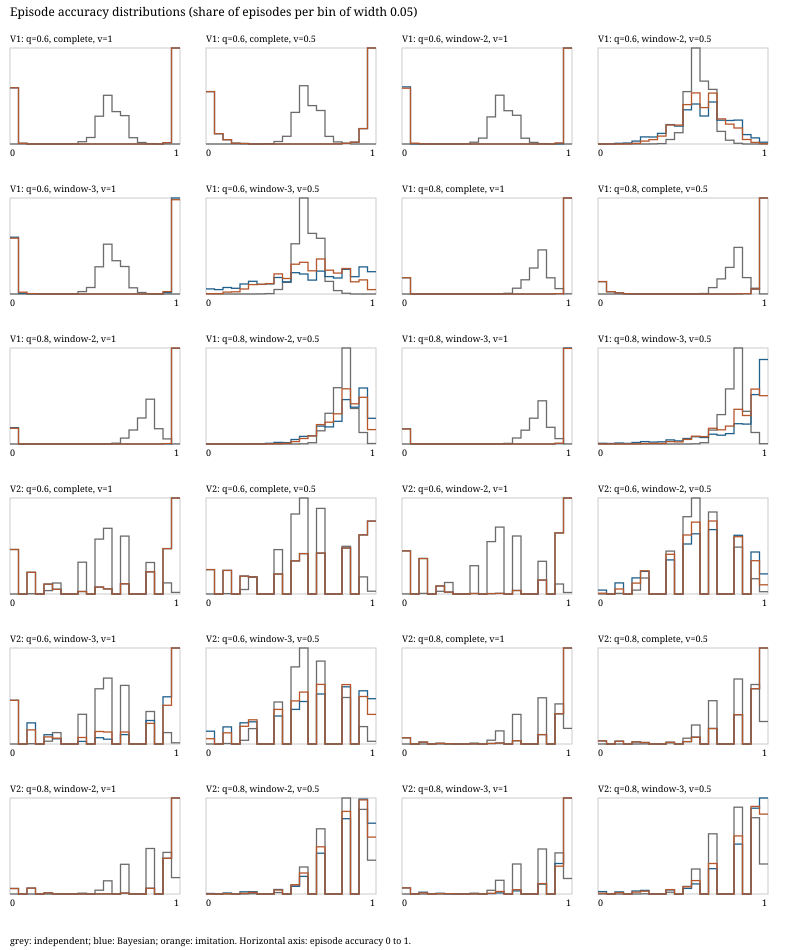

<!-- SPDX-License-Identifier: LicenseRef-HERD-NC-Research-1.0 -->
# EXP-004-R001 (EXPLORATORY): generated run report

**EXPLORATORY RUN. Not evidence for any study hypothesis.** These numbers serve planning and verification only (master prompt section 3).

- Experiment: EXP-004; run: EXP-004-R001; created (UTC): 2026-11-25T01:20:06Z
- Description: EXPLORATORY, post hoc (M4, 2026-11-25): the EXP-003 sensitivity design (V1 coin ties N=50, V2 N=10, V3 N=200) on the complementary q values 0.60 and 0.80 not covered by EXP-003, seeds 0-9 so that episode draws match EXP-002; never evidence for a frozen hypothesis
- Config SHA-256: `9269dee899844d0595693bf088efcdb7ddd179de3f3cbd202e905a585dcf0e66`
- Seeds: [0, 1, 2, 3, 4, 5, 6, 7, 8, 9]; episodes per seed and cell: 1000
- Result schema: 1.0.0
- Code revision: `3831429e2589fbeec183b04e367f39bb78e98d2a` (dirty: False)
- Platform: Apple M1 Pro, Darwin 24.3.0; Python 3.12.1, numpy 2.3.4
- Wall-clock runtime: 20.50 s; peak resident memory: 305086464 bytes
- Simulation time: 13.61 s for 93600000 agent decisions (0.145 ms per 1,000 decisions); analysis time 5.21 s

## Verification checks

89 checks, 89 passed, 0 failed.

- C1: analytic wrong-cascade anchor (Bayesian, complete, v=1)
- C3: independent baseline: agent accuracy q, no cascades
- C4: complete network: Bayesian and imitation actions identical
- C5: result validates against result-v1 schema
- C6: no near ties in Bayesian comparisons
- C7: complete network, coin ties: Bayesian vs imitation divergence (diagnostic, no prediction)

| Check | Cell | Rule | Result | Observed | Expected |
|------|----------------------------------------|------------------|-------|----------|----------|
| C3 | V1: q=0.6, complete, v=1, N=50, coin | independent | pass | 0.5996 | 0.6000 |
| C7 | V1: q=0.6, complete, v=1, N=50, coin | bayesian,imitation | pass | 0 | n/a |
| C6 | V1: q=0.6, complete, v=1, N=50, coin | bayesian | pass | 0 | 0 |
| C3 | V1: q=0.6, complete, v=0.5, N=50, coin | independent | pass | 0.6007 | 0.6000 |
| C7 | V1: q=0.6, complete, v=0.5, N=50, coin | bayesian,imitation | pass | 0 | n/a |
| C6 | V1: q=0.6, complete, v=0.5, N=50, coin | bayesian | pass | 0 | 0 |
| C3 | V1: q=0.6, window-2, v=1, N=50, coin | independent | pass | 0.6009 | 0.6000 |
| C6 | V1: q=0.6, window-2, v=1, N=50, coin | bayesian | pass | 0 | 0 |
| C3 | V1: q=0.6, window-2, v=0.5, N=50, coin | independent | pass | 0.6012 | 0.6000 |
| C6 | V1: q=0.6, window-2, v=0.5, N=50, coin | bayesian | pass | 0 | 0 |
| C3 | V1: q=0.6, window-3, v=1, N=50, coin | independent | pass | 0.5995 | 0.6000 |
| C6 | V1: q=0.6, window-3, v=1, N=50, coin | bayesian | pass | 0 | 0 |
| C3 | V1: q=0.6, window-3, v=0.5, N=50, coin | independent | pass | 0.6009 | 0.6000 |
| C6 | V1: q=0.6, window-3, v=0.5, N=50, coin | bayesian | pass | 0 | 0 |
| C3 | V1: q=0.8, complete, v=1, N=50, coin | independent | pass | 0.8004 | 0.8000 |
| C7 | V1: q=0.8, complete, v=1, N=50, coin | bayesian,imitation | pass | 0 | n/a |
| C6 | V1: q=0.8, complete, v=1, N=50, coin | bayesian | pass | 0 | 0 |
| C3 | V1: q=0.8, complete, v=0.5, N=50, coin | independent | pass | 0.8005 | 0.8000 |
| C7 | V1: q=0.8, complete, v=0.5, N=50, coin | bayesian,imitation | pass | 0 | n/a |
| C6 | V1: q=0.8, complete, v=0.5, N=50, coin | bayesian | pass | 0 | 0 |
| C3 | V1: q=0.8, window-2, v=1, N=50, coin | independent | pass | 0.7994 | 0.8000 |
| C6 | V1: q=0.8, window-2, v=1, N=50, coin | bayesian | pass | 0 | 0 |
| C3 | V1: q=0.8, window-2, v=0.5, N=50, coin | independent | pass | 0.8005 | 0.8000 |
| C6 | V1: q=0.8, window-2, v=0.5, N=50, coin | bayesian | pass | 0 | 0 |
| C3 | V1: q=0.8, window-3, v=1, N=50, coin | independent | pass | 0.8008 | 0.8000 |
| C6 | V1: q=0.8, window-3, v=1, N=50, coin | bayesian | pass | 0 | 0 |
| C3 | V1: q=0.8, window-3, v=0.5, N=50, coin | independent | pass | 0.7996 | 0.8000 |
| C6 | V1: q=0.8, window-3, v=0.5, N=50, coin | bayesian | pass | 0 | 0 |
| C1 | V2: q=0.6, complete, v=1, N=10, own | bayesian | pass | 0.2999 | 0.2914 |
| C3 | V2: q=0.6, complete, v=1, N=10, own | independent | pass | 0.5978 | 0.6000 |
| C4 | V2: q=0.6, complete, v=1, N=10, own | bayesian,imitation | pass | 0 | 0 |
| C6 | V2: q=0.6, complete, v=1, N=10, own | bayesian | pass | 0 | 0 |
| C3 | V2: q=0.6, complete, v=0.5, N=10, own | independent | pass | 0.6010 | 0.6000 |
| C4 | V2: q=0.6, complete, v=0.5, N=10, own | bayesian,imitation | pass | 0 | 0 |
| C6 | V2: q=0.6, complete, v=0.5, N=10, own | bayesian | pass | 0 | 0 |
| C3 | V2: q=0.6, window-2, v=1, N=10, own | independent | pass | 0.6007 | 0.6000 |
| C6 | V2: q=0.6, window-2, v=1, N=10, own | bayesian | pass | 0 | 0 |
| C3 | V2: q=0.6, window-2, v=0.5, N=10, own | independent | pass | 0.6004 | 0.6000 |
| C6 | V2: q=0.6, window-2, v=0.5, N=10, own | bayesian | pass | 0 | 0 |
| C3 | V2: q=0.6, window-3, v=1, N=10, own | independent | pass | 0.6003 | 0.6000 |
| C6 | V2: q=0.6, window-3, v=1, N=10, own | bayesian | pass | 0 | 0 |
| C3 | V2: q=0.6, window-3, v=0.5, N=10, own | independent | pass | 0.6037 | 0.6000 |
| C6 | V2: q=0.6, window-3, v=0.5, N=10, own | bayesian | pass | 0 | 0 |
| C1 | V2: q=0.8, complete, v=1, N=10, own | bayesian | pass | 0.0605 | 0.0582 |
| C3 | V2: q=0.8, complete, v=1, N=10, own | independent | pass | 0.8002 | 0.8000 |
| C4 | V2: q=0.8, complete, v=1, N=10, own | bayesian,imitation | pass | 0 | 0 |
| C6 | V2: q=0.8, complete, v=1, N=10, own | bayesian | pass | 0 | 0 |
| C3 | V2: q=0.8, complete, v=0.5, N=10, own | independent | pass | 0.8002 | 0.8000 |
| C4 | V2: q=0.8, complete, v=0.5, N=10, own | bayesian,imitation | pass | 0 | 0 |
| C6 | V2: q=0.8, complete, v=0.5, N=10, own | bayesian | pass | 0 | 0 |
| C3 | V2: q=0.8, window-2, v=1, N=10, own | independent | pass | 0.8023 | 0.8000 |
| C6 | V2: q=0.8, window-2, v=1, N=10, own | bayesian | pass | 0 | 0 |
| C3 | V2: q=0.8, window-2, v=0.5, N=10, own | independent | pass | 0.7995 | 0.8000 |
| C6 | V2: q=0.8, window-2, v=0.5, N=10, own | bayesian | pass | 0 | 0 |
| C3 | V2: q=0.8, window-3, v=1, N=10, own | independent | pass | 0.8000 | 0.8000 |
| C6 | V2: q=0.8, window-3, v=1, N=10, own | bayesian | pass | 0 | 0 |
| C3 | V2: q=0.8, window-3, v=0.5, N=10, own | independent | pass | 0.7984 | 0.8000 |
| C6 | V2: q=0.8, window-3, v=0.5, N=10, own | bayesian | pass | 0 | 0 |
| C1 | V3: q=0.6, complete, v=1, N=200, own | bayesian | pass | 0.3010 | 0.3077 |
| C3 | V3: q=0.6, complete, v=1, N=200, own | independent | pass | 0.6001 | 0.6000 |
| C4 | V3: q=0.6, complete, v=1, N=200, own | bayesian,imitation | pass | 0 | 0 |
| C6 | V3: q=0.6, complete, v=1, N=200, own | bayesian | pass | 0 | 0 |
| C3 | V3: q=0.6, complete, v=0.5, N=200, own | independent | pass | 0.5998 | 0.6000 |
| C4 | V3: q=0.6, complete, v=0.5, N=200, own | bayesian,imitation | pass | 0 | 0 |
| C6 | V3: q=0.6, complete, v=0.5, N=200, own | bayesian | pass | 0 | 0 |
| C3 | V3: q=0.6, window-2, v=1, N=200, own | independent | pass | 0.5999 | 0.6000 |
| C6 | V3: q=0.6, window-2, v=1, N=200, own | bayesian | pass | 0 | 0 |
| C3 | V3: q=0.6, window-2, v=0.5, N=200, own | independent | pass | 0.6001 | 0.6000 |
| C6 | V3: q=0.6, window-2, v=0.5, N=200, own | bayesian | pass | 0 | 0 |
| C3 | V3: q=0.6, window-3, v=1, N=200, own | independent | pass | 0.5994 | 0.6000 |
| C6 | V3: q=0.6, window-3, v=1, N=200, own | bayesian | pass | 0 | 0 |
| C3 | V3: q=0.6, window-3, v=0.5, N=200, own | independent | pass | 0.6000 | 0.6000 |
| C6 | V3: q=0.6, window-3, v=0.5, N=200, own | bayesian | pass | 0 | 0 |
| C1 | V3: q=0.8, complete, v=1, N=200, own | bayesian | pass | 0.0589 | 0.0588 |
| C3 | V3: q=0.8, complete, v=1, N=200, own | independent | pass | 0.7999 | 0.8000 |
| C4 | V3: q=0.8, complete, v=1, N=200, own | bayesian,imitation | pass | 0 | 0 |
| C6 | V3: q=0.8, complete, v=1, N=200, own | bayesian | pass | 0 | 0 |
| C3 | V3: q=0.8, complete, v=0.5, N=200, own | independent | pass | 0.8000 | 0.8000 |
| C4 | V3: q=0.8, complete, v=0.5, N=200, own | bayesian,imitation | pass | 0 | 0 |
| C6 | V3: q=0.8, complete, v=0.5, N=200, own | bayesian | pass | 0 | 0 |
| C3 | V3: q=0.8, window-2, v=1, N=200, own | independent | pass | 0.8004 | 0.8000 |
| C6 | V3: q=0.8, window-2, v=1, N=200, own | bayesian | pass | 0 | 0 |
| C3 | V3: q=0.8, window-2, v=0.5, N=200, own | independent | pass | 0.7999 | 0.8000 |
| C6 | V3: q=0.8, window-2, v=0.5, N=200, own | bayesian | pass | 0 | 0 |
| C3 | V3: q=0.8, window-3, v=1, N=200, own | independent | pass | 0.8005 | 0.8000 |
| C6 | V3: q=0.8, window-3, v=1, N=200, own | bayesian | pass | 0 | 0 |
| C3 | V3: q=0.8, window-3, v=0.5, N=200, own | independent | pass | 0.8001 | 0.8000 |
| C6 | V3: q=0.8, window-3, v=0.5, N=200, own | bayesian | pass | 0 | 0 |
| C5 | all |  | pass | valid | valid |

## Failed cells

None.

## Paired accuracy differences against the independent baseline

Mean paired difference in episode accuracy (proportion of agents correct), normal-approximation 95% interval at the episode level, Holm adjustment within each variation over its non-degenerate contrasts; a degenerate contrast (zero paired variance) is an exact comparison outside the Holm family and shows `n/a` as its Holm p-value. `seed SD` is the standard deviation of the per-seed mean differences; `hw@10k` is the 95% half-width that the observed paired SD implies at 10,000 episodes.

| Cell | Rule | n | Delta | CI low | CI high | paired SD | seed SD | p (Holm) | hw@10k |
|----------------------------------|---------|------|--------|--------|--------|--------|--------|--------|--------|
| V1: q=0.6, complete, v=1, N=50, coin | bayesian | 10000 | 0.0294 | 0.0202 | 0.0386 | 0.4687 | 0.0160 | 0.0000 | 0.0092 |
| V1: q=0.6, complete, v=1, N=50, coin | imitation | 10000 | 0.0294 | 0.0202 | 0.0386 | 0.4687 | 0.0160 | 0.0000 | 0.0092 |
| V1: q=0.6, complete, v=0.5, N=50, coin | bayesian | 10000 | 0.0222 | 0.0133 | 0.0310 | 0.4496 | 0.0125 | 0.0000 | 0.0088 |
| V1: q=0.6, complete, v=0.5, N=50, coin | imitation | 10000 | 0.0222 | 0.0133 | 0.0310 | 0.4496 | 0.0125 | 0.0000 | 0.0088 |
| V1: q=0.6, window-2, v=1, N=50, coin | bayesian | 10000 | 0.0246 | 0.0154 | 0.0338 | 0.4711 | 0.0191 | 0.0000 | 0.0092 |
| V1: q=0.6, window-2, v=1, N=50, coin | imitation | 10000 | 0.0289 | 0.0197 | 0.0381 | 0.4688 | 0.0199 | 0.0000 | 0.0092 |
| V1: q=0.6, window-2, v=0.5, N=50, coin | bayesian | 10000 | 0.0117 | 0.0089 | 0.0145 | 0.1422 | 0.0057 | 0.0000 | 0.0028 |
| V1: q=0.6, window-2, v=0.5, N=50, coin | imitation | 10000 | 0.0083 | 0.0062 | 0.0104 | 0.1061 | 0.0047 | 0.0000 | 0.0021 |
| V1: q=0.6, window-3, v=1, N=50, coin | bayesian | 10000 | 0.0275 | 0.0183 | 0.0367 | 0.4682 | 0.0204 | 0.0000 | 0.0092 |
| V1: q=0.6, window-3, v=1, N=50, coin | imitation | 10000 | 0.0245 | 0.0154 | 0.0337 | 0.4680 | 0.0189 | 0.0000 | 0.0092 |
| V1: q=0.6, window-3, v=0.5, N=50, coin | bayesian | 10000 | 0.0133 | 0.0085 | 0.0180 | 0.2439 | 0.0082 | 0.0000 | 0.0048 |
| V1: q=0.6, window-3, v=0.5, N=50, coin | imitation | 10000 | 0.0140 | 0.0106 | 0.0173 | 0.1700 | 0.0075 | 0.0000 | 0.0033 |
| V1: q=0.8, complete, v=1, N=50, coin | bayesian | 10000 | 0.0520 | 0.0453 | 0.0588 | 0.3446 | 0.0080 | 0.0000 | 0.0068 |
| V1: q=0.8, complete, v=1, N=50, coin | imitation | 10000 | 0.0520 | 0.0453 | 0.0588 | 0.3446 | 0.0080 | 0.0000 | 0.0068 |
| V1: q=0.8, complete, v=0.5, N=50, coin | bayesian | 10000 | 0.0562 | 0.0498 | 0.0626 | 0.3250 | 0.0124 | 0.0000 | 0.0064 |
| V1: q=0.8, complete, v=0.5, N=50, coin | imitation | 10000 | 0.0562 | 0.0498 | 0.0626 | 0.3250 | 0.0124 | 0.0000 | 0.0064 |
| V1: q=0.8, window-2, v=1, N=50, coin | bayesian | 10000 | 0.0528 | 0.0460 | 0.0595 | 0.3459 | 0.0063 | 0.0000 | 0.0068 |
| V1: q=0.8, window-2, v=1, N=50, coin | imitation | 10000 | 0.0576 | 0.0509 | 0.0643 | 0.3409 | 0.0070 | 0.0000 | 0.0067 |
| V1: q=0.8, window-2, v=0.5, N=50, coin | bayesian | 10000 | 0.0185 | 0.0164 | 0.0206 | 0.1084 | 0.0018 | 0.0000 | 0.0021 |
| V1: q=0.8, window-2, v=0.5, N=50, coin | imitation | 10000 | 0.0143 | 0.0127 | 0.0159 | 0.0827 | 0.0017 | 0.0000 | 0.0016 |
| V1: q=0.8, window-3, v=1, N=50, coin | bayesian | 10000 | 0.0595 | 0.0529 | 0.0661 | 0.3375 | 0.0133 | 0.0000 | 0.0066 |
| V1: q=0.8, window-3, v=1, N=50, coin | imitation | 10000 | 0.0600 | 0.0534 | 0.0666 | 0.3365 | 0.0120 | 0.0000 | 0.0066 |
| V1: q=0.8, window-3, v=0.5, N=50, coin | bayesian | 10000 | 0.0349 | 0.0313 | 0.0385 | 0.1838 | 0.0074 | 0.0000 | 0.0036 |
| V1: q=0.8, window-3, v=0.5, N=50, coin | imitation | 10000 | 0.0323 | 0.0298 | 0.0348 | 0.1268 | 0.0052 | 0.0000 | 0.0025 |
| V2: q=0.6, complete, v=1, N=10, own | bayesian | 10000 | 0.0520 | 0.0455 | 0.0586 | 0.3348 | 0.0128 | 0.0000 | 0.0066 |
| V2: q=0.6, complete, v=1, N=10, own | imitation | 10000 | 0.0520 | 0.0455 | 0.0586 | 0.3348 | 0.0128 | 0.0000 | 0.0066 |
| V2: q=0.6, complete, v=0.5, N=10, own | bayesian | 10000 | 0.0348 | 0.0301 | 0.0396 | 0.2424 | 0.0063 | 0.0000 | 0.0048 |
| V2: q=0.6, complete, v=0.5, N=10, own | imitation | 10000 | 0.0348 | 0.0301 | 0.0396 | 0.2424 | 0.0063 | 0.0000 | 0.0048 |
| V2: q=0.6, window-2, v=1, N=10, own | bayesian | 10000 | 0.0461 | 0.0389 | 0.0532 | 0.3637 | 0.0116 | 0.0000 | 0.0071 |
| V2: q=0.6, window-2, v=1, N=10, own | imitation | 10000 | 0.0461 | 0.0389 | 0.0532 | 0.3637 | 0.0116 | 0.0000 | 0.0071 |
| V2: q=0.6, window-2, v=0.5, N=10, own | bayesian | 10000 | 0.0150 | 0.0120 | 0.0180 | 0.1531 | 0.0048 | 0.0000 | 0.0030 |
| V2: q=0.6, window-2, v=0.5, N=10, own | imitation | 10000 | 0.0108 | 0.0088 | 0.0128 | 0.1022 | 0.0039 | 0.0000 | 0.0020 |
| V2: q=0.6, window-3, v=1, N=10, own | bayesian | 10000 | 0.0555 | 0.0490 | 0.0621 | 0.3330 | 0.0116 | 0.0000 | 0.0065 |
| V2: q=0.6, window-3, v=1, N=10, own | imitation | 10000 | 0.0552 | 0.0489 | 0.0614 | 0.3189 | 0.0108 | 0.0000 | 0.0063 |
| V2: q=0.6, window-3, v=0.5, N=10, own | bayesian | 10000 | 0.0226 | 0.0184 | 0.0267 | 0.2121 | 0.0068 | 0.0000 | 0.0042 |
| V2: q=0.6, window-3, v=0.5, N=10, own | imitation | 10000 | 0.0212 | 0.0179 | 0.0245 | 0.1683 | 0.0056 | 0.0000 | 0.0033 |
| V2: q=0.8, complete, v=1, N=10, own | bayesian | 10000 | 0.0981 | 0.0941 | 0.1022 | 0.2058 | 0.0067 | 0.0000 | 0.0040 |
| V2: q=0.8, complete, v=1, N=10, own | imitation | 10000 | 0.0981 | 0.0941 | 0.1022 | 0.2058 | 0.0067 | 0.0000 | 0.0040 |
| V2: q=0.8, complete, v=0.5, N=10, own | bayesian | 10000 | 0.0645 | 0.0614 | 0.0677 | 0.1629 | 0.0052 | 0.0000 | 0.0032 |
| V2: q=0.8, complete, v=0.5, N=10, own | imitation | 10000 | 0.0645 | 0.0614 | 0.0677 | 0.1629 | 0.0052 | 0.0000 | 0.0032 |
| V2: q=0.8, window-2, v=1, N=10, own | bayesian | 10000 | 0.0861 | 0.0816 | 0.0906 | 0.2288 | 0.0091 | 0.0000 | 0.0045 |
| V2: q=0.8, window-2, v=1, N=10, own | imitation | 10000 | 0.0861 | 0.0816 | 0.0906 | 0.2288 | 0.0091 | 0.0000 | 0.0045 |
| V2: q=0.8, window-2, v=0.5, N=10, own | bayesian | 10000 | 0.0270 | 0.0250 | 0.0291 | 0.1028 | 0.0028 | 0.0000 | 0.0020 |
| V2: q=0.8, window-2, v=0.5, N=10, own | imitation | 10000 | 0.0198 | 0.0184 | 0.0212 | 0.0726 | 0.0021 | 0.0000 | 0.0014 |
| V2: q=0.8, window-3, v=1, N=10, own | bayesian | 10000 | 0.0999 | 0.0959 | 0.1039 | 0.2029 | 0.0046 | 0.0000 | 0.0040 |
| V2: q=0.8, window-3, v=1, N=10, own | imitation | 10000 | 0.0981 | 0.0942 | 0.1020 | 0.1977 | 0.0049 | 0.0000 | 0.0039 |
| V2: q=0.8, window-3, v=0.5, N=10, own | bayesian | 10000 | 0.0466 | 0.0438 | 0.0494 | 0.1433 | 0.0040 | 0.0000 | 0.0028 |
| V2: q=0.8, window-3, v=0.5, N=10, own | imitation | 10000 | 0.0399 | 0.0376 | 0.0422 | 0.1161 | 0.0034 | 0.0000 | 0.0023 |
| V3: q=0.6, complete, v=1, N=200, own | bayesian | 10000 | 0.0971 | 0.0882 | 0.1059 | 0.4513 | 0.0116 | 0.0000 | 0.0088 |
| V3: q=0.6, complete, v=1, N=200, own | imitation | 10000 | 0.0971 | 0.0882 | 0.1059 | 0.4513 | 0.0116 | 0.0000 | 0.0088 |
| V3: q=0.6, complete, v=0.5, N=200, own | bayesian | 10000 | 0.0861 | 0.0773 | 0.0948 | 0.4463 | 0.0184 | 0.0000 | 0.0087 |
| V3: q=0.6, complete, v=0.5, N=200, own | imitation | 10000 | 0.0861 | 0.0773 | 0.0948 | 0.4463 | 0.0184 | 0.0000 | 0.0087 |
| V3: q=0.6, window-2, v=1, N=200, own | bayesian | 10000 | 0.0575 | 0.0483 | 0.0667 | 0.4686 | 0.0151 | 0.0000 | 0.0092 |
| V3: q=0.6, window-2, v=1, N=200, own | imitation | 10000 | 0.0575 | 0.0483 | 0.0667 | 0.4686 | 0.0151 | 0.0000 | 0.0092 |
| V3: q=0.6, window-2, v=0.5, N=200, own | bayesian | 10000 | 0.0191 | 0.0179 | 0.0203 | 0.0615 | 0.0026 | 0.0000 | 0.0012 |
| V3: q=0.6, window-2, v=0.5, N=200, own | imitation | 10000 | 0.0120 | 0.0115 | 0.0125 | 0.0278 | 0.0007 | 0.0000 | 0.0005 |
| V3: q=0.6, window-3, v=1, N=200, own | bayesian | 10000 | 0.0887 | 0.0797 | 0.0976 | 0.4551 | 0.0191 | 0.0000 | 0.0089 |
| V3: q=0.6, window-3, v=1, N=200, own | imitation | 10000 | 0.1022 | 0.0934 | 0.1110 | 0.4475 | 0.0182 | 0.0000 | 0.0088 |
| V3: q=0.6, window-3, v=0.5, N=200, own | bayesian | 10000 | 0.0403 | 0.0377 | 0.0428 | 0.1277 | 0.0039 | 0.0000 | 0.0025 |
| V3: q=0.6, window-3, v=0.5, N=200, own | imitation | 10000 | 0.0280 | 0.0268 | 0.0291 | 0.0569 | 0.0016 | 0.0000 | 0.0011 |
| V3: q=0.8, complete, v=1, N=200, own | bayesian | 10000 | 0.1391 | 0.1345 | 0.1437 | 0.2336 | 0.0049 | 0.0000 | 0.0046 |
| V3: q=0.8, complete, v=1, N=200, own | imitation | 10000 | 0.1391 | 0.1345 | 0.1437 | 0.2336 | 0.0049 | 0.0000 | 0.0046 |
| V3: q=0.8, complete, v=0.5, N=200, own | bayesian | 10000 | 0.1347 | 0.1302 | 0.1393 | 0.2336 | 0.0080 | 0.0000 | 0.0046 |
| V3: q=0.8, complete, v=0.5, N=200, own | imitation | 10000 | 0.1347 | 0.1302 | 0.1393 | 0.2336 | 0.0080 | 0.0000 | 0.0046 |
| V3: q=0.8, window-2, v=1, N=200, own | bayesian | 10000 | 0.1155 | 0.1102 | 0.1209 | 0.2733 | 0.0094 | 0.0000 | 0.0054 |
| V3: q=0.8, window-2, v=1, N=200, own | imitation | 10000 | 0.1155 | 0.1102 | 0.1209 | 0.2733 | 0.0094 | 0.0000 | 0.0054 |
| V3: q=0.8, window-2, v=0.5, N=200, own | bayesian | 10000 | 0.0397 | 0.0389 | 0.0405 | 0.0403 | 0.0011 | 0.0000 | 0.0008 |
| V3: q=0.8, window-2, v=0.5, N=200, own | imitation | 10000 | 0.0249 | 0.0246 | 0.0253 | 0.0193 | 0.0005 | 0.0000 | 0.0004 |
| V3: q=0.8, window-3, v=1, N=200, own | bayesian | 10000 | 0.1424 | 0.1380 | 0.1468 | 0.2263 | 0.0068 | 0.0000 | 0.0044 |
| V3: q=0.8, window-3, v=1, N=200, own | imitation | 10000 | 0.1476 | 0.1434 | 0.1518 | 0.2154 | 0.0066 | 0.0000 | 0.0042 |
| V3: q=0.8, window-3, v=0.5, N=200, own | bayesian | 10000 | 0.0727 | 0.0711 | 0.0742 | 0.0799 | 0.0019 | 0.0000 | 0.0016 |
| V3: q=0.8, window-3, v=0.5, N=200, own | imitation | 10000 | 0.0537 | 0.0530 | 0.0544 | 0.0358 | 0.0006 | 0.0000 | 0.0007 |

*Figure: paired accuracy difference (proportion) against the independent baseline, points are means and bars 95% normal intervals over episodes; the dashed line marks zero. Source: EXP-004-R001/result.json.*

## Arms

Means over episodes with 95% intervals in the CSV table `tables/arms.csv`.

| Cell | Rule | n | Accuracy | Cascade | Wrong cascade | Longest wrong run | Informative | Last agent |
|----------------------------------|----------|------|--------|--------|--------|--------|--------|--------|
| V1: q=0.6, complete, v=1, N=50, coin | independent | 10000 | 0.600 | 0.000 | 0.000 | 3.855 | 1.000 | 0.600 |
| V1: q=0.6, complete, v=1, N=50, coin | bayesian | 10000 | 0.629 | 1.000 | 0.369 | 18.446 | 0.052 | 0.631 |
| V1: q=0.6, complete, v=1, N=50, coin | imitation | 10000 | 0.629 | 1.000 | 0.369 | 18.446 | 0.052 | 0.631 |
| V1: q=0.6, complete, v=0.5, N=50, coin | independent | 10000 | 0.601 | 0.000 | 0.000 | 3.836 | 1.000 | 0.593 |
| V1: q=0.6, complete, v=0.5, N=50, coin | bayesian | 10000 | 0.623 | 1.000 | 0.374 | 18.204 | 0.105 | 0.626 |
| V1: q=0.6, complete, v=0.5, N=50, coin | imitation | 10000 | 0.623 | 1.000 | 0.374 | 18.204 | 0.105 | 0.626 |
| V1: q=0.6, window-2, v=1, N=50, coin | independent | 10000 | 0.601 | 0.000 | 0.000 | 3.857 | 1.000 | 0.605 |
| V1: q=0.6, window-2, v=1, N=50, coin | bayesian | 10000 | 0.626 | 1.000 | 0.373 | 18.658 | 0.048 | 0.627 |
| V1: q=0.6, window-2, v=1, N=50, coin | imitation | 10000 | 0.630 | 1.000 | 0.369 | 18.416 | 0.049 | 0.631 |
| V1: q=0.6, window-2, v=0.5, N=50, coin | independent | 10000 | 0.601 | 0.000 | 0.000 | 3.862 | 1.000 | 0.596 |
| V1: q=0.6, window-2, v=0.5, N=50, coin | bayesian | 10000 | 0.613 | 1.000 | 0.827 | 8.861 | 0.658 | 0.602 |
| V1: q=0.6, window-2, v=0.5, N=50, coin | imitation | 10000 | 0.609 | 0.999 | 0.850 | 7.354 | 0.799 | 0.601 |
| V1: q=0.6, window-3, v=1, N=50, coin | independent | 10000 | 0.600 | 0.000 | 0.000 | 3.867 | 1.000 | 0.598 |
| V1: q=0.6, window-3, v=1, N=50, coin | bayesian | 10000 | 0.627 | 1.000 | 0.371 | 18.537 | 0.053 | 0.629 |
| V1: q=0.6, window-3, v=1, N=50, coin | imitation | 10000 | 0.624 | 1.000 | 0.374 | 18.631 | 0.057 | 0.625 |
| V1: q=0.6, window-3, v=0.5, N=50, coin | independent | 10000 | 0.601 | 0.000 | 0.000 | 3.860 | 1.000 | 0.606 |
| V1: q=0.6, window-3, v=0.5, N=50, coin | bayesian | 10000 | 0.614 | 1.000 | 0.750 | 13.114 | 0.388 | 0.618 |
| V1: q=0.6, window-3, v=0.5, N=50, coin | imitation | 10000 | 0.615 | 1.000 | 0.832 | 10.079 | 0.587 | 0.618 |
| V1: q=0.8, complete, v=1, N=50, coin | independent | 10000 | 0.800 | 0.000 | 0.000 | 2.175 | 1.000 | 0.799 |
| V1: q=0.8, complete, v=1, N=50, coin | bayesian | 10000 | 0.852 | 1.000 | 0.145 | 7.346 | 0.047 | 0.855 |
| V1: q=0.8, complete, v=1, N=50, coin | imitation | 10000 | 0.852 | 1.000 | 0.145 | 7.346 | 0.047 | 0.855 |
| V1: q=0.8, complete, v=0.5, N=50, coin | independent | 10000 | 0.801 | 0.000 | 0.000 | 2.161 | 1.000 | 0.802 |
| V1: q=0.8, complete, v=0.5, N=50, coin | bayesian | 10000 | 0.857 | 1.000 | 0.138 | 6.938 | 0.095 | 0.862 |
| V1: q=0.8, complete, v=0.5, N=50, coin | imitation | 10000 | 0.857 | 1.000 | 0.138 | 6.938 | 0.095 | 0.862 |
| V1: q=0.8, window-2, v=1, N=50, coin | independent | 10000 | 0.799 | 0.000 | 0.000 | 2.172 | 1.000 | 0.796 |
| V1: q=0.8, window-2, v=1, N=50, coin | bayesian | 10000 | 0.852 | 1.000 | 0.146 | 7.370 | 0.045 | 0.854 |
| V1: q=0.8, window-2, v=1, N=50, coin | imitation | 10000 | 0.857 | 1.000 | 0.140 | 7.118 | 0.046 | 0.860 |
| V1: q=0.8, window-2, v=0.5, N=50, coin | independent | 10000 | 0.801 | 0.000 | 0.000 | 2.176 | 1.000 | 0.801 |
| V1: q=0.8, window-2, v=0.5, N=50, coin | bayesian | 10000 | 0.819 | 1.000 | 0.497 | 4.798 | 0.649 | 0.823 |
| V1: q=0.8, window-2, v=0.5, N=50, coin | imitation | 10000 | 0.815 | 1.000 | 0.529 | 4.199 | 0.786 | 0.818 |
| V1: q=0.8, window-3, v=1, N=50, coin | independent | 10000 | 0.801 | 0.000 | 0.000 | 2.163 | 1.000 | 0.812 |
| V1: q=0.8, window-3, v=1, N=50, coin | bayesian | 10000 | 0.860 | 1.000 | 0.137 | 6.945 | 0.048 | 0.863 |
| V1: q=0.8, window-3, v=1, N=50, coin | imitation | 10000 | 0.861 | 1.000 | 0.136 | 6.902 | 0.050 | 0.864 |
| V1: q=0.8, window-3, v=0.5, N=50, coin | independent | 10000 | 0.800 | 0.000 | 0.000 | 2.180 | 1.000 | 0.805 |
| V1: q=0.8, window-3, v=0.5, N=50, coin | bayesian | 10000 | 0.835 | 1.000 | 0.407 | 6.108 | 0.374 | 0.836 |
| V1: q=0.8, window-3, v=0.5, N=50, coin | imitation | 10000 | 0.832 | 1.000 | 0.483 | 5.012 | 0.565 | 0.838 |
| V2: q=0.6, complete, v=1, N=10, own | independent | 10000 | 0.598 | 0.000 | 0.000 | 2.215 | 1.000 | 0.599 |
| V2: q=0.6, complete, v=1, N=10, own | bayesian | 10000 | 0.650 | 0.946 | 0.300 | 3.087 | 0.374 | 0.677 |
| V2: q=0.6, complete, v=1, N=10, own | imitation | 10000 | 0.650 | 0.946 | 0.300 | 3.087 | 0.374 | 0.677 |
| V2: q=0.6, complete, v=0.5, N=10, own | independent | 10000 | 0.601 | 0.000 | 0.000 | 2.187 | 1.000 | 0.600 |
| V2: q=0.6, complete, v=0.5, N=10, own | bayesian | 10000 | 0.636 | 0.725 | 0.223 | 2.680 | 0.620 | 0.666 |
| V2: q=0.6, complete, v=0.5, N=10, own | imitation | 10000 | 0.636 | 0.725 | 0.223 | 2.680 | 0.620 | 0.666 |
| V2: q=0.6, window-2, v=1, N=10, own | independent | 10000 | 0.601 | 0.000 | 0.000 | 2.194 | 1.000 | 0.597 |
| V2: q=0.6, window-2, v=1, N=10, own | bayesian | 10000 | 0.647 | 0.997 | 0.336 | 3.342 | 0.292 | 0.663 |
| V2: q=0.6, window-2, v=1, N=10, own | imitation | 10000 | 0.647 | 0.997 | 0.336 | 3.342 | 0.292 | 0.663 |
| V2: q=0.6, window-2, v=0.5, N=10, own | independent | 10000 | 0.600 | 0.000 | 0.000 | 2.195 | 1.000 | 0.591 |
| V2: q=0.6, window-2, v=0.5, N=10, own | bayesian | 10000 | 0.615 | 0.674 | 0.243 | 2.563 | 0.797 | 0.623 |
| V2: q=0.6, window-2, v=0.5, N=10, own | imitation | 10000 | 0.611 | 0.629 | 0.229 | 2.451 | 0.869 | 0.612 |
| V2: q=0.6, window-3, v=1, N=10, own | independent | 10000 | 0.600 | 0.000 | 0.000 | 2.200 | 1.000 | 0.597 |
| V2: q=0.6, window-3, v=1, N=10, own | bayesian | 10000 | 0.656 | 0.949 | 0.294 | 3.038 | 0.373 | 0.684 |
| V2: q=0.6, window-3, v=1, N=10, own | imitation | 10000 | 0.655 | 0.886 | 0.265 | 2.902 | 0.425 | 0.687 |
| V2: q=0.6, window-3, v=0.5, N=10, own | independent | 10000 | 0.604 | 0.000 | 0.000 | 2.179 | 1.000 | 0.596 |
| V2: q=0.6, window-3, v=0.5, N=10, own | bayesian | 10000 | 0.626 | 0.788 | 0.272 | 2.701 | 0.676 | 0.634 |
| V2: q=0.6, window-3, v=0.5, N=10, own | imitation | 10000 | 0.625 | 0.734 | 0.253 | 2.572 | 0.751 | 0.626 |
| V2: q=0.8, complete, v=1, N=10, own | independent | 10000 | 0.800 | 0.000 | 0.000 | 1.231 | 1.000 | 0.804 |
| V2: q=0.8, complete, v=1, N=10, own | bayesian | 10000 | 0.898 | 0.990 | 0.060 | 0.894 | 0.292 | 0.937 |
| V2: q=0.8, complete, v=1, N=10, own | imitation | 10000 | 0.898 | 0.990 | 0.060 | 0.894 | 0.292 | 0.937 |
| V2: q=0.8, complete, v=0.5, N=10, own | independent | 10000 | 0.800 | 0.000 | 0.000 | 1.224 | 1.000 | 0.803 |
| V2: q=0.8, complete, v=0.5, N=10, own | bayesian | 10000 | 0.865 | 0.853 | 0.053 | 1.028 | 0.529 | 0.918 |
| V2: q=0.8, complete, v=0.5, N=10, own | imitation | 10000 | 0.865 | 0.853 | 0.053 | 1.028 | 0.529 | 0.918 |
| V2: q=0.8, window-2, v=1, N=10, own | independent | 10000 | 0.802 | 0.000 | 0.000 | 1.210 | 1.000 | 0.807 |
| V2: q=0.8, window-2, v=1, N=10, own | bayesian | 10000 | 0.888 | 0.999 | 0.084 | 1.045 | 0.259 | 0.916 |
| V2: q=0.8, window-2, v=1, N=10, own | imitation | 10000 | 0.888 | 0.999 | 0.084 | 1.045 | 0.259 | 0.916 |
| V2: q=0.8, window-2, v=0.5, N=10, own | independent | 10000 | 0.799 | 0.000 | 0.000 | 1.228 | 1.000 | 0.794 |
| V2: q=0.8, window-2, v=0.5, N=10, own | bayesian | 10000 | 0.827 | 0.729 | 0.064 | 1.203 | 0.779 | 0.838 |
| V2: q=0.8, window-2, v=0.5, N=10, own | imitation | 10000 | 0.819 | 0.703 | 0.059 | 1.214 | 0.847 | 0.823 |
| V2: q=0.8, window-3, v=1, N=10, own | independent | 10000 | 0.800 | 0.000 | 0.000 | 1.238 | 1.000 | 0.805 |
| V2: q=0.8, window-3, v=1, N=10, own | bayesian | 10000 | 0.900 | 0.990 | 0.058 | 0.879 | 0.293 | 0.940 |
| V2: q=0.8, window-3, v=1, N=10, own | imitation | 10000 | 0.898 | 0.974 | 0.053 | 0.858 | 0.319 | 0.941 |
| V2: q=0.8, window-3, v=0.5, N=10, own | independent | 10000 | 0.798 | 0.000 | 0.000 | 1.231 | 1.000 | 0.796 |
| V2: q=0.8, window-3, v=0.5, N=10, own | bayesian | 10000 | 0.845 | 0.849 | 0.076 | 1.149 | 0.629 | 0.870 |
| V2: q=0.8, window-3, v=0.5, N=10, own | imitation | 10000 | 0.838 | 0.820 | 0.068 | 1.157 | 0.703 | 0.852 |
| V3: q=0.6, complete, v=1, N=200, own | independent | 10000 | 0.600 | 0.000 | 0.000 | 5.353 | 1.000 | 0.600 |
| V3: q=0.6, complete, v=1, N=200, own | bayesian | 10000 | 0.697 | 1.000 | 0.301 | 60.134 | 0.019 | 0.699 |
| V3: q=0.6, complete, v=1, N=200, own | imitation | 10000 | 0.697 | 1.000 | 0.301 | 60.134 | 0.019 | 0.699 |
| V3: q=0.6, complete, v=0.5, N=200, own | independent | 10000 | 0.600 | 0.000 | 0.000 | 5.401 | 1.000 | 0.606 |
| V3: q=0.6, complete, v=0.5, N=200, own | bayesian | 10000 | 0.686 | 1.000 | 0.310 | 61.272 | 0.039 | 0.690 |
| V3: q=0.6, complete, v=0.5, N=200, own | imitation | 10000 | 0.686 | 1.000 | 0.310 | 61.272 | 0.039 | 0.690 |
| V3: q=0.6, window-2, v=1, N=200, own | independent | 10000 | 0.600 | 0.000 | 0.000 | 5.352 | 1.000 | 0.611 |
| V3: q=0.6, window-2, v=1, N=200, own | bayesian | 10000 | 0.657 | 1.000 | 0.342 | 68.320 | 0.015 | 0.658 |
| V3: q=0.6, window-2, v=1, N=200, own | imitation | 10000 | 0.657 | 1.000 | 0.342 | 68.320 | 0.015 | 0.658 |
| V3: q=0.6, window-2, v=0.5, N=200, own | independent | 10000 | 0.600 | 0.000 | 0.000 | 5.336 | 1.000 | 0.595 |
| V3: q=0.6, window-2, v=0.5, N=200, own | bayesian | 10000 | 0.619 | 1.000 | 0.996 | 13.442 | 0.671 | 0.614 |
| V3: q=0.6, window-2, v=0.5, N=200, own | imitation | 10000 | 0.612 | 1.000 | 0.997 | 7.803 | 0.832 | 0.608 |
| V3: q=0.6, window-3, v=1, N=200, own | independent | 10000 | 0.599 | 0.000 | 0.000 | 5.370 | 1.000 | 0.608 |
| V3: q=0.6, window-3, v=1, N=200, own | bayesian | 10000 | 0.688 | 1.000 | 0.310 | 61.938 | 0.019 | 0.690 |
| V3: q=0.6, window-3, v=1, N=200, own | imitation | 10000 | 0.702 | 1.000 | 0.296 | 59.000 | 0.023 | 0.704 |
| V3: q=0.6, window-3, v=0.5, N=200, own | independent | 10000 | 0.600 | 0.000 | 0.000 | 5.357 | 1.000 | 0.595 |
| V3: q=0.6, window-3, v=0.5, N=200, own | bayesian | 10000 | 0.640 | 1.000 | 0.984 | 25.473 | 0.386 | 0.643 |
| V3: q=0.6, window-3, v=0.5, N=200, own | imitation | 10000 | 0.628 | 1.000 | 0.998 | 12.683 | 0.641 | 0.631 |
| V3: q=0.8, complete, v=1, N=200, own | independent | 10000 | 0.800 | 0.000 | 0.000 | 3.007 | 1.000 | 0.794 |
| V3: q=0.8, complete, v=1, N=200, own | bayesian | 10000 | 0.939 | 1.000 | 0.059 | 12.079 | 0.015 | 0.941 |
| V3: q=0.8, complete, v=1, N=200, own | imitation | 10000 | 0.939 | 1.000 | 0.059 | 12.079 | 0.015 | 0.941 |
| V3: q=0.8, complete, v=0.5, N=200, own | independent | 10000 | 0.800 | 0.000 | 0.000 | 3.019 | 1.000 | 0.799 |
| V3: q=0.8, complete, v=0.5, N=200, own | bayesian | 10000 | 0.935 | 1.000 | 0.061 | 12.610 | 0.030 | 0.939 |
| V3: q=0.8, complete, v=0.5, N=200, own | imitation | 10000 | 0.935 | 1.000 | 0.061 | 12.610 | 0.030 | 0.939 |
| V3: q=0.8, window-2, v=1, N=200, own | independent | 10000 | 0.800 | 0.000 | 0.000 | 3.020 | 1.000 | 0.797 |
| V3: q=0.8, window-2, v=1, N=200, own | bayesian | 10000 | 0.916 | 1.000 | 0.083 | 16.747 | 0.013 | 0.917 |
| V3: q=0.8, window-2, v=1, N=200, own | imitation | 10000 | 0.916 | 1.000 | 0.083 | 16.747 | 0.013 | 0.917 |
| V3: q=0.8, window-2, v=0.5, N=200, own | independent | 10000 | 0.800 | 0.000 | 0.000 | 3.019 | 1.000 | 0.800 |
| V3: q=0.8, window-2, v=0.5, N=200, own | bayesian | 10000 | 0.840 | 1.000 | 0.757 | 6.874 | 0.648 | 0.845 |
| V3: q=0.8, window-2, v=0.5, N=200, own | imitation | 10000 | 0.825 | 1.000 | 0.768 | 4.456 | 0.804 | 0.825 |
| V3: q=0.8, window-3, v=1, N=200, own | independent | 10000 | 0.800 | 0.000 | 0.000 | 3.002 | 1.000 | 0.800 |
| V3: q=0.8, window-3, v=1, N=200, own | bayesian | 10000 | 0.943 | 1.000 | 0.055 | 11.294 | 0.015 | 0.945 |
| V3: q=0.8, window-3, v=1, N=200, own | imitation | 10000 | 0.948 | 1.000 | 0.049 | 10.204 | 0.016 | 0.951 |
| V3: q=0.8, window-3, v=0.5, N=200, own | independent | 10000 | 0.800 | 0.000 | 0.000 | 3.025 | 1.000 | 0.805 |
| V3: q=0.8, window-3, v=0.5, N=200, own | bayesian | 10000 | 0.873 | 1.000 | 0.659 | 10.984 | 0.358 | 0.873 |
| V3: q=0.8, window-3, v=0.5, N=200, own | imitation | 10000 | 0.854 | 1.000 | 0.769 | 6.234 | 0.591 | 0.857 |

*Figure: distribution of episode accuracy, share of episodes per bin of width 0.05; grey independent, blue Bayesian, orange imitation.*

## Metric definitions

- `accuracy`: proportion of agents with a_i = theta (0 to 1)
- `cascade_any`: 1 if at least one agent is in a cascade (0 or 1)
- `wrong_cascade_any`: 1 if at least one agent is in a cascade on the wrong action (0 or 1)
- `longest_wrong_run`: length of the longest run of consecutive incorrect actions (agents)
- `informative_share`: share of agents not in a cascade (0 to 1)
- `action_entropy_bits`: binary entropy of the within-episode action frequency (bits)
- `last_agent_accuracy`: 1 if a_N = theta (0 or 1)
